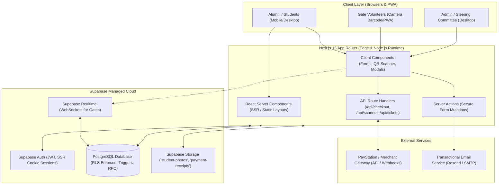
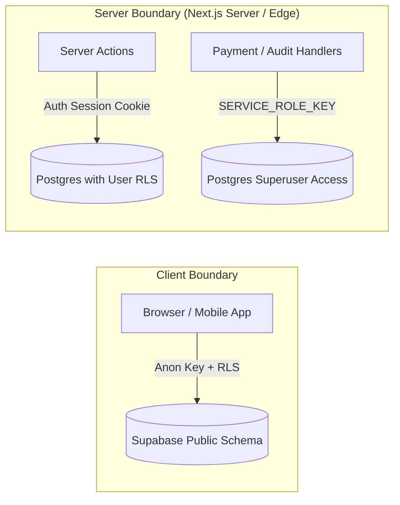
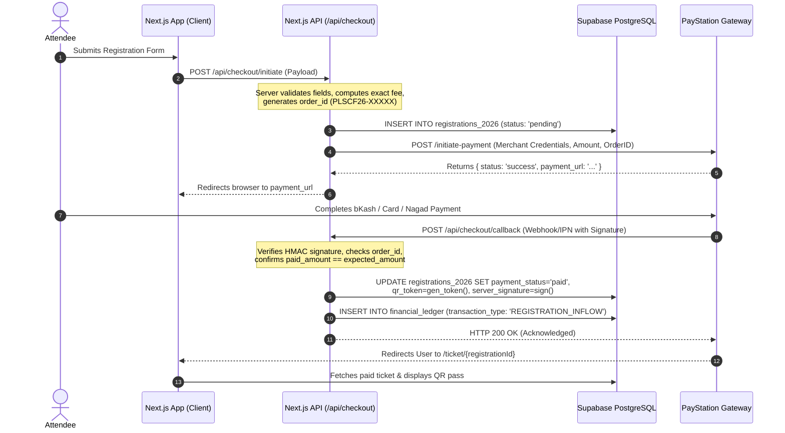

# System Architecture Document
## Police Lines School & College Faridpur — Reunion 2026 Platform
### Technology Stack: Next.js 15 (App Router) + TypeScript + Supabase (PostgreSQL, Auth, RLS, Storage)
### Aesthetic Engine: Raw Form — Light Sky Brutalist Edition

---

## 1. High-Level System Architecture

The platform follows a modern, decoupled server-authoritative architecture. The frontend is built on **Next.js 15 with App Router**, using **React Server Components (RSC)** for optimal SEO and rapid initial load, combined with interactive **Client Components** for registration forms, scanning portals, and dashboards. 

All backend services leverage **Supabase** as the unified platform for PostgreSQL database persistence, Row Level Security (RLS), Supabase Auth, Object Storage, and Realtime event streaming.



---

## 2. Frontend Architecture (Next.js App Router)

### 2.1. Routing & Directory Structure
```
src/
├── app/
│   ├── [lang]/                       # Bilingual route group (en / bn)
│   │   ├── layout.tsx                # Global Root Layout (Fonts, Header, Footer)
│   │   ├── page.tsx                  # Public Landing Page (Raw Form Hero, Blocks)
│   │   ├── register/                 # Multi-step Registration Page
│   │   │   └── page.tsx
│   │   ├── ticket/                   # Secure Public Ticket Lookup & View
│   │   │   ├── page.tsx
│   │   │   └── [id]/page.tsx
│   │   ├── notices/                  # Official Notice Board
│   │   │   └── page.tsx
│   │   ├── gallery/                  # Historical Image Archive
│   │   │   └── page.tsx
│   │   ├── about/                    # About & Contact Inquiry Desk
│   │   │   └── page.tsx
│   │   ├── donate/                   # Direct Contribution Portal
│   │   │   └── page.tsx
│   │   ├── scanner/                  # Operations Scanner Portal (Role Protected)
│   │   │   ├── layout.tsx
│   │   │   ├── gate/page.tsx
│   │   │   ├── food/page.tsx
│   │   │   ├── dress/page.tsx
│   │   │   └── finance/page.tsx
│   │   └── admin/                    # Admin Dashboard (Super Admin Protected)
│   │       ├── layout.tsx
│   │       ├── overview/page.tsx
│   │       ├── registrations/page.tsx
│   │       ├── finance/page.tsx
│   │       ├── staff/page.tsx
│   │       └── audit/page.tsx
│   └── api/                          # Backend API Route Handlers
│       ├── checkout/
│       │   ├── initiate/route.ts
│       │   └── callback/route.ts
│       ├── tickets/
│       │   └── lookup/route.ts
│       ├── scanner/
│       │   └── verify/route.ts
│       └── inquiries/route.ts
├── components/                       # Shared Brutalist UI Components
│   ├── brutalist/                    # Raw Form Design System Atoms
│   │   ├── BrutalistButton.tsx       # Sliding fill interactive button
│   │   ├── AnimatedGradientBlob.tsx  # Organic blurred ambient glow
│   │   ├── CategoryDivider.tsx       # Massive 12vw section separator
│   │   └── TypographicHero.tsx       # 18vw headline poster block
│   ├── navigation/                   # Minimalist Fixed Nav & Brutalist Footer
│   ├── forms/                        # Registration & Inquiry Forms
│   ├── ticket/                       # Boarding Pass Print & QR Display
│   └── scanner/                      # Camera stream & Barcode Decoders
├── lib/
│   ├── supabase/
│   │   ├── client.ts                 # Browser client (anon key)
│   │   ├── server.ts                 # Server Actions / RSC client (cookies)
│   │   └── admin.ts                  # Service Role client (private routes)
│   ├── i18n/                         # Dictionaries (en.json, bn.json)
│   ├── paystation/                   # Payment gateway SDK & signature verification
│   └── utils/                        # Validation, formatting, crypto helpers
└── styles/
    └── globals.css                   # Tailwind v4 theme, Clash Display, Satoshi
```

### 2.2. State Management Strategy
- **Server State**: Managed via Next.js React Server Components (RSC) and React Cache (`revalidatePath`, `revalidateTag`).
- **Interactive UI State**: Lightweight React 19 hooks (`useActionState`, `useOptimistic`) for form submissions and pending checkout transitions.
- **Client Scanner State**: In-memory scan queue with IndexedDB persistence for offline-resilience during field operations.
- **Realtime Sync**: Supabase Realtime WebSocket subscriptions on `gate_events` and `food_distributions` to propagate check-in updates instantly across multiple gate tablets.

---

## 3. Backend & Data Architecture

### 3.1. Supabase Client Segregation Pattern
To prevent security leaks, database access is segregated into three distinct client levels:

1. **Browser Client (`createBrowserClient`)**:
   - Uses `NEXT_PUBLIC_SUPABASE_ANON_KEY`.
   - Constrained by Postgres Row Level Security (RLS).
   - Only allowed to query public notices, submit pending registrations with unverified status, or listen to public broadcast channels.
2. **Server Client (`createServerClient`)**:
   - Uses user session cookies via `@supabase/ssr`.
   - Used inside Server Components and Server Actions.
   - Enforces authenticated user identity (`staff_accounts` or `admin_accounts`).
3. **Service Role Client (`createClient` with `SUPABASE_SERVICE_ROLE_KEY`)**:
   - STRICTLY isolated to internal server-side Route Handlers (`/api/checkout/callback`, rate-limiting RPCs, audit log generation).
   - NEVER leaked or bundled into client code.



### 3.2. Storage Architecture
Two private Supabase Storage buckets manage user media with server-controlled signed URLs:
- `student-photos`: Stores attendee portrait photos. Max file size: 2 MB. Allowed MIME types: `image/jpeg`, `image/png`, `image/webp`. Clean filename hashing (`sha256(student_id + timestamp).jpg`).
- `payment-receipts`: Stores staff expense receipts and bank deposit vouchers. Accessible exclusively to authorized finance staff and super-admins.

---

## 4. Payment Gateway & Webhook Architecture

Payment processing uses a secure 3-legged redirection and webhook verification pattern:



---

## 5. Security & Authorization Architecture

### 5.1. Row Level Security (RLS) Policy Model
1. **Public Anonymous**:
   - `SELECT` on `notices`, `gallery_items`, and system settings.
   - `INSERT` on `registrations_2026` ONLY with `payment_status = 'pending'`, `total_paid = 0`, and `server_verification_signature = NULL`.
2. **Event Staff (Gate, Food, Dress)**:
   - Evaluated using `SECURITY DEFINER` function `current_event_staff_role()`.
   - Gate Staff: `SELECT` on paid registrations; `INSERT` on `gate_events` and `scanner_logs`.
   - Food Staff: `SELECT` on paid registrations; `INSERT` on `food_distributions` (Breakfast allowed only before 13:00 Dhaka time).
   - Dress Staff: `SELECT` on paid registrations; `INSERT` on `dress_distributions`.
3. **Finance Staff**:
   - `SELECT` on `staff_allocations`, `staff_expenses`, and `central_budget`.
   - `INSERT` on `staff_expenses` with own `staff_id`.
4. **Super Admin**:
   - Unrestricted read/write across all operational and audit tables.
   - All mutations append an immutable record to `admin_audit_logs`.

### 5.2. Public Ticket Rate Limiting & Anti-Scraping
Public ticket lookup (`/api/tickets/lookup`) is protected by atomic database-backed rate-limiting:
- Window: 60-second sliding window per client IP and per targeted Mobile/Registration ID.
- IP Threshold: Max 20 queries/minute.
- Target Identifier Threshold: Max 5 queries/minute.
- Implemented via Postgres function `consume_ticket_lookup_rate_limit(subject_hash, limit, window_seconds)` in a private schema inaccessible to the public API.

---

## 6. Infrastructure, Hosting & Deployment Pipeline

- **Frontend & Edge Hosting**: Vercel Enterprise or Cloudflare Pages with globally distributed Edge Network.
- **Backend & Database**: Supabase Managed Cloud (PostgreSQL 15+, Supabase Auth, Storage, and Realtime Engine).
- **DNS & CDN**: Cloudflare with DDoS protection, Web Application Firewall (WAF) rules, and TLS 1.3 encryption.
- **CI/CD Pipeline**: GitHub Actions for automated linting, unit tests, Playwright end-to-end tests, and preview branch deployments.

