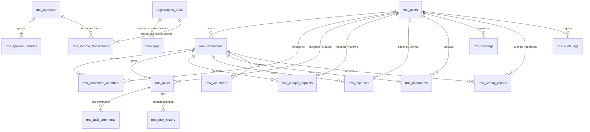

# Database Relationships & Entity Relationship Diagram (ERD)
## Sylhet Police Lines High School & College Reunion 2027

---

## 1. Visual Entity Relationship Diagram

---

## 2. Referential Integrity & Foreign Key Policies

### 2.1 Committees to Members
- **Parent Table**: `rms_committees (id)`
- **Child Table**: `rms_committee_members (committee_id)`
- **Constraint**: `ON DELETE CASCADE`
- **Behavior**: If a sub-committee is dismantled, its roster member assignments are cascaded.

### 2.2 Committees to Financial Expenses & Budgets
- **Parent Table**: `rms_committees (id)`
- **Child Tables**: `rms_budget_requests (committee_id)`, `rms_expenses (committee_id)`
- **Constraint**: `ON DELETE RESTRICT`
- **Behavior**: A committee that has incurred registered expenses or budget allocations cannot be deleted.

### 2.3 Sponsors to Corporate Benefits
- **Parent Table**: `rms_sponsors (id)`
- **Child Table**: `rms_sponsor_benefits (sponsor_id)`
- **Constraint**: `ON DELETE CASCADE`
- **Behavior**: Deleting a sponsor lead removes their associated deliverable checklist.

### 2.4 Tasks to Deliverables & Comments
- **Parent Table**: `rms_tasks (id)`
- **Child Tables**: `rms_task_comments (task_id)`, `rms_task_history (task_id)`
- **Constraint**: `ON DELETE CASCADE`
- **Behavior**: Historical log entries remain bound to the task lifecycle.

---

## 3. Cross-Domain Data Flow

### 3.1 Public Registrations to ERP Financial Inflow
1. Public attendee registers via `RegistrationPage` and completes payment via PayStation.
2. The registration fee (e.g. ৳1,500) and optional donation (e.g. ৳500) are recorded in `registrations_2026`.
3. The RMS Finance Engine aggregates confirmed ticket sales directly into the `rms_income_transactions` ledger under source category `REGISTRATION_FEES`.
4. This ensures total financial transparency between registration and central accounting without manual ledger entry.

### 3.2 Public Registrations to Event Day Gate Telemetry
1. Attendee arrives at Gate 01 or Gate 02 on January 28 or 29, 2027.
2. Duty volunteer or scanner officer scans attendee's encrypted QR e-Ticket.
3. Successful scan is saved to `scan_logs` with `scanType: 'entry'` and status `'approved'`.
4. The Event Day Command Center (`RmsEventDayModule`) computes real-time gate throughput, remaining expected attendees, and buffet distribution ratios.

