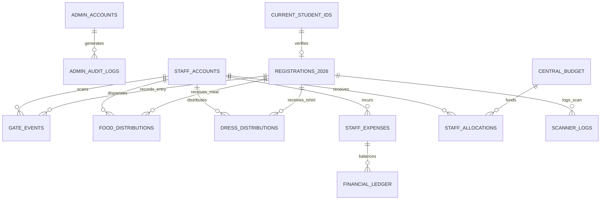

# Database Architecture & Schema Specification (Database.md)
## Police Lines School & College Faridpur — Reunion 2026 Platform
### Database Engine: PostgreSQL 15+ (Managed on Supabase Cloud)
### Security Boundary: Row Level Security (RLS) & Security Definer Functions

---

## 1. Entity-Relationship Overview



---

## 2. Table Specifications & SQL Declarations

### 2.1. System Authentication & Accounts

#### `public.admin_accounts`
Links Supabase Auth users to administrative roles.
```sql
CREATE TABLE public.admin_accounts (
  id TEXT PRIMARY KEY DEFAULT gen_random_uuid()::text,
  auth_user_id UUID UNIQUE REFERENCES auth.users(id) ON DELETE CASCADE,
  username TEXT UNIQUE NOT NULL,
  full_name TEXT NOT NULL,
  email TEXT NOT NULL,
  role TEXT NOT NULL CHECK (role IN ('super_admin', 'finance_admin', 'support_admin')),
  is_locked BOOLEAN NOT NULL DEFAULT FALSE,
  failed_attempts INTEGER NOT NULL DEFAULT 0,
  last_login_at TIMESTAMPTZ,
  created_at TIMESTAMPTZ NOT NULL DEFAULT timezone('utc'::text, now())
);

CREATE INDEX idx_admin_accounts_auth_uid ON public.admin_accounts(auth_user_id);
```

#### `public.staff_accounts`
Staff members assigned to gates, food counters, and merchandise desks.
```sql
CREATE TABLE public.staff_accounts (
  id TEXT PRIMARY KEY DEFAULT gen_random_uuid()::text,
  auth_user_id UUID UNIQUE REFERENCES auth.users(id) ON DELETE CASCADE,
  full_name TEXT NOT NULL,
  username TEXT UNIQUE NOT NULL,
  email TEXT UNIQUE NOT NULL,
  role TEXT NOT NULL CHECK (role IN ('gate_staff', 'food_staff', 'dress_staff', 'finance_staff', 'super_admin')),
  status TEXT NOT NULL DEFAULT 'active' CHECK (status IN ('active', 'inactive', 'suspended')),
  assigned_gate TEXT,
  created_at TIMESTAMPTZ NOT NULL DEFAULT timezone('utc'::text, now()),
  created_by TEXT
);

CREATE INDEX idx_staff_accounts_auth_uid ON public.staff_accounts(auth_user_id);
CREATE INDEX idx_staff_accounts_role ON public.staff_accounts(role);
```

---

### 2.2. Attendee Registration & Ticketing

#### `public.registrations_2026`
Central ledger of all attendees, ticketing tokens, payment details, and fulfillment statuses.
```sql
CREATE TABLE public.registrations_2026 (
  id TEXT PRIMARY KEY, -- e.g., 'REG-2026-0001'
  full_name TEXT NOT NULL,
  full_name_bn TEXT,
  photo_url TEXT,
  mobile_number TEXT NOT NULL,
  email TEXT,
  address TEXT,
  category TEXT NOT NULL CHECK (category IN ('ALUMNI', 'CURRENT_STUDENT', 'TEACHER', 'GUEST')),
  passing_year TEXT,
  current_class TEXT,
  batch_name TEXT,
  group_or_section TEXT,
  roll_number TEXT,
  student_id TEXT, -- For verified current students
  t_shirt_size TEXT NOT NULL CHECK (t_shirt_size IN ('S', 'M', 'L', 'XL', 'XXL', 'XXXL', 'Oversize 50')),
  registration_fee NUMERIC(10, 2) NOT NULL DEFAULT 0 CHECK (registration_fee >= 0),
  donation_amount NUMERIC(10, 2) NOT NULL DEFAULT 0 CHECK (donation_amount >= 0),
  total_paid NUMERIC(10, 2) NOT NULL DEFAULT 0 CHECK (total_paid >= 0),
  payment_status TEXT NOT NULL DEFAULT 'pending' CHECK (payment_status IN ('pending', 'paid', 'failed', 'refunded')),
  transaction_id TEXT UNIQUE,
  payment_method TEXT,
  server_verification_signature TEXT,
  verification_timestamp TIMESTAMPTZ,
  verified_by TEXT,
  registered_at TIMESTAMPTZ NOT NULL DEFAULT timezone('utc'::text, now()),
  qr_token TEXT UNIQUE,
  is_tshirt_collected BOOLEAN NOT NULL DEFAULT FALSE,
  is_checked_in BOOLEAN NOT NULL DEFAULT FALSE,
  notes TEXT,
  year INTEGER NOT NULL DEFAULT 2026
);

-- Crucial Query Indexes
CREATE INDEX idx_registrations_2026_mobile ON public.registrations_2026(mobile_number);
CREATE INDEX idx_registrations_2026_qr_token ON public.registrations_2026(qr_token) WHERE qr_token IS NOT NULL;
CREATE INDEX idx_registrations_2026_payment_status ON public.registrations_2026(payment_status);
CREATE INDEX idx_registrations_2026_batch ON public.registrations_2026(batch_name);
```

#### `public.current_student_ids` (Resolves Missing Table Finding)
Pre-seeded student verification ledger for subsidized tickets.
```sql
CREATE TABLE public.current_student_ids (
  student_id TEXT PRIMARY KEY,
  student_name TEXT NOT NULL,
  class_name TEXT NOT NULL,
  roll_number TEXT NOT NULL,
  section TEXT,
  is_registered BOOLEAN NOT NULL DEFAULT FALSE,
  registered_at TIMESTAMPTZ,
  registration_id TEXT REFERENCES public.registrations_2026(id)
);

CREATE INDEX idx_current_student_ids_class ON public.current_student_ids(class_name);
```

---

### 2.3. Event Operations & Scanner Distribution

#### `public.gate_events`
Immutable record of physical campus entrance check-ins.
```sql
CREATE TABLE public.gate_events (
  id TEXT PRIMARY KEY DEFAULT gen_random_uuid()::text,
  registration_id TEXT NOT NULL REFERENCES public.registrations_2026(id),
  student_name TEXT NOT NULL,
  batch_name TEXT,
  photo_url TEXT,
  event_type TEXT NOT NULL DEFAULT 'GATE_ENTRY' CHECK (event_type IN ('GATE_ENTRY', 'GATE_EXIT')),
  gate_id TEXT NOT NULL,
  scanner_id TEXT,
  staff_id TEXT NOT NULL,
  staff_name TEXT NOT NULL,
  timestamp TIMESTAMPTZ NOT NULL DEFAULT timezone('utc'::text, now()),
  status TEXT NOT NULL DEFAULT 'SUCCESS' CHECK (status IN ('SUCCESS', 'DUPLICATE_ATTEMPT', 'FLAGGED')),
  correction_reason TEXT,
  corrected_by TEXT,
  corrected_at TIMESTAMPTZ
);

CREATE INDEX idx_gate_events_reg_id ON public.gate_events(registration_id);
CREATE INDEX idx_gate_events_timestamp ON public.gate_events(timestamp DESC);
```

#### `public.food_distributions`
Tracks breakfast, lunch, and dinner fulfillment.
```sql
CREATE TABLE public.food_distributions (
  id TEXT PRIMARY KEY DEFAULT gen_random_uuid()::text,
  registration_id TEXT NOT NULL REFERENCES public.registrations_2026(id),
  student_name TEXT NOT NULL,
  batch_name TEXT,
  meal_type TEXT NOT NULL CHECK (meal_type IN ('BREAKFAST', 'LUNCH', 'DINNER')),
  status TEXT NOT NULL DEFAULT 'COLLECTED' CHECK (status IN ('COLLECTED', 'VOIDED')),
  collected_at TIMESTAMPTZ NOT NULL DEFAULT timezone('utc'::text, now()),
  staff_id TEXT NOT NULL,
  staff_name TEXT NOT NULL,
  notes TEXT,
  corrected_by TEXT,
  correction_reason TEXT,
  corrected_at TIMESTAMPTZ,
  CONSTRAINT uq_food_distributions_reg_meal UNIQUE (registration_id, meal_type)
);

CREATE INDEX idx_food_distributions_meal ON public.food_distributions(meal_type);
```

#### `public.dress_distributions`
Tracks official Polo T-shirt and souvenir kit hand-over.
```sql
CREATE TABLE public.dress_distributions (
  id TEXT PRIMARY KEY DEFAULT gen_random_uuid()::text,
  registration_id TEXT NOT NULL REFERENCES public.registrations_2026(id),
  student_name TEXT NOT NULL,
  item_type TEXT NOT NULL DEFAULT 'T_SHIRT' CHECK (item_type IN ('T_SHIRT', 'GIFT_BAG')),
  registered_size TEXT NOT NULL CHECK (registered_size IN ('S', 'M', 'L', 'XL', 'XXL', 'XXXL', 'Oversize 50')),
  status TEXT NOT NULL DEFAULT 'DELIVERED' CHECK (status IN ('DELIVERED', 'VOIDED')),
  received_at TIMESTAMPTZ NOT NULL DEFAULT timezone('utc'::text, now()),
  staff_id TEXT NOT NULL,
  staff_name TEXT NOT NULL,
  notes TEXT,
  corrected_by TEXT,
  correction_reason TEXT,
  corrected_at TIMESTAMPTZ,
  CONSTRAINT uq_dress_distributions_reg_item UNIQUE (registration_id, item_type)
);
```

---

### 2.4. Financial Ledger, Budget & Petty Cash

#### `public.central_budget`
```sql
CREATE TABLE public.central_budget (
  id TEXT PRIMARY KEY DEFAULT gen_random_uuid()::text,
  academic_year INTEGER NOT NULL UNIQUE DEFAULT 2026,
  total_budget NUMERIC(12, 2) NOT NULL CHECK (total_budget >= 0),
  description TEXT,
  updated_at TIMESTAMPTZ NOT NULL DEFAULT timezone('utc'::text, now()),
  updated_by TEXT
);
```

#### `public.staff_allocations`
```sql
CREATE TABLE public.staff_allocations (
  id TEXT PRIMARY KEY DEFAULT gen_random_uuid()::text,
  staff_id TEXT NOT NULL,
  staff_name TEXT NOT NULL,
  allocated_amount NUMERIC(10, 2) NOT NULL CHECK (allocated_amount > 0),
  academic_year INTEGER NOT NULL DEFAULT 2026,
  status TEXT NOT NULL DEFAULT 'ACTIVE' CHECK (status IN ('ACTIVE', 'CLOSED')),
  allocated_at TIMESTAMPTZ NOT NULL DEFAULT timezone('utc'::text, now()),
  allocated_by TEXT NOT NULL,
  notes TEXT
);

CREATE INDEX idx_staff_allocations_staff ON public.staff_allocations(staff_id);
```

#### `public.staff_expenses`
```sql
CREATE TABLE public.staff_expenses (
  id TEXT PRIMARY KEY DEFAULT gen_random_uuid()::text,
  staff_id TEXT NOT NULL,
  staff_name TEXT NOT NULL,
  amount NUMERIC(10, 2) NOT NULL CHECK (amount > 0),
  category TEXT NOT NULL,
  description TEXT NOT NULL,
  expense_date DATE NOT NULL CHECK (expense_date <= CURRENT_DATE),
  expense_time TIME NOT NULL DEFAULT CURRENT_TIME,
  vendor_name TEXT NOT NULL,
  receipt_url TEXT,
  status TEXT NOT NULL DEFAULT 'pending' CHECK (status IN ('pending', 'approved', 'rejected', 'voided')),
  approved_by TEXT,
  approved_at TIMESTAMPTZ,
  rejection_reason TEXT,
  void_reason TEXT,
  created_at TIMESTAMPTZ NOT NULL DEFAULT timezone('utc'::text, now())
);

CREATE INDEX idx_staff_expenses_staff ON public.staff_expenses(staff_id);
CREATE INDEX idx_staff_expenses_status ON public.staff_expenses(status);
```

#### `public.financial_ledger`
Double-entry bookkeeping table recording gross inflows and outflows.
```sql
CREATE TABLE public.financial_ledger (
  id TEXT PRIMARY KEY DEFAULT gen_random_uuid()::text,
  staff_id TEXT,
  transaction_type TEXT NOT NULL CHECK (transaction_type IN ('REGISTRATION_INFLOW', 'DONATION_INFLOW', 'STAFF_DISBURSEMENT', 'EXPENSE_OUTFLOW', 'CASH_RETURN')),
  amount NUMERIC(10, 2) NOT NULL,
  reference_id TEXT,
  description TEXT NOT NULL,
  created_at TIMESTAMPTZ NOT NULL DEFAULT timezone('utc'::text, now()),
  created_by TEXT
);
```

---

### 2.5. Audit & Security Infrastructure

#### `public.admin_audit_logs`
Tamper-evident audit log with HMAC cryptographic verification.
```sql
CREATE TABLE public.admin_audit_logs (
  id TEXT PRIMARY KEY DEFAULT gen_random_uuid()::text,
  admin_id TEXT NOT NULL,
  admin_username TEXT NOT NULL,
  admin_role TEXT NOT NULL,
  action TEXT NOT NULL,
  target_type TEXT NOT NULL,
  target_id TEXT NOT NULL,
  details JSONB NOT NULL DEFAULT '{}'::jsonb,
  ip_address TEXT,
  user_agent TEXT,
  checksum TEXT NOT NULL, -- HMAC-SHA256 signature
  created_at TIMESTAMPTZ NOT NULL DEFAULT timezone('utc'::text, now())
);

CREATE INDEX idx_admin_audit_logs_actor ON public.admin_audit_logs(admin_id);
CREATE INDEX idx_admin_audit_logs_target ON public.admin_audit_logs(target_type, target_id);
```

#### `private.ticket_lookup_rate_limits`
Isolated rate-limiting counter table in private schema.
```sql
CREATE SCHEMA IF NOT EXISTS private;

CREATE TABLE private.ticket_lookup_rate_limits (
  subject_hash TEXT PRIMARY KEY,
  window_started_at TIMESTAMPTZ NOT NULL DEFAULT timezone('utc'::text, now()),
  attempt_count INTEGER NOT NULL DEFAULT 1 CHECK (attempt_count > 0)
);

REVOKE ALL ON SCHEMA private FROM public, anon, authenticated;
REVOKE ALL ON TABLE private.ticket_lookup_rate_limits FROM public, anon, authenticated;
```

#### `public.inquiries` (Resolves Missing Contact Table Finding)
```sql
CREATE TABLE public.inquiries (
  id TEXT PRIMARY KEY DEFAULT gen_random_uuid()::text,
  name TEXT NOT NULL,
  phone TEXT NOT NULL,
  email TEXT,
  subject TEXT NOT NULL,
  message TEXT NOT NULL,
  status TEXT NOT NULL DEFAULT 'unread' CHECK (status IN ('unread', 'responded', 'archived')),
  created_at TIMESTAMPTZ NOT NULL DEFAULT timezone('utc'::text, now())
);
```

---

## 3. Row Level Security (RLS) Policies

All tables have RLS explicitly enabled:
```sql
ALTER TABLE public.admin_accounts ENABLE ROW LEVEL SECURITY;
ALTER TABLE public.staff_accounts ENABLE ROW LEVEL SECURITY;
ALTER TABLE public.registrations_2026 ENABLE ROW LEVEL SECURITY;
ALTER TABLE public.gate_events ENABLE ROW LEVEL SECURITY;
ALTER TABLE public.food_distributions ENABLE ROW LEVEL SECURITY;
ALTER TABLE public.dress_distributions ENABLE ROW LEVEL SECURITY;
ALTER TABLE public.staff_expenses ENABLE ROW LEVEL SECURITY;
ALTER TABLE public.admin_audit_logs ENABLE ROW LEVEL SECURITY;
ALTER TABLE public.inquiries ENABLE ROW LEVEL SECURITY;
```

### 3.1. Policy Matrix Examples

```sql
-- 1. Anonymous Registration Insertion (Constrained to pending/unpaid only)
CREATE POLICY "anon_insert_pending_registration" ON public.registrations_2026
  FOR INSERT TO anon, authenticated
  WITH CHECK (
    payment_status = 'pending' 
    AND total_paid = 0 
    AND server_verification_signature IS NULL
    AND qr_token IS NULL
  );

-- 2. Gate Staff Read Access to Paid Registrations
CREATE POLICY "gate_staff_read_paid" ON public.registrations_2026
  FOR SELECT TO authenticated
  USING (
    payment_status = 'paid' 
    AND (
      EXISTS (
        SELECT 1 FROM public.staff_accounts 
        WHERE auth_user_id = auth.uid() 
        AND role IN ('gate_staff', 'super_admin') 
        AND status = 'active'
      )
    )
  );

-- 3. Breakfast Food Insertion Time Boundary (Cutoff at 13:00 Dhaka Time)
CREATE POLICY "food_staff_insert_breakfast" ON public.food_distributions
  FOR INSERT TO authenticated
  WITH CHECK (
    meal_type != 'BREAKFAST' 
    OR (
      CURRENT_TIME AT TIME ZONE 'Asia/Dhaka' <= TIME '13:00:00'
    )
  );
```

---

## 4. Database Stored Procedures & Triggers

### 4.1. Single Admin Slot Enforcement Trigger
```sql
CREATE OR REPLACE FUNCTION public.check_single_admin_slot()
RETURNS TRIGGER AS $$
BEGIN
  IF (SELECT count(*) FROM public.admin_accounts WHERE role = 'super_admin') >= 1 THEN
    RAISE EXCEPTION 'Only one Super Admin root slot is permitted.';
  END IF;
  RETURN NEW;
END;
$$ LANGUAGE plpgsql SECURITY DEFINER;

CREATE TRIGGER trg_enforce_single_admin_slot
BEFORE INSERT ON public.admin_accounts
FOR EACH ROW
WHEN (NEW.role = 'super_admin')
EXECUTE FUNCTION public.check_single_admin_slot();
```

### 4.2. Atomic Rate-Limiter RPC
```sql
CREATE OR REPLACE FUNCTION private.consume_ticket_lookup_rate_limit(
  p_subject_hash TEXT,
  p_max_attempts INTEGER,
  p_window_seconds INTEGER
) RETURNS BOOLEAN AS $$
DECLARE
  v_now TIMESTAMPTZ := timezone('utc'::text, now());
  v_started TIMESTAMPTZ;
  v_count INTEGER;
BEGIN
  SELECT window_started_at, attempt_count INTO v_started, v_count
  FROM private.ticket_lookup_rate_limits
  WHERE subject_hash = p_subject_hash FOR UPDATE;

  IF NOT FOUND THEN
    INSERT INTO private.ticket_lookup_rate_limits (subject_hash, window_started_at, attempt_count)
    VALUES (p_subject_hash, v_now, 1);
    RETURN TRUE;
  END IF;

  IF v_now > (v_started + (p_window_seconds || ' seconds')::interval) THEN
    UPDATE private.ticket_lookup_rate_limits
    SET window_started_at = v_now, attempt_count = 1
    WHERE subject_hash = p_subject_hash;
    RETURN TRUE;
  END IF;

  IF v_count >= p_max_attempts THEN
    RETURN FALSE; -- Limit Exceeded
  END IF;

  UPDATE private.ticket_lookup_rate_limits
  SET attempt_count = attempt_count + 1
  WHERE subject_hash = p_subject_hash;
  RETURN TRUE;
END;
$$ LANGUAGE plpgsql SECURITY DEFINER;

GRANT EXECUTE ON FUNCTION private.consume_ticket_lookup_rate_limit(TEXT, INTEGER, INTEGER) TO service_role;
```

