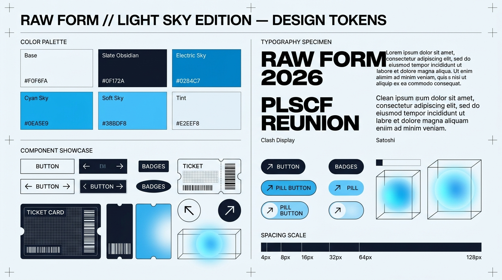

# UI/UX Design System Specification (Design.md)
## Design System: Raw Form — Light Sky Brutalist Edition
### Platform: Police Lines School & College Faridpur — Reunion 2026

---

## 1. Design Philosophy & Aesthetic Foundation

**Raw Form (Light Sky Edition)** is an editorial, high-contrast Swiss Brutalist design language that prioritizes typographic drama, architectural discipline, and atmospheric depth. Moving away from traditional container-heavy, generic card-based web interfaces, Raw Form delivers:
- **Massive Typographic Breaks**: Editorial type scales up to `18vw` that command the viewport.
- **Atmospheric Depth**: Soft, organic blurred radial blobs with `mix-blend-mode: multiply` set behind stark geometric text.
- **Light Sky Colorway**: A pristine, modern light sky palette replacing warm tones with ice-alabaster bases, deep slate obsidian text, and electric azure sky accents.
- **Zero Border-Radius & Sharp Geometry**: Razor-sharp rectilinear buttons, borderless editorial grids, and circular badge accents.
- **Kinetic Micro-Interactions**: Directional sliding fills and smooth `cubic-bezier(0.16, 1, 0.3, 1)` entrance curves.



---

## 2. Color Palette & Design Tokens

### 2.1. Core Color Tokens
```css
:root {
  /* Surface & Backgrounds */
  --color-base: #F0F6FA;             /* Ice Alabaster / Light Sky Paper */
  --color-surface-secondary: #E2EEF8;/* Soft Sky Tint for Campaign Blocks */
  --color-surface-dark: #0F172A;     /* Obsidian Deep Slate for Footers & Primary CTA */
  
  /* Primary Text & Grayscale */
  --color-text-primary: #0F172A;     /* Deep Slate Obsidian */
  --color-text-secondary: #475569;   /* Muted Slate for secondary descriptions */
  --color-text-subtle: #94A3B8;      /* Light Slate for borders & disabled states */
  --color-text-inverse: #F0F6FA;     /* White/Light Sky text on dark surfaces */

  /* Light Sky Accent Palette */
  --color-accent-primary: #0284C7;   /* Electric Sky Blue (Primary Interactive Accent) */
  --color-accent-vibrant: #0EA5E9;   /* Radiant Cyan Sky (Gradient Blobs & Highlights) */
  --color-accent-glow: #38BDF8;      /* Soft Sky Cyan Glow (Blobs & Hover States) */
  --color-accent-tint: #BAE6FD;      /* Atmospheric Cyan Mist */

  /* Operational & Status Tokens */
  --color-success: #059669;          /* Emerald Green (Gate Check-In Approved) */
  --color-warning: #D97706;          /* Amber (Pending Review / Attention) */
  --color-error: #E11D48;            /* Rose Red (Duplicate Scan / Invalid Ticket) */

  /* Selection & Scrollbar */
  --color-selection-bg: #0284C7;
  --color-selection-text: #FFFFFF;
  --color-scrollbar-thumb: #0284C7;
  --color-scrollbar-track: #F0F6FA;
}
```

---

## 3. Typography Hierarchy

### 3.1. Font Families
1. **Headline Font**: `'Clash Display'` (Display Sans, Weight 700 / Bold, Tracking `-0.05em`, Line Height `0.75` to `0.9`). Used for heroic page titles, category dividers, and major editorial statements.
2. **Body & Interface Font**: `'Satoshi'` (Modern Geometric Sans, Weight 400 / Regular, 500 / Medium, 700 / Bold). Used for body paragraphs, forms, navigation links, and data tables.

### 3.2. Typographic Scale

| Level | Font Family | Size (Desktop / Mobile) | Weight | Tracking | Line-Height | Transform |
|---|---|---|---|---|---|---|
| **Hero Title** | Clash Display | `18vw` / `14vw` | 700 | `-0.05em` | `0.75` | Uppercase |
| **Category Divider** | Clash Display | `12vw` / `10vw` | 700 | `-0.05em` | `0.80` | Uppercase |
| **Footer Year Watermark**| Clash Display | `10vw` / `12vw` | 700 | `-0.04em` | `1.00` | Uppercase |
| **Section Heading (H1)** | Clash Display | `6vw` / `8vw` | 700 | `-0.04em` | `0.90` | Uppercase |
| **Card Heading (H2)** | Clash Display | `32px` / `24px` | 700 | `-0.03em` | `1.05` | Uppercase |
| **Subtext / Lead** | Satoshi | `20px` / `16px` | 400 | `0` | `1.50` | Sentence |
| **Body Text** | Satoshi | `16px` / `14px` | 400 | `0` | `1.60` | Normal |
| **Metadata & Badges** | Satoshi | `14px` / `12px` | 700 | `0.15em` | `1.00` | Uppercase |
| **Navigation Links** | Satoshi | `14px` / `13px` | 500 | `0.10em` | `1.00` | Uppercase |

---

## 4. Layout & Grid Architecture

### 4.1. Global Grid Structure
- **Vertical Orientation**: High visual rhythm emphasizing expansive vertical scrolling, bold horizontal category cuts, and borderless product grids.
- **12-Column Responsive Grid**:
  - Desktop: 12 columns, max-width `1600px`, `32px` margins, `24px` gutter.
  - Tablet: 8 columns, `24px` margins, `16px` gutter.
  - Mobile: 4 columns, `16px` margins, `12px` gutter.

### 4.2. Navigation Bar
- **Minimalist Fixed Top Bar**: Fixed position (`z-50`), height `72px`, backdrop-filter `blur(12px)`.
- **Left**: PLSCF Reunion 2026 Brand Logo in *Clash Display* (bold, uppercase, `text-2xl`, tracking-tight).
- **Center**: Navigation text links in *Satoshi* (medium, `14px`, tracked out `0.1em`).
- **Right**: Action cluster featuring Language Toggle (`BN | EN`), Search, and Ticket/Bag icon (`20px` Lucide icons).
- **Mobile Mode**: Applies `mix-blend-difference` with white foreground text over varying backgrounds; standard high-contrast dark text on desktop.

---

## 5. Hero & Editorial Section Specifications

### 5.1. Typographic Hero Section
- **Dimensions**: Full viewport height (`100vh` or `100dvh`).
- **Atmospheric Background**: Three large, organic gradient blobs in `#0EA5E9` and `#38BDF8` pulsating slowly in the background behind typography with `mix-blend-mode: multiply`.
- **Headline Architecture**:
  - Line 1: `PLSCF REUNION` at `18vw`, uppercase, line-height `0.75`.
  - Line 2: `2026` indented by `15vw` to create dramatic asymmetric negative space.
- **Subtext**: Constrained to `max-width: 420px`, font size `20px`, color `#475569`.
- **CTA Group**:
  - Primary: Rectangular Brutalist CTA button with directional white slide-in hover effect.
  - Secondary: Underlined text link in `#0284C7` with right arrow icon (`ArrowRight` from Lucide).

### 5.2. Category Divider
- **Full-Width Section**: Vertical padding `128px` (`py-32`).
- **Background**: Soft radial gradient of `#38BDF8/20%`.
- **Typography**: Headline in *Clash Display*, `12vw`, uppercase, tracking-tighter, opacity `0.9`.
- **Alignment**: Dynamically alternates between right-aligned and left-aligned across consecutive sections.

### 5.3. Borderless 3/4 Card Grid
- **Columns**: 1 column on mobile, 2 columns on tablet, 3 columns on desktop.
- **Spacing**: `16px` horizontal gap, `64px` vertical gap.
- **Card Ratio**: Sharp `3:4` vertical aspect ratio.
- **Micro-Interactions**:
  - Image scale on hover: `scale(1.05)` with `transition: transform 0.6s cubic-bezier(0.16, 1, 0.3, 1)`.
  - Card Title in bold uppercase Satoshi (`14px`, tracking `0.15em`). On hover, title text smoothly shifts color to `#0284C7`.
  - Fee / Price displayed in crisp `#475569`.

### 5.4. Campaign & Story Block
- **Background**: Tinted secondary surface `#E2EEF8`.
- **12-Column Grid Split**:
  - Left 8 Columns: Massive *Clash Display* statement headline at `6vw`, leading `0.9`.
  - Right 4 Columns: Vertical editorial stack with thin dividers (`#0F172A/20%`), event milestone summaries, and "Read More" links paired with circular bordered arrow-up-right (`ArrowUpRight`) icons.

### 5.5. Monumental Brutalist Footer
- **Background**: Solid `#0F172A` (Obsidian Slate), Text `#F0F6FA`.
- **Layout**: 4-column asymmetric grid.
  - Column 1: School emblem, Reunion 2026 manifesto, and social icons.
  - Columns 2–3: Fast links (Registration, Ticket Lookup, Notice Board, Contact).
  - Column 4: Contact details, Police Lines campus location, and support hotline.
- **Bottom Watermark**: Giant background year `'2026'` rendered at `10vw` in `#FFFFFF/10%`, paired with a crisp right-aligned copyright line.

---

## 6. Signature Component Specifications

### 6.1. Interactive Brutalist CTA Button
```tsx
// Rectangular button, zero border radius, directional slide fill
<button className="relative group overflow-hidden px-8 py-4 bg-[#0F172A] text-[#F0F6FA] font-satoshi font-bold text-sm uppercase tracking-[0.15em] transition-colors duration-300">
  <span className="relative z-10 transition-colors duration-300 group-hover:text-[#0284C7]">
    {label}
  </span>
  <div className="absolute inset-0 bg-white transform -translate-x-full transition-transform duration-300 ease-out group-hover:translate-x-0" />
</button>
```

### 6.2. Animated Gradient Blobs
```tsx
// Organic depth blobs positioned behind typography
<div 
  className="absolute rounded-full pointer-events-none filter blur-[140px] mix-blend-multiply animate-pulse"
  style={{
    width: '60vw',
    height: '60vw',
    backgroundColor: '#0EA5E9',
    opacity: 0.75,
    animationDuration: '12s',
  }}
/>
```

### 6.3. Global Entrance Motion
All major viewport sections and layout containers utilize a global entrance animation:
```css
@keyframes brutalistSlideUp {
  0% {
    opacity: 0;
    transform: translateY(40px);
  }
  100% {
    opacity: 1;
    transform: translateY(0);
  }
}

.brutalist-enter {
  animation: brutalistSlideUp 0.8s cubic-bezier(0.16, 1, 0.3, 1) forwards;
}
```

