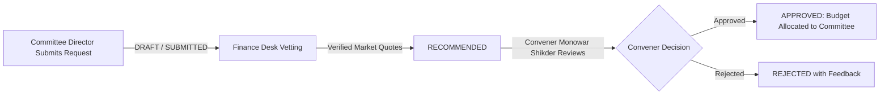

# Finance & Accounts Management Guide
## Sylhet Police Lines High School & College Reunion 2027

---

## 1. Financial Governance Framework
The RMS Finance module (`RmsFinanceModule`) implements strict non-repudiation and anti-fraud protocols designed for multi-million Taka institutional events.

---

## 2. Three-Stage Budget Request & Allocation Pipeline

Every monetary disbursement begins with a formal budget request:

1. **Submission**: Committee Directors specify Title, Category, Requested Amount (৳), Supporting Vendor Quotes, and justification.
2. **Finance Vetting**: The Finance Desk Officer (`finance@gmail.com`) verifies market rates, adjusts recommended amounts, and signs off.
3. **Executive Approval**: Convener Monowar Shikder or Super Admin approves the requisition. The committee's `budgetAllocated` balance is automatically increased.

---

## 3. Expense Recording & Voucher Verification
When an expense occurs:
1. The submitting officer records Expense Title, Amount (৳), Vendor Name, Payment Method (`BKASH`, `NAGAD`, `BANK_TRANSFER`, `CASH`, `CHEQUE`), and Voucher Number.
2. The initial status is set to `PENDING_VERIFICATION`.
3. The Finance Desk inspects the physical receipt or digital voucher, confirms banking debits, and updates the status to `VERIFIED`.
4. Committee `budgetSpent` increments in real time.

---

## 4. Zero-Silent-Deletion Policy & Mandatory Audit Reversals
To prevent internal embezzlement or clandestine record tampering:
- **No Delete Button Exists**: Verified financial entries cannot be removed or purged from the database.
- **Mandatory Reversal Workflow**:
  - Reversals can only be initiated by the **Convener**, **Member Secretary**, or **Super Admin**.
  - A minimum **8-character justification** is legally required.
  - Upon reversal:
    1. The voucher status changes to `REVERSED`.
    2. The committee's `budgetSpent` balance is automatically credited.
    3. An immutable entry is written to `rms_audit_logs` capturing user ID, timestamp, and justification reason.

---

## 5. Income Ledger & PayStation Reconciliation
- **Ticket Revenue**: Registration fees and voluntary donations from the public website flow directly into the income ledger via automated PayStation callback reconciliation.
- **Sponsorship Inflow**: Tranche disbursements from Title, Platinum, Gold, and Silver partners are recorded with payment method, cheque number, or bank deposit slip.
- **Audit Export**: Financial controllers can export the entire balance sheet, expense roster, and reversal audit log to CSV format with a single click.

