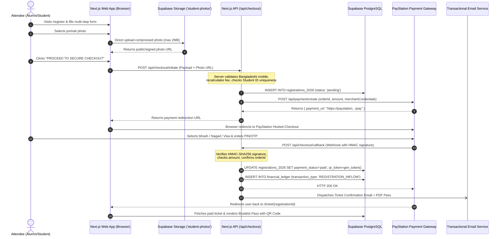
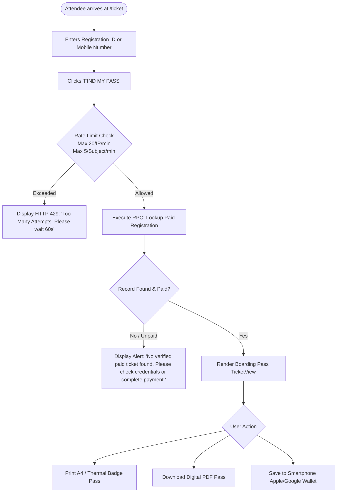
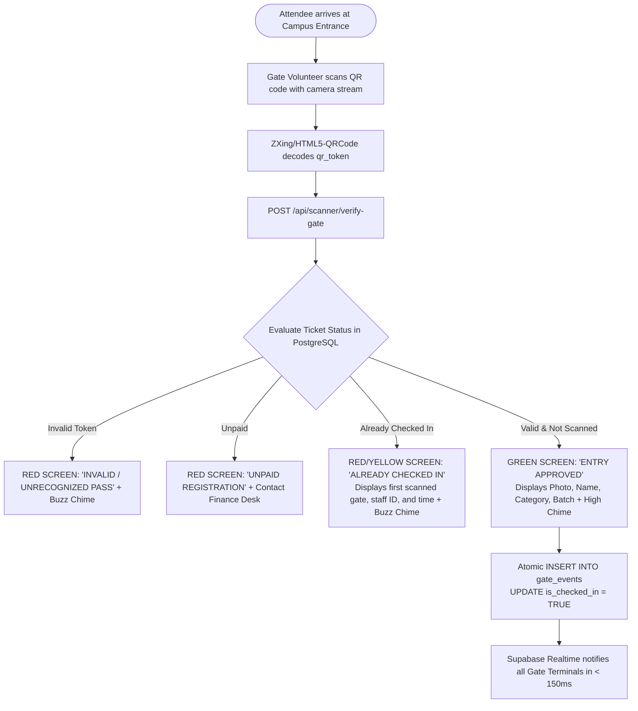
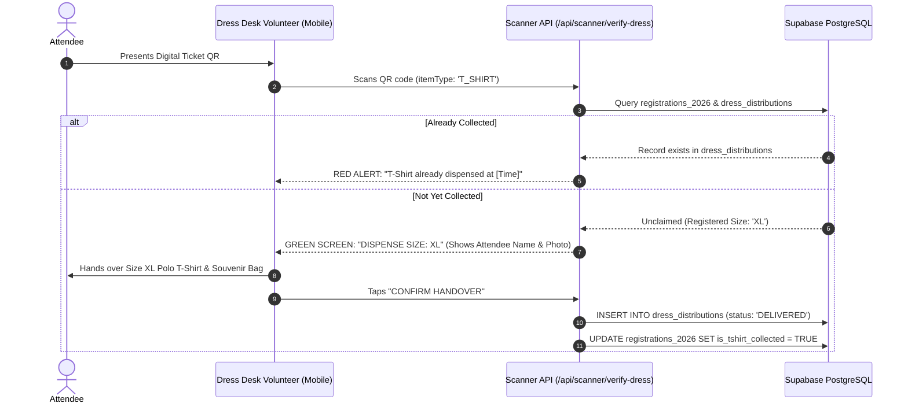
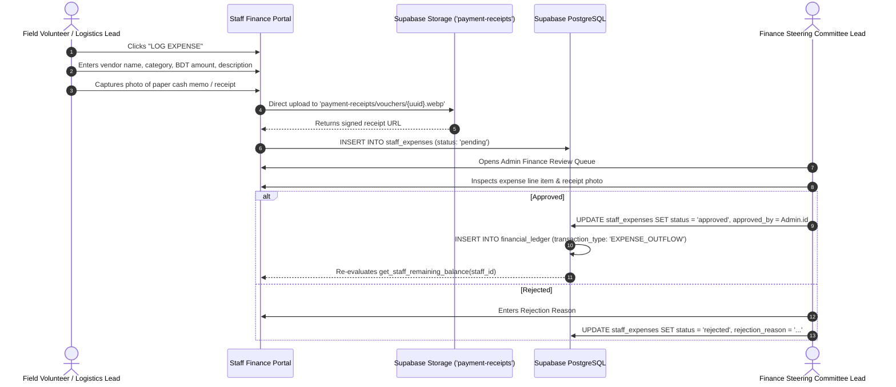

# User & System Flows Specification (Flow.md)
## Police Lines School & College Faridpur — Reunion 2026 Platform
### Architecture: Next.js 15 + Supabase + PayStation Merchant Gateway

---

## 1. Public Registration & Payment Checkout Flow



---

## 2. Public Digital Ticket Lookup Flow



---

## 3. On-Site Gate Check-In Flow



---

## 4. Food & Meal Distribution Flow

```mermaid
flowchart TD
  MealQueue([Attendee queues at Meal Distribution Desk]) --> ScanMeal[Volunteer scans attendee QR pass]
  ScanMeal --> SelectMeal{Active Meal Selection}
  
  SelectMeal -- Breakfast --> TimeCheck{Current Dhaka Time <= 13:00?}
  TimeCheck -- No (Past 1:00 PM) --> CloseAlert[REJECT: 'Breakfast distribution ended at 13:00' + Audio Alert]
  TimeCheck -- Yes --> UniqueMealCheck
  
  SelectMeal -- Lunch / Dinner --> UniqueMealCheck{Check food_distributions table for (reg_id, meal_type)}
  
  UniqueMealCheck -- Record Exists --> DupMeal[RED ALERT: 'MEAL ALREADY COLLECTED'<br/>Collected at HH:MM by Staff X]
  UniqueMealCheck -- No Record --> ApproveMeal[GREEN SCREEN: 'MEAL APPROVED'<br/>Dispense Meal Box to Attendee]
  
  ApproveMeal --> PersistMeal[INSERT INTO food_distributions<br/>Status: 'COLLECTED']
```

---

## 5. Dress & Merchandise Distribution Flow



---

## 6. Staff Expense Logging & Financial Reconciliation Flow



