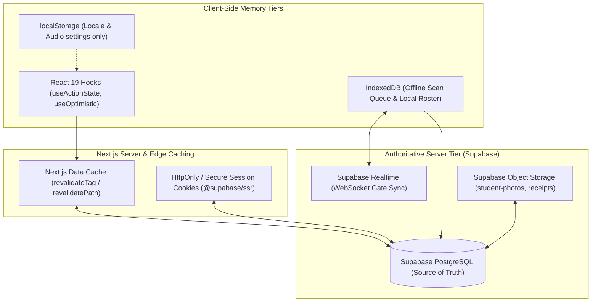

# State Management & Persistence Architecture (Memory.md)
## Police Lines School & College Faridpur — Reunion 2026 Platform
### Technology Stack: Next.js 15 (App Router) + Supabase + IndexedDB

---

## 1. Architectural Memory Strategy & Remediation

The legacy prototype suffered from architectural vulnerabilities: domain state was held in unencrypted `localStorage`, write operations were fire-and-forget (swallowing network errors), and camera scanner devices had no central cache synchronization.

The Next.js 15 and Supabase platform implements a **hierarchical, multi-tier memory model** ensuring zero data loss, strict server authority, sub-second query performance, and offline resilience during event operations.



---

## 2. Multi-Tier Memory Classification

| Memory Tier | Storage Medium | Scope & Lifetime | Authorized Content | Invalidation / Eviction Policy |
|---|---|---|---|---|
| **Tier 1: Ephemeral UI Memory** | React 19 State / Context | Single browser tab; reset on navigation / refresh | Form inputs, modal open/close states, active camera stream pointer, UI tab index. | Cleared on component unmount or view transition. |
| **Tier 2: Client Preferences** | Browser `localStorage` | Cross-session per device | UI language (`bn` / `en`), sound chime toggle (`muted: true/false`). **NO PII, NO TICKETS.** | Explicit user toggle or cache wipe. |
| **Tier 3: Offline Scanner Storage** | Browser `IndexedDB` (`idb`) | Persistent on field scanner mobile devices | Offline scan queue, pending event sync records, cached attendee verification manifest. | Auto-flushed to Supabase upon internet reconnection; purged at end of event day. |
| **Tier 4: Staff Session Memory** | `HttpOnly` Secure Cookies | Managed via `@supabase/ssr` (JWT session tokens) | Authenticated staff/admin session token and refresh token. | Expiry at 8 hours; revoked on logout or account lock. |
| **Tier 5: Server Data Cache** | Next.js Edge Data Cache | Distributed globally across Edge locations | Public notice boards, event schedule, batch directory list, public gallery items. | Tagged invalidation (`revalidateTag('notices')`); 60s ISR on landing counters. |
| **Tier 6: Authoritative Ledger** | Supabase PostgreSQL | Permanent, ACID-compliant database storage | Registrations, transaction logs, check-ins, food distributions, financial ledgers, audit logs. | Permanent historical record; write-once audit logs. |
| **Tier 7: Media Storage** | Supabase Storage Buckets | Permanent object store with CDN edge delivery | Attendee portrait photos (`student-photos`), cash expense receipts (`payment-receipts`). | Public signed URLs or permanent CDN links. Base64 strings prohibited. |

---

## 3. Client Offline & Scanner Sync Architecture

During peak morning check-in (07:30 – 10:00 AM on event day), high campus cellular congestion can degrade network connectivity. The scanner application operates an **offline-first queue**:

### 3.1. Local Scan Queuing Protocol
1. When a volunteer scans a ticket QR code, the client checks network connectivity (`navigator.onLine`).
2. If online, the scan is immediately posted to `/api/scanner/verify`.
3. If offline or if the API returns a timeout (`> 1500ms`), the scan payload is safely appended to the `offline_scan_queue` store in **IndexedDB**:
   ```typescript
   interface OfflineScanRecord {
     id: string; // UUID v4
     registration_id: string;
     qr_token: string;
     scan_type: 'GATE_ENTRY' | 'BREAKFAST' | 'LUNCH' | 'DINNER' | 'DRESS';
     gate_id: string;
     staff_id: string;
     scanned_at: string; // ISO 8601 UTC timestamp
     sync_status: 'pending' | 'syncing' | 'failed' | 'synced';
   }
   ```
4. Visual feedback on scanner UI displays: `"STORED OFFLINE — WILL SYNC ONCE CONNECTED"`.

### 3.2. Background Sync & Reconciliation
- The scanner client initiates a background sync daemon using the **Web Background Sync API** (or fallback interval timer every 10 seconds).
- Once connectivity is restored, items in `offline_scan_queue` are dispatched to `/api/scanner/batch-sync`.
- The database executes atomic upserts with conflict handling: if a ticket was already checked in elsewhere, the server flags the duplicate and returns an alert report to the scanner.

---

## 4. Realtime Gateway Synchronization

To prevent an attendee from sharing their QR code with a friend at an adjacent gate, the platform establishes a **Supabase Realtime Channel**:

```typescript
// Subscribed on all active scanner terminals
const channel = supabase
  .channel('realtime:gate-operations')
  .on(
    'postgres_changes',
    {
      event: 'INSERT',
      schema: 'public',
      table: 'gate_events',
    },
    (payload) => {
      // Invalidate local in-memory gate cache
      markRegistrationAsScannedLocally(payload.new.registration_id);
    }
  )
  .subscribe();
```

When Gate 1 scans Attendee `REG-2026-0812`, all other gate terminals receive the WebSocket payload in **< 150ms**, immediately blacklisting that QR token from entry at Gate 2 or Gate 3.

---

## 5. Server Cache Invalidation Triggers

Next.js Server Actions enforce deterministic cache tag revalidation:

```typescript
// Invalidation upon confirmed payment
import { revalidateTag, revalidatePath } from 'next/cache';

export async function onPaymentSuccess(registrationId: string) {
  // Invalidate specific ticket page
  revalidatePath(`/ticket/${registrationId}`);
  // Invalidate public statistics and batch counts
  revalidateTag('registration-stats');
  revalidateTag('admin-overview');
}

// Invalidation upon notice board update
export async function onNoticePublished() {
  revalidateTag('notices');
  revalidatePath('/notices');
}
```

---

## 6. Memory & Resource Sanitation Rules

1. **Camera Stream Tear-Down**: Whenever a scanner operator exits a scanner page or locks their screen, the `MediaStream` tracks are explicitly stopped (`track.stop()`) to prevent mobile battery drain and memory leaks.
2. **Zero Base64 Image Persistence**: Base64 strings are held in memory solely during initial client cropping, immediately converted to a `Blob` / `File`, uploaded to Supabase Storage, and the ephemeral object URL is revoked (`URL.revokeObjectURL(previewUrl)`).
3. **Audit Cache Flush**: Admin audit queries are paginated (50 items per page) to prevent browser memory exhaustion when viewing tens of thousands of event logs.

