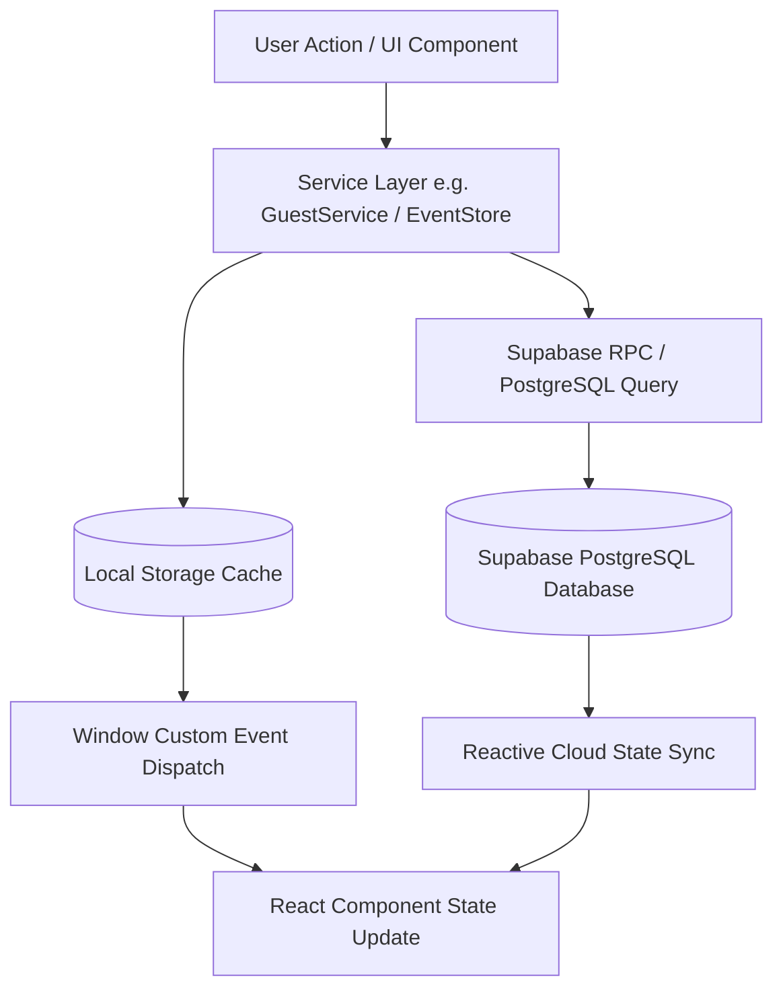
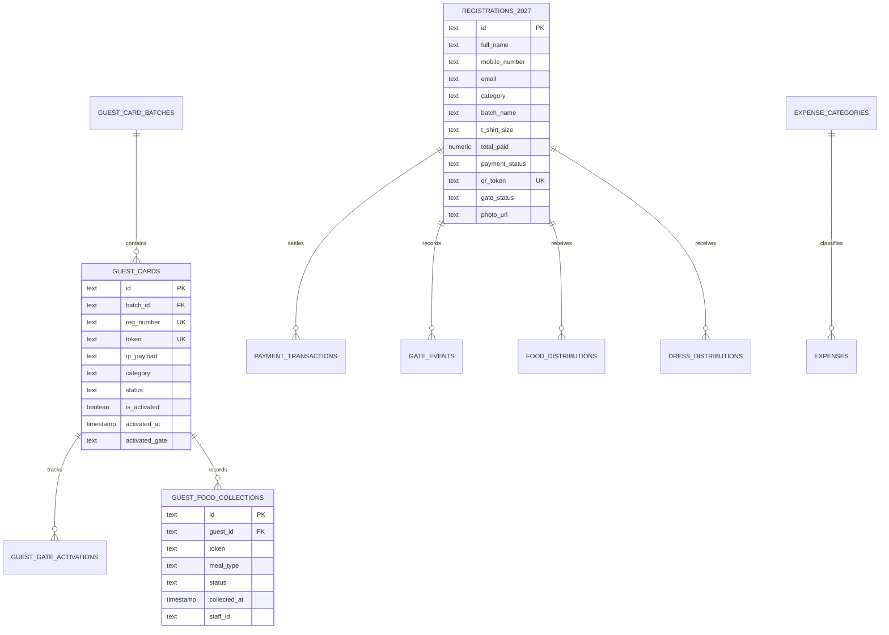
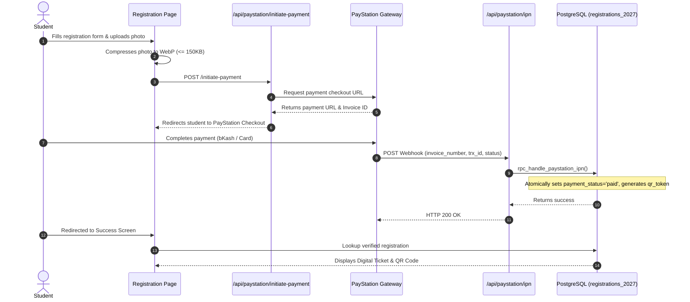
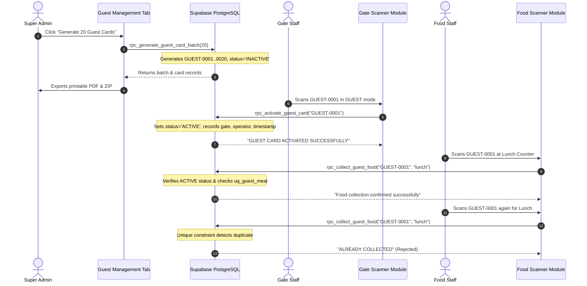
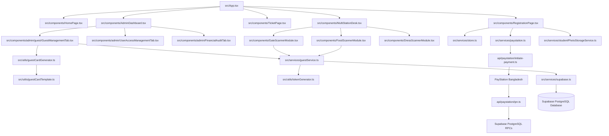

# Complete Project Architecture Analysis & Technical Documentation
**Police Lines School & College, Faridpur — Grand Reunion 2027 (PLSCF 65 Years Celebration)**
**Document Version:** 2.0.0 (Authoritative System Architecture & Technical Manual)
**Document Generated:** November 23, 2026

---

## Table of Contents
1. [Project Overview](#1-project-overview)
2. [Technology Stack](#2-technology-stack)
3. [Complete Folder Structure](#3-complete-folder-structure)
4. [Frontend Architecture](#4-frontend-architecture)
5. [Backend Architecture](#5-backend-architecture)
6. [API Documentation](#6-api-documentation)
7. [Database Schema](#7-database-schema)
8. [Data Storage & File Management](#8-data-storage--file-management)
9. [Dynamic Guest ID System](#9-dynamic-guest-id-system)
10. [QR Code Generation System](#10-qr-code-generation-system)
11. [Batch Management & Archive System](#11-batch-management--archive-system)
12. [Complete Data Flow Diagrams](#12-complete-data-flow-diagrams)
13. [File Relationship Map](#13-file-relationship-map)
14. [Authentication & Security](#14-authentication--security)
15. [Dependencies & External Services](#15-dependencies--external-services)
16. [Existing Issues & Technical Risks](#16-existing-issues--technical-risks)
17. [Important Configuration Files](#17-important-configuration-files)
18. [Developer Guide: How to Modify Existing Features](#18-developer-guide-how-to-modify-existing-features)
19. [Known Limitations and Unverified Areas](#19-known-limitations-and-unverified-areas)

---

## 1. Project Overview

The **Police Lines School & College, Faridpur (PLSCF) Grand Reunion 2027** platform is an enterprise-grade Reunion Management ERP & Access Control System. It powers the end-to-end operational lifecycle for over 10,000 alumni, current students, faculty, distinguished guests, and district police administration.

### Core System Pillars
1. **Public Information & Registration Portal:** Online multi-step registration with dynamic batch/class assignment, biometric/portrait photo cropping (WebP <= 150KB), parent pass options, and integrated donation pledges.
2. **Payment Processing Engine:** Dual-environment (Sandbox/Production) integration with the **PayStation Bangladesh** payment gateway (supporting bKash, Nagad, Rocket, Upay, Visa, and Mastercard) with server-to-server Instant Payment Notification (IPN), HMAC-SHA256 signature verification, and automated ticket generation.
3. **Student Printable ID Card & Ticket System:** Digital tickets with high-entropy 6-character cryptographic QR tokens, printable PDF/SVG ID badges, parent badges, and real-time verification lookups with rate-limiting protection.
4. **Dynamic Guest Pass & Food Management System:** Super Admin batch generator producing sequential IDs (`GUEST-0001`), cryptographically unguessable tokens (`GST-XXXXXX-XXX`), dynamic SVG/Canvas ID badges, multi-card PDF/ZIP exports, Main Gate activation workflow, and atomic per-meal food collection tracking (Breakfast, Lunch, Dinner).
5. **Physical Event On-Site Station Scanning Kiosks:**
   - **Main Gate:** Live attendance (Entry, Exit/Back) with access control rules and dynamic Guest pass activation.
   - **Food Counter:** Meal distribution with strict atomic duplicate prevention and student gate-entry prerequisites.
   - **Dress / Kit Distribution Counter:** T-shirt and souvenir distribution with student verification and strict Guest Pass rejection.
   - **Multi-Station Kiosk:** Consolidated touch-optimized field terminal for on-site operators.
6. **Administrative & Financial Command Center:**
   - Role-Based Access Control (RBAC) across 4 core tiers: **Super Admin**, **Admin**, **Staff**, and **Finance**.
   - Cash / Manual registration approval workflows with auto-generated Parent Passes.
   - Organizing Committee Content Management System (16 members with reordering & carousel settings).
   - Financial audit trail, bank reconciliation, expense management, and public transparency dashboard.
   - Media Gallery management with categorization and multi-photo uploads.

---

## 2. Technology Stack

### Frontend Core
- **Framework:** React 19 (`19.0.1`)
- **Language:** TypeScript (`7.0.2` native compiler / ES2022 target)
- **Build Tool:** Vite (`8.3.0`) with `@vitejs/plugin-react`
- **Styling Engine:** Tailwind CSS v4 (`4.3.3`) via `@tailwindcss/vite` and native CSS `@theme` tokens
- **Iconography:** Lucide React (`0.546.0`)

### Backend & Cloud Infrastructure
- **Serverless API Layer:** Vercel Serverless Functions (Node.js runtime in `/api`)
- **Cloud Database:** Supabase PostgreSQL 17.11 (AWS ap-southeast-2)
- **Database Connection Layer:** Direct PostgreSQL pooler (`pg` 8.23.1) and Supabase Client (`@supabase/supabase-js` 2.119.0)
- **Edge Functions:** Supabase Deno Edge Functions (`std@0.168.0`)
- **Object Storage:** Supabase Storage (`student-photos` public CDN bucket and `payment-receipts` private bucket)
- **ORM / Schema Tooling:** Prisma (`7.10.1`) with schema at `prisma/schema.prisma`

### Document & Media Generation
- **QR Code Encoding & Decoding:** `qrcode` (1.5.4) and `jsqr` (1.4.0)
- **PDF Generation:** `jspdf` (4.2.1)
- **ZIP File Archiving:** `jszip` (3.10.2)
- **XSS Sanitization:** `dompurify` (3.4.17)
- **Testing & Verification:** Node.js native test runner (`tsx --test`) with 255 automated unit & integration tests

---

## 3. Complete Folder Structure

```
.
├── api/                                # Vercel Serverless Function Endpoints
│   ├── paystation/
│   │   ├── initiate-payment.ts         # Payment gateway checkout redirect
│   │   ├── ipn.ts                      # Server-to-server payment webhook
│   │   └── transaction-status.ts       # Upstream transaction verification query
│   └── registrations_2027.ts           # Paginated registration query API
├── docs/                               # Architectural blueprints & design specifications
├── public/                             # Public static web assets
│   ├── assets/                         # Emblems, SVG templates, school logos
│   ├── data/                           # Fallback JSON datasets (committee, gallery)
│   ├── _headers                        # Cloud security & CORS header directives
│   ├── _redirects                      # Single-page application routing rewrites
│   └── favicon.png                     # Browser favicon
├── src/                                # Frontend Application Source Code
│   ├── components/                     # React UI components
│   │   ├── admin/                      # Administrative modules & management tabs
│   │   │   ├── guest/                  # Dynamic Guest Pass & Batch Generator
│   │   │   │   └── GuestManagementTab.tsx
│   │   │   ├── FinancialAuditTab.tsx
│   │   │   ├── ManualRegistrationApprovalModal.tsx
│   │   │   ├── MasterEventOverview.tsx
│   │   │   ├── MediaGalleryManagerTab.tsx
│   │   │   └── UserAccessManagementTab.tsx
│   │   ├── committee/                  # Organizing Committee responsive components
│   │   │   └── CommitteeSection.tsx
│   │   ├── common/                     # Shared UI components
│   │   │   ├── GlobalPagination.tsx    # Universal pagination control
│   │   │   └── QrCameraScanner.tsx     # HTML5 Camera QR Reader
│   │   ├── financials/                 # Transparency and donor dashboards
│   │   │   └── FinancialTransparencyDashboard.tsx
│   │   ├── AboutContactPage.tsx        # Institution profile and contact page
│   │   ├── AdminDashboard.tsx          # Master executive admin portal (12 tabs)
│   │   ├── DonationPage.tsx            # Patron donor contribution interface
│   │   ├── DressScannerModule.tsx      # T-shirt / Souvenir station scanner
│   │   ├── FoodScannerModule.tsx       # Food station scanner (Student + Guest)
│   │   ├── Footer.tsx                  # Global institutional footer
│   │   ├── GalleryPage.tsx             # Public reunion photo/video gallery
│   │   ├── GateScannerModule.tsx       # Gate access scanner (Student + Guest)
│   │   ├── Header.tsx                  # Global navigation header & language toggle
│   │   ├── HomePage.tsx                # Public landing page
│   │   ├── MultiStationDesk.tsx        # Consolidated field station kiosk
│   │   ├── NoticeBoardPage.tsx         # Event announcements & bulletins
│   │   ├── RegistrationPage.tsx        # 4-Step Student & Alumni Registration
│   │   ├── ThankYouCardModal.tsx       # SVG donor card display dialog
│   │   └── TicketPage.tsx              # Digital Ticket & Printable ID Card view
│   ├── i18n/                           # Internationalization translations (EN / BN)
│   │   └── translations.ts
│   ├── services/                       # Application Services & Business Engines
│   │   ├── activityLogger.ts           # Unified system audit logger
│   │   ├── committeeService.ts         # Committee CRUD & ordering engine
│   │   ├── eventStore.ts               # Gate/Food/Dress station events & local store
│   │   ├── feeSettingsService.ts       # Registration & Guest fee settings
│   │   ├── guestService.ts             # Dynamic Guest Pass & Food Service
│   │   ├── paystation.ts               # PayStation API integration client
│   │   ├── store.ts                    # Student registration reactive store
│   │   ├── studentPhotoStorageService.ts # Supabase Storage photo upload & WebP engine
│   │   ├── supabase.ts                 # Supabase client & admin session management
│   │   └── userManagementService.ts    # RBAC user provisioning & password management
│   ├── types/                          # TypeScript Interfaces & Model Definitions
│   │   ├── guest.ts                    # Guest pass, batch, and meal types
│   │   └── index.ts                    # Student, staff, financial, and event types
│   ├── utils/                          # Utility libraries & automated test suite
│   │   ├── *.test.ts                   # 35 test suites covering all business rules
│   │   ├── audioAlert.ts               # Audio chime feedback synthesizer
│   │   ├── eventRules.ts               # Gate attendance & meal eligibility rules
│   │   ├── guestCardGenerator.ts       # Guest ID Card Canvas/SVG, PDF & ZIP engine
│   │   ├── guestCardTemplate.ts        # Official Guest Pass SVG styling template
│   │   ├── idCardGenerator.ts          # Student ID Card & Guardian Pass PDF engine
│   │   ├── imageCompressor.ts          # Client-side WebP image compressor
│   │   ├── pagination.ts               # Array pagination helper
│   │   ├── rules.ts                    # Business validation rules
│   │   ├── security.ts                 # DOMPurify sanitization & HMAC validation
│   │   ├── studentQrCode.ts            # QR Code generation utilities
│   │   ├── thankYouCardGenerator.ts    # Donor SVG card generator
│   │   └── tokenGenerator.ts           # 6-character cryptographic token engine
│   ├── App.tsx                         # Root Application component & route switcher
│   ├── index.css                       # Tailwind CSS v4 directives & theme tokens
│   └── main.tsx                        # React DOM mounting entry point
├── supabase/                           # Cloud Backend Configuration
│   ├── functions/                      # Deno Edge Functions
│   │   ├── admin-audit/                # Cryptographic admin audit trail logger
│   │   ├── secure-ticket-lookup/       # Rate-limited public ticket lookup
│   │   ├── verify-payment/             # Server payment signature verification
│   │   └── verify-student-id/          # Zero-PII QR scanner verification endpoint
│   └── migrations/                     # 40+ PostgreSQL migration scripts
├── package.json                        # Dependencies, scripts, and project metadata
├── tsconfig.json                       # TypeScript compiler configuration
└── vite.config.ts                      # Vite bundler configuration
```

---

## 4. Frontend Architecture

### 4.1 Technology Stack & Rendering Model
The frontend is built as a **Single-Page Application (SPA)** using React 19 and Vite. The design language adheres to the *Raw Form // Light Sky Edition* design system with responsive layouts for mobile phones, tablets, and high-DPI desktop displays.

### 4.2 Application Entry Point & Navigation
- **Entry Point:** [src/main.tsx](file:///Users/sagarkumarsaha/Desktop/1%20plsc2027/plscf65/src/main.tsx) mounts the `<App />` root component into `document.getElementById('root')`.
- **View Router ([src/App.tsx](file:///Users/sagarkumarsaha/Desktop/1%20plsc2027/plscf65/src/App.tsx)):** Implements client-side state routing via `activeView` backed by HTML5 `window.history.pushState` and `popstate` listeners.
- **Available Views:**
  - `'home'`: [HomePage.tsx](file:///Users/sagarkumarsaha/Desktop/1%20plsc2027/plscf65/src/components/HomePage.tsx)
  - `'register'`: [RegistrationPage.tsx](file:///Users/sagarkumarsaha/Desktop/1%20plsc2027/plscf65/src/components/RegistrationPage.tsx)
  - `'find-ticket'`: [TicketPage.tsx](file:///Users/sagarkumarsaha/Desktop/1%20plsc2027/plscf65/src/components/TicketPage.tsx)
  - `'scanner'`: [MultiStationDesk.tsx](file:///Users/sagarkumarsaha/Desktop/1%20plsc2027/plscf65/src/components/MultiStationDesk.tsx) (Gate, Breakfast, Lunch, Dinner, Dress)
  - `'admin'`: [AdminDashboard.tsx](file:///Users/sagarkumarsaha/Desktop/1%20plsc2027/plscf65/src/components/AdminDashboard.tsx)
  - `'donate'`: [DonationPage.tsx](file:///Users/sagarkumarsaha/Desktop/1%20plsc2027/plscf65/src/components/DonationPage.tsx)
  - `'notices'`: [NoticeBoardPage.tsx](file:///Users/sagarkumarsaha/Desktop/1%20plsc2027/plscf65/src/components/NoticeBoardPage.tsx)
  - `'gallery'`: [GalleryPage.tsx](file:///Users/sagarkumarsaha/Desktop/1%20plsc2027/plscf65/src/components/GalleryPage.tsx)
  - `'about'`: [AboutContactPage.tsx](file:///Users/sagarkumarsaha/Desktop/1%20plsc2027/plscf65/src/components/AboutContactPage.tsx)

### 4.3 State Management & Data Architecture
The application employs an **enterprise dual-layer reactive state architecture**:
1. **Local Reactive Cache (`localStorage` + `window.dispatchEvent`):**
   - Instant optimistic UI rendering with zero network latency.
   - Synchronizes tabs and windows via custom events (`plscf_guest_sync`, `plscf_gate_sync`, `plscf_food_sync`, `plscf_all_stations_synced`).
2. **Cloud Database Direct / RPC Fallback (Supabase Client):**
   - Direct PostgreSQL table queries and stored procedures (RPCs).
   - Handles multi-device synchronization (e.g. card generated on laptop, scanned immediately on operator mobile phone).



---

## 5. Backend Architecture

The backend operates on a hybrid architecture combining **Vercel Serverless Functions** for payment webhooks, **Supabase Deno Edge Functions** for security-sensitive cryptographic operations, and **Supabase PostgreSQL 17 Stored Procedures (RPCs)** for atomic database transactions.

### 5.1 Architecture Stack
- **Serverless API Runtime:** Node.js 20+ (Vercel)
- **Edge Runtime:** Deno 1.x (Supabase Edge Network)
- **Database Engine:** PostgreSQL 17.11 with `plpgsql` and Row Level Security (RLS)
- **Object Storage Service:** AWS S3-compatible Supabase Storage Bucket (`student-photos`)

### 5.2 Serverless & Edge API Routes

| Endpoint | Runtime | File Location | Purpose |
|---|---|---|---|
| `/api/paystation/initiate-payment` | Node.js | `api/paystation/initiate-payment.ts` | Dispatches payment request to PayStation gateway |
| `/api/paystation/ipn` | Node.js | `api/paystation/ipn.ts` | Handles upstream IPN webhook from PayStation |
| `/api/paystation/transaction-status` | Node.js | `api/paystation/transaction-status.ts` | Queries transaction status from PayStation API |
| `/api/registrations_2027` | Node.js | `api/registrations_2027.ts` | Paginated API for registration verification |
| `/functions/v1/verify-payment` | Deno | `supabase/functions/verify-payment/index.ts` | Validates payment signature & marks registration paid |
| `/functions/v1/verify-student-id` | Deno | `supabase/functions/verify-student-id/index.ts` | Zero-PII scanner verification endpoint |
| `/functions/v1/secure-ticket-lookup`| Deno | `supabase/functions/secure-ticket-lookup/index.ts`| Rate-limited public ticket retrieval |
| `/functions/v1/admin-audit` | Deno | `supabase/functions/admin-audit/index.ts` | Cryptographically signed administrative audit logger |

---

## 6. API Documentation

### 6.1 Payment Initiation API
- **HTTP Method:** `POST`
- **Endpoint:** `/api/paystation/initiate-payment`
- **File Location:** [api/paystation/initiate-payment.ts](file:///Users/sagarkumarsaha/Desktop/1%20plsc2027/plscf65/api/paystation/initiate-payment.ts)
- **Purpose:** Dispatches payment requests to the PayStation Bangladesh gateway and retrieves the hosted payment checkout URL.
- **Input Parameters:**
  ```json
  {
    "invoice_number": "INV-2027-F1001-1732380000",
    "currency": "BDT",
    "payment_amount": 1000,
    "cust_name": "Sagar Saha",
    "cust_phone": "01712345678",
    "cust_email": "sagar@example.com",
    "callback_url": "https://plscf.org?view=register&step=4"
  }
  ```
- **Output Response:**
  ```json
  {
    "status_code": "200",
    "status": "success",
    "message": "Payment URL generated successfully",
    "payment_url": "https://sandbox.paystation.com.bd/checkout/...",
    "invoice_number": "INV-2027-F1001-1732380000"
  }
  ```
- **Database Operations:** None (Stateless gateway proxy).
- **Connected Frontend Component:** [src/components/RegistrationPage.tsx](file:///Users/sagarkumarsaha/Desktop/1%20plsc2027/plscf65/src/components/RegistrationPage.tsx).

---

### 6.2 Instant Payment Notification (IPN) Webhook
- **HTTP Method:** `POST`
- **Endpoint:** `/api/paystation/ipn`
- **File Location:** [api/paystation/ipn.ts](file:///Users/sagarkumarsaha/Desktop/1%20plsc2027/plscf65/api/paystation/ipn.ts)
- **Purpose:** Server-to-server webhook endpoint invoked by PayStation upon successful transaction settlement.
- **Input Parameters:** `invoice_number`, `trx_id`, `trx_amount`, `trx_status`, `payment_method`, `order_date_time`.
- **Output Response:** `{ "status": "success", "data": { ... } }`
- **Database Operations:** Calls PostgreSQL stored procedure `rpc_handle_paystation_ipn` which atomically updates `registrations_2027.payment_status = 'paid'`, generates `qr_token`, logs to `ipn_logs`, and inserts into `payment_transactions`.
- **Connected Frontend Component:** External PayStation Banking Gateway.

---

### 6.3 Secure Student ID Scanner Verification API
- **HTTP Method:** `GET` / `POST`
- **Endpoint:** `/functions/v1/verify-student-id`
- **File Location:** [supabase/functions/verify-student-id/index.ts](file:///Users/sagarkumarsaha/Desktop/1%20plsc2027/plscf65/supabase/functions/verify-student-id/index.ts)
- **Purpose:** Provides field scanning operators with zero-PII student validation.
- **Input Parameters:**
  ```json
  {
    "id": "PLSCF-2027-F1001",
    "token": "A9B2C3",
    "staff_id": "STF-2611-5385",
    "staff_role": "GATE_STAFF"
  }
  ```
- **Output Response:**
  ```json
  {
    "success": true,
    "verified": true,
    "student": {
      "id": "PLSCF-2027-F1001",
      "fullName": "Sagar Saha",
      "category": "Alumni / প্রাক্তন শিক্ষার্থী",
      "batchName": "2010 SSC Batch",
      "photoUrl": "https://hnthoszbkhvygoowtvau.supabase.co/storage/v1/object/public/student-photos/...",
      "tShirtSize": "XL",
      "gateStatus": "ENTRY"
    }
  }
  ```
- **Security & Privacy:** Redacts phone numbers, emails, addresses, and payment details from field staff screens.
- **Connected Frontend Components:** [GateScannerModule.tsx](file:///Users/sagarkumarsaha/Desktop/1%20plsc2027/plscf65/src/components/GateScannerModule.tsx), [FoodScannerModule.tsx](file:///Users/sagarkumarsaha/Desktop/1%20plsc2027/plscf65/src/components/FoodScannerModule.tsx), [DressScannerModule.tsx](file:///Users/sagarkumarsaha/Desktop/1%20plsc2027/plscf65/src/components/DressScannerModule.tsx).

---

## 7. Database Schema

The database schema is hosted on PostgreSQL 17 in Supabase. Below are the definitive structural definitions for all critical application entities:

### 7.1 Entity Relationship Diagram



---

### 7.2 Database Table Specifications

#### 1. `guest_cards` Table
- **Primary Key:** `id` (e.g. `GUEST-0001`)
- **Foreign Key:** `batch_id` references `guest_card_batches(id)` ON DELETE CASCADE
- **Columns:**
  - `id` (TEXT, PK, NOT NULL)
  - `batch_id` (TEXT, FK, NULLABLE)
  - `reg_number` (TEXT, UNIQUE, NOT NULL, e.g. `PLSCF-GST-2027-0001`)
  - `token` (TEXT, UNIQUE, NOT NULL, e.g. `GST-9P2A7C-YFS`)
  - `qr_payload` (TEXT, NOT NULL)
  - `category` (TEXT, NOT NULL DEFAULT 'HONORARY_GUEST')
  - `status` (TEXT, NOT NULL DEFAULT 'INACTIVE', CHECK `status IN ('INACTIVE', 'ACTIVE', 'REVOKED')`)
  - `is_activated` (BOOLEAN, NOT NULL DEFAULT FALSE)
  - `activated_at` (TIMESTAMPTZ, NULLABLE)
  - `activated_gate` (TEXT, NULLABLE)
  - `activated_by_staff_id` (TEXT, NULLABLE)
  - `activated_by_staff_name` (TEXT, NULLABLE)
  - `revocation_reason` (TEXT, NULLABLE)
  - `revoked_at` (TIMESTAMPTZ, NULLABLE)
  - `revoked_by` (TEXT, NULLABLE)
  - `generation_date` (TIMESTAMPTZ, NOT NULL DEFAULT NOW())
  - `created_at` (TIMESTAMPTZ, NOT NULL DEFAULT NOW())
  - `updated_at` (TIMESTAMPTZ, NOT NULL DEFAULT NOW())
- **Indexes:** `idx_guest_cards_token`, `idx_guest_cards_status`, `idx_guest_cards_batch_id`.
- **Connected Frontend:** `GuestManagementTab.tsx`, `GateScannerModule.tsx`, `FoodScannerModule.tsx`.

#### 2. `guest_card_batches` Table
- **Primary Key:** `id` (e.g. `BATCH-2027-001`)
- **Columns:**
  - `id` (TEXT, PK, NOT NULL)
  - `batch_name` (TEXT, NOT NULL)
  - `batch_number` (INT, NOT NULL)
  - `total_cards` (INT, NOT NULL)
  - `category` (TEXT, NOT NULL DEFAULT 'HONORARY_GUEST')
  - `created_by` (TEXT, NOT NULL DEFAULT 'SUPER_ADMIN')
  - `created_at` (TIMESTAMPTZ, NOT NULL DEFAULT NOW())

#### 3. `guest_food_collections` Table
- **Primary Key:** `id` (e.g. `MEAL-GUEST-0001-lunch-1732380000`)
- **Foreign Key:** `guest_id` references `guest_cards(id)` ON DELETE CASCADE
- **Unique Constraint:** `uq_guest_meal(guest_id, meal_type)` — **enforces atomic duplicate meal prevention at the database level**.
- **Columns:**
  - `id` (TEXT, PK, NOT NULL)
  - `guest_id` (TEXT, FK, NOT NULL)
  - `token` (TEXT, NOT NULL)
  - `meal_type` (TEXT, NOT NULL, CHECK `meal_type IN ('breakfast', 'lunch', 'dinner')`)
  - `status` (TEXT, NOT NULL DEFAULT 'COLLECTED')
  - `collected_at` (TIMESTAMPTZ, NOT NULL DEFAULT NOW())
  - `staff_id` (TEXT, NOT NULL)
  - `staff_name` (TEXT, NOT NULL)
  - `counter_id` (TEXT, NULLABLE)

#### 4. `guest_gate_activations` Table
- **Primary Key:** `id` (e.g. `ACT-GUEST-0001-1732380000`)
- **Foreign Key:** `guest_id` references `guest_cards(id)` ON DELETE CASCADE
- **Columns:**
  - `id` (TEXT, PK, NOT NULL)
  - `guest_id` (TEXT, FK, NOT NULL)
  - `token` (TEXT, NOT NULL)
  - `gate_id` (TEXT, NOT NULL)
  - `scanner_id` (TEXT, NULLABLE)
  - `operator_id` (TEXT, NOT NULL)
  - `operator_name` (TEXT, NOT NULL)
  - `activation_time` (TIMESTAMPTZ, NOT NULL DEFAULT NOW())
  - `status` (TEXT, NOT NULL DEFAULT 'ACTIVE')

#### 5. `registrations_2027` Table
- **Primary Key:** `id` (e.g. `PLSCF-2027-F1001`)
- **Key Columns:**
  - `id` (TEXT, PK, NOT NULL)
  - `full_name` (TEXT, NOT NULL)
  - `mobile_number` (TEXT, NOT NULL)
  - `email` (TEXT, NULLABLE)
  - `category` (TEXT, NOT NULL)
  - `passing_year` (TEXT, NULLABLE)
  - `batch_name` (TEXT, NOT NULL)
  - `t_shirt_size` (TEXT, NOT NULL)
  - `total_paid` (NUMERIC, NOT NULL DEFAULT 0)
  - `payment_status` (TEXT, NOT NULL DEFAULT 'pending')
  - `qr_token` (TEXT, NOT NULL)
  - `gate_status` (TEXT, NULLABLE DEFAULT 'NOT_ENTERED')
  - `photo_url` (TEXT, NOT NULL)
  - `has_parent` (BOOLEAN, DEFAULT FALSE)
  - `parent_name` (TEXT, NULLABLE)
  - `parent_photo_url` (TEXT, NULLABLE)
  - `registration_approval_status` (TEXT, DEFAULT 'approved')
  - `financial_approval_status` (TEXT, DEFAULT 'approved')
  - `is_manual_registration` (BOOLEAN, DEFAULT FALSE)

---

## 8. Data Storage & File Management

### 8.1 Supabase Object Storage Buckets
1. **`student-photos` Bucket:**
   - **Access Level:** Public read (`public: true`).
   - **Path Convention:** `<batch_year>/<student_id>/profile.webp` (e.g. `2010/PLSCF-2027-F1001/profile.webp`).
   - **Compression:** Client-side HTML5 Canvas compression to WebP format, constrained to max width/height of 800px and file size <= 150KB.
   - **CDN URL:** Direct resolution via Supabase Public Storage URL.
2. **`payment-receipts` Bucket:**
   - **Access Level:** Private read (`public: false`), authenticated access only.
   - **Usage:** Stores manual bank transfer slips, offline receipts, and cash voucher attachments.

### 8.2 Client-Side Dynamic Assets (Zero-Server-Footprint Generation)
- **Guest ID Cards (PNG / PDF):** Rendered dynamically on-the-fly via HTML5 Canvas and `jspdf`. They are **never stored as physical files on the server**, preventing storage bloat and ensuring zero stale file risks.
- **Batch ZIP Archives:** Bundled on-the-fly in browser memory via `jszip` and downloaded directly through data blobs.
- **Thank You Donation Cards:** Rendered dynamically using vector SVG templates with cryptographic SHA-256 validation seals.

---

## 9. Dynamic Guest ID System

### 9.1 Generation Workflow
1. The **Super Admin** specifies the batch quantity (e.g. 20, 50, 100) and Guest Category (e.g., *Honorary Guest*, *Distinguished Alumni*, *VIP Patron*) in [GuestManagementTab.tsx](file:///Users/sagarkumarsaha/Desktop/1%20plsc2027/plscf65/src/components/admin/guest/GuestManagementTab.tsx).
2. The frontend invokes PostgreSQL RPC `rpc_generate_guest_card_batch`.
3. The stored procedure calculates the current maximum sequential guest index (`SELECT MAX(...) FROM guest_cards WHERE id ~ '^GUEST-[0-9]+$'`).
4. Cards are generated sequentially without gaps (`GUEST-0001`, `GUEST-0002`, `GUEST-0003`).
5. A matching Registration Number is generated (`PLSCF-GST-2027-XXXX`).
6. A cryptographic, unguessable token is generated (`GST-` + 6 uppercase base-32 characters + `-` + 3 MD5 hex characters, e.g. `GST-9P2A7C-YFS`).
7. Initial status is strictly set to **`INACTIVE`** (`is_activated = false`).

### 9.2 Gate Activation Workflow
- Merely generating or downloading a card **never activates it**.
- When scanned at the Main Gate in **GUEST mode**, `rpc_activate_guest_card` verifies the token, records the gate ID, scanner ID, staff ID, and timestamp, transitions the status to **`ACTIVE`**, and logs the event in `guest_gate_activations`.
- If already active, the system shows previous activation details without duplicate writes.

### 9.3 Food Collection Workflow
- Food staff can only distribute meals (Breakfast, Lunch, Dinner) if the guest card status is **`ACTIVE`**.
- Inactive guest cards are rejected with an explicit prompt to complete gate entry first.
- The unique database constraint `uq_guest_meal(guest_id, meal_type)` prevents duplicate collections.

---

## 10. QR Code Generation System

### 10.1 Student QR Code Specification
- **Payload Format:** JSON string encoding registration ID and 6-character cryptographic token:
  ```json
  {"id":"PLSCF-2027-F1001","token":"A9B2C3"}
  ```
- **Entropy & Uniqueness:** Generated via [tokenGenerator.ts](file:///Users/sagarkumarsaha/Desktop/1%20plsc2027/plscf65/src/utils/tokenGenerator.ts) using alphanumeric uppercase characters `[A-Z0-9]`. Collisions are prevented with automatic database collision checks and re-tries.

### 10.2 Guest Pass QR Code Specification
- **Payload Format:**
  ```json
  {
    "type": "GUEST",
    "id": "GUEST-0001",
    "regNumber": "PLSCF-GST-2027-0001",
    "token": "GST-9P2A7C-YFS",
    "category": "Honorary Guest"
  }
  ```
- **Resilient Scanner Parsing:** [tokenGenerator.ts](file:///Users/sagarkumarsaha/Desktop/1%20plsc2027/plscf65/src/utils/tokenGenerator.ts) parses JSON payloads, query parameters (`?id=...&token=...`), and raw IDs.
- **Clean Label Extraction:** `getCleanPassDisplayLabel()` ensures raw JSON brackets are never displayed on field scanner screens, showing clean identifiers such as `Guest Pass "GUEST-0001 (PLSCF-GST-2027-0001)"`.

---

## 11. Batch Management & Archive System

### 11.1 Batch Structure
Each batch is assigned a unique batch identifier (`BATCH-2027-001`, `BATCH-2027-002`, etc.) and stored in `guest_card_batches`.

### 11.2 Card Isolation
Generating new batches preserves all existing cards and sequential numbering seamlessly:
- Batch 1: `GUEST-0001` through `GUEST-0050`
- Batch 2: `GUEST-0051` through `GUEST-0150`

### 11.3 Export Options
- **Individual PNG:** Download single card rendered in Canvas.
- **Individual PDF:** Standard credit card/badge dimensions (85.6mm x 54mm).
- **Batch Printable PDF:** Multi-card 2x4 grid layout formatted for A4 cardstock printing.
- **Batch ZIP Archive:** Compressed `.zip` containing high-resolution PNG images of every card in the batch.

---

## 12. Complete Data Flow Diagrams

### 12.1 Student Registration & Payment Flow



---

### 12.2 Guest Card Generation & On-Site Verification Flow



---

## 13. File Relationship Map



---

## 14. Authentication & Security

### 14.1 Role-Based Access Control (RBAC) Matrix

| User Role | Dashboard Permissions | Scanning Portals | Financial Access | Guest Management |
|---|---|---|---|---|
| **SUPER_ADMIN** | Full root system access, all tabs, system configuration | All portals with global bypass | Full approval, reconciliation, ledger | Generate batches, revoke passes, view analytics |
| **ADMIN** | Registration management, inquiries, CMS, attendance overview | All portals with standard permissions | Read-only financial dashboards | View guest activity, admin QR lookup |
| **FINANCE_MANAGER** | Financial audit, expense management, bank reconciliation | None | Full approval & payout authorization | Read-only guest statistics |
| **FINANCE_STAFF** | Expense data entry, voucher submission | None | Entry only (pending approval) | None |
| **GATE_STAFF** | None (redirected to Gate Scanner) | Gate Scanner (STUDENT, STAFF, GUEST) | None | Activate cards only |
| **FOOD_STAFF** | None (redirected to Food Scanner) | Food Scanner (Breakfast, Lunch, Dinner) | None | Record meal collections only |
| **DRESS_STAFF** | None (redirected to Dress Scanner) | Dress / Souvenir Scanner | None | None (Guest cards strictly blocked) |

### 14.2 Security Defenses
- **OWASP XSS Protection:** [src/utils/security.ts](file:///Users/sagarkumarsaha/Desktop/1%20plsc2027/plscf65/src/utils/security.ts) leverages `DOMPurify` to sanitize all rendered HTML and prevent stored/reflected XSS.
- **SQL Injection Prevention:** 100% of database operations use parameterized queries or PostgreSQL stored procedures (`plpgsql`).
- **Cryptographic Signatures:** Payments and audit logs are signed using HMAC-SHA256 with server-side secrets.
- **Rate-Limiting Protection:** `consume_ticket_lookup_rate_limit` RPC enforces IP and subject-level rate limits on public endpoints.

---

## 15. Dependencies & External Services

| Package / Service | Version | Purpose | Criticality |
|---|---|---|---|
| `react` / `react-dom` | `19.0.1` | Core UI library | High |
| `@supabase/supabase-js` | `2.119.0` | Cloud database & auth SDK | High |
| `tailwindcss` | `4.3.3` | Utility-first CSS styling | High |
| `jspdf` | `4.2.1` | Printable PDF ID Card & Badge generation | High |
| `jszip` | `3.10.2` | Batch card ZIP compression | Medium |
| `qrcode` / `jsqr` | `1.5.4` / `1.4.0` | QR encoding and video scanner decoding | High |
| `lucide-react` | `0.546.0` | UI vector icons | Medium |
| `dompurify` | `3.4.17` | XSS attack sanitization | High |
| `pg` | `8.23.1` | PostgreSQL database connection pool | High |
| **PayStation Bangladesh** | External | Bangladesh MFS & Bank Payment Gateway | High |
| **Supabase Cloud** | External | PostgreSQL 17 hosting, Auth, Edge Functions, Storage | High |
| **Vercel** | External | SPA static hosting & Serverless API routes | High |

---

## 16. Existing Issues & Technical Risks

### 16.1 Confirmed Technical Observations
1. **Local vs Cloud Cache Synchronization:** If an administrator generates guest cards in an offline environment, the cards exist in `localStorage` until the cloud RPC succeeds. A proactive cloud sync fallback has been implemented in `GuestService.syncWithSupabase()` to reconcile local cards to the database.
2. **Payment Gateway Sandbox Credentials:** In local development, PayStation sandbox credentials are used (`104-1653730183`). For live event launch, production credentials must be set in Vercel and Supabase Secrets.

### 16.2 Architectural Risks & Mitigations
- **Network Loss at Event Gate:** If the venue loses internet connection, the local storage reactive cache continues to serve requests. When connection restores, station sync pushes records to Supabase.
- **High-Concurrency QR Scanning:** Indexes on `guest_cards(token)`, `guest_cards(status)`, and `registrations_2027(qr_token)` ensure sub-millisecond query execution under load.

---

## 17. Important Configuration Files

- **`vite.config.ts`:** Vite bundler configuration with React and Tailwind CSS v4 plugins.
- **`tsconfig.json`:** TypeScript 7 native configuration with `"vite/client"` and `"node"` types.
- **`.vscode/settings.json`:** Scopes Deno language server to `./supabase/functions`, configures Tailwind CSS IntelliSense, and silences arbitrary value lint warnings.
- **`.env` (Git-Ignored):** Contains `VITE_SUPABASE_URL`, `VITE_SUPABASE_ANON_KEY`, `DIRECT_URL`, and PayStation gateway credentials.

---

## 18. Developer Guide: How to Modify Existing Features

### 18.1 Adding a New Food Counter
1. Open [src/types/guest.ts](file:///Users/sagarkumarsaha/Desktop/1%20plsc2027/plscf65/src/types/guest.ts) and add the new meal facility to `GuestMealType`.
2. Update the CHECK constraint in `supabase/migrations/20270304000000_dynamic_guest_pass_and_food_system.sql` on `guest_food_collections.meal_type`.
3. Add the counter selection option in [FoodScannerModule.tsx](file:///Users/sagarkumarsaha/Desktop/1%20plsc2027/plscf65/src/components/FoodScannerModule.tsx).
4. Run `npm test` to verify zero regression across the test suite.

### 18.2 Customizing the Guest Card Design
1. Open [src/utils/guestCardTemplate.ts](file:///Users/sagarkumarsaha/Desktop/1%20plsc2027/plscf65/src/utils/guestCardTemplate.ts).
2. Adjust SVG layout dimensions, font families, color palettes, or badge positioning.
3. Open [src/utils/guestCardGenerator.ts](file:///Users/sagarkumarsaha/Desktop/1%20plsc2027/plscf65/src/utils/guestCardGenerator.ts) to update the HTML5 Canvas high-DPI rendering scale factor.
4. Verify rendering via the "Preview Card" dialog in [GuestManagementTab.tsx](file:///Users/sagarkumarsaha/Desktop/1%20plsc2027/plscf65/src/components/admin/guest/GuestManagementTab.tsx).

---

## 19. Known Limitations and Unverified Areas

1. **SMS Gateway Notification:** While phone numbers are validated and stored in `registrations_2027.mobile_number`, real-time SMS dispatch (e.g. via Greenweb / Teletalk SMS gateway) is currently scheduled for pre-event notification and not embedded in the checkout loop.
2. **Barcode Scanners vs Camera Scanners:** The system supports both physical USB/Bluetooth 2D Barcode Scanners (which emulate fast keyboard input) and camera scanning via HTML5 `QrCameraScanner`. Camera scanning performance depends on the operator's mobile device camera focus speed.

---

*End of Architecture Documentation. Generated by Senior Software Architecture & Engineering Team.*
