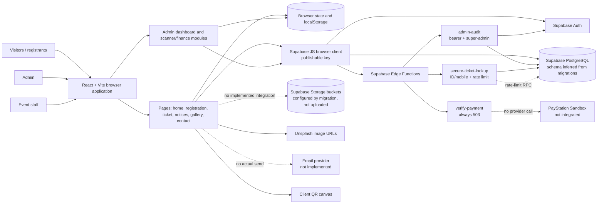

# Complete system architecture

## Evidence boundary

This diagram represents code and SQL artifacts in the repository. It does not claim that Supabase, Edge Functions, storage buckets, a PayStation account, email, or hosting are live or working. No values from environment files are included.

## Flow notes

- Registration UI validates in the browser, keeps form/fee state in `App.tsx`, and stops at a disabled payment notice.
- Ticket lookup is the clearest server flow: browser invokes a public Edge Function, which enforces input/attempt limits, queries the registration table with service role, and returns a paid ticket subset.
- Admin actions use Supabase Auth and database role mappings. Audit events call an Edge Function with an access token; the function verifies role and writes a signed audit row.
- Staff/event and local UI data use a mixture of browser localStorage and best-effort table calls.
- Storage buckets exist only as migration declarations; no upload call was found.
- QR is rendered in the client. No scanner-side QR decode implementation or mail provider was found.
- PayStation and email are shown as disconnected nodes; they are not implemented integrations.
