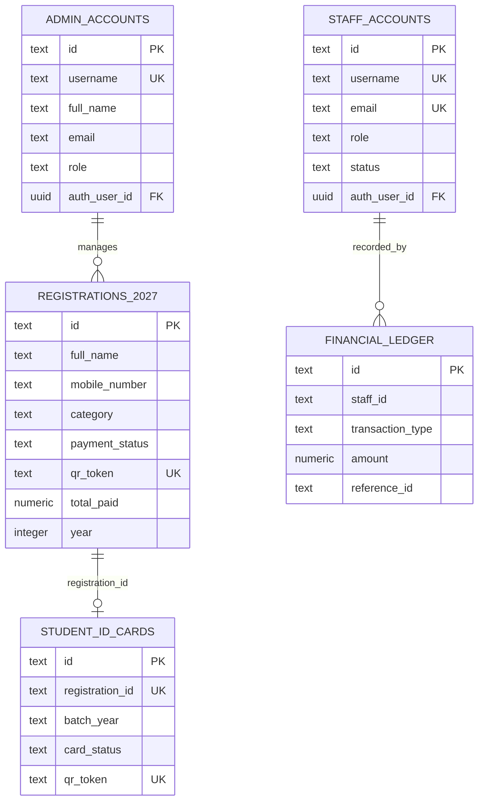

# DATABASE ARCHITECTURE SPECIFICATION
## Police Lines School & College, Faridpur — Reunion Platform
**Database Engine:** PostgreSQL 15+ (Supabase Managed Cloud)  
**Target Project:** `hnthoszbkhvygoowtvau`  
**Schema Version:** 20270104000000  

---

## 1. SCHEMA ORGANIZATION

The database is structured into 4 major logical domains:
1. **Student Registration & Ticketing Domain:** Year-namespaced tables (`registrations_2026`, `registrations_2027`), pre-allocated Student ID pool (`current_student_ids`), and ticket rate limiting (`ticket_lookup_rate_limits`).
2. **Event Day Operations & Scanner Domain:** Food distribution (`food_distributions`), Gate management (`gate_events`), Kit/Dress distribution (`dress_distributions`), Staff accounts (`staff_accounts`).
3. **Financial Accounting Domain:** Double-entry ledger (`financial_ledger`), Central budget (`central_budget`), Staff allocations (`staff_allocations`), Expenses (`staff_expenses`), Donations (`donations_2026`, `donations_2027`).
4. **RMS (Reunion Management ERP) & ID Card Domain:** Committees (`rms_committees`), Members (`rms_committee_members`), Tasks (`rms_tasks`), Meetings (`rms_meetings`), Student ID cards (`student_id_cards`), Batch collections (`batch_id_card_collections`), Download audit logs (`id_card_download_logs`).

---

## 2. TABLE INVENTORY & RELATIONSHIPS

---

## 3. HIGH-SCALE PERFORMANCE INDEXES (FOR 10,000+ ATTENDEES)

| Table | Index Name | Columns | Purpose |
|---|---|---|---|
| `registrations_2027` | `uq_registrations_2027_mobile_normalized` | normalized mobile | Strict 1 registration per mobile number |
| `registrations_2027` | `idx_reg_2027_qr` | `qr_token` | Gate scanning instant O(1) lookup |
| `registrations_2027` | `idx_reg_2027_status` | `payment_status` | Filter paid vs pending students |
| `registrations_2027` | `idx_reg_2027_batch_name` | `batch_name` | Batch grouping & aggregation |
| `registrations_2027` | `idx_reg_2027_registered_at_desc` | `registered_at DESC` | Paginated admin query optimization |
| `student_id_cards` | `idx_student_id_cards_year_status` | `(event_year, card_status)` | ID Card generation status filtering |
| `food_distributions` | `uq_student_meal` | `(registration_id, meal_type)` | Prevents duplicate meal collection |
| `dress_distributions` | `uq_student_dress` | `(registration_id, item_type)` | Prevents duplicate T-shirt issuance |
