# COMPLETE DATABASE ARCHITECTURE & ENTITY RELATIONSHIP SPECIFICATION

**System:** Police Lines School & College, Faridpur — Grand Reunion 2026 / 2027 Management Platform  
**Audit Date:** November 12, 2026  
**Auditor:** Senior Software Architect, Database Architect & Cybersecurity Auditor  
**Scope:** PostgreSQL 15+ (Supabase Managed), Prisma Schema, Edge Function RPCs, and Client Cache Stores

---

## 1. Executive Database Technology Overview

The website utilizes a hybrid data layer architecture designed for high availability during peak registration rushes and offline resilience on event day:

1. **Primary Database Engine:** **PostgreSQL 15+** managed on **Supabase Cloud Infrastructure** (`hnthoszbkhvygoowtvau.supabase.co`).
2. **Access Layers:**
   - **PostgREST HTTP API:** Direct client-side SDK queries (`@supabase/supabase-js`) protected by database-level Row Level Security (RLS).
   - **PostgreSQL Stored Procedures (RPCs):** `SECURITY DEFINER` functions handling atomic state transitions (payment verification, duplicate prevention, department service approvals).
   - **Supabase Edge Functions (Deno Runtime):** Serverless microservices executing cryptographic HMAC signing, third-party payment gateway callbacks, and rate-limited ticket lookups.
   - **Client-Side Cache & Offline Fallback Layer:** Structured LocalStorage stores (`AppStore`, `EventStore`, `RmsStore`, `IdCardStore`) providing instant UI responsiveness and failover when network connectivity is degraded.
3. **ORM & Schema Migrations:** Declarative SQL migrations located in `supabase/migrations/` (10 migration files, 2,488 lines of DDL/DML) and Prisma schema in `prisma/schema.prisma`.

---

## 2. Comprehensive Table Inventory (37 Tables)

The database schema is partitioned across four operational domains:
1. **Core Registration & Financial Subsystem**
2. **Event Day Gate & Distribution Subsystem**
3. **Reunion Management ERP (RMS) Subsystem**
4. **Student ID Card Production & Printing Subsystem**

```
┌────────────────────────────────────────────────────────────────────────────────────────────────────────┐
│                                       DATABASE DOMAIN BREAKDOWN                                        │
├───────────────────────────────────┬─────────────────────────────────┬──────────────────────────────────┤
│ Core & Security Subsystem (6)     │ Event Day Subsystem (9)         │ Reunion Management ERP (14)      │
├───────────────────────────────────┼─────────────────────────────────┼──────────────────────────────────┤
│ 1. public.admin_accounts          │ 7. public.staff_accounts        │ 16. public.rms_committees        │
│ 2. public.admin_audit_logs        │ 8. public.food_distributions    │ 17. public.rms_committee_members │
│ 3. public.registrations_2026      │ 9. public.gate_events           │ 18. public.rms_tasks             │
│ 4. public.registrations_2027      │ 10. public.dress_distributions  │ 19. public.rms_task_comments     │
│ 5. public.donations_2026          │ 11. public.central_budget       │ 20. public.rms_budget_requests   │
│ 6. public.donations_2027          │ 12. public.staff_allocations    │ 21. public.rms_expenses          │
│                                   │ 13. public.staff_expenses       │ 22. public.rms_income_txs        │
│ Private Security Subsystem (1)    │ 14. public.financial_ledger     │ 23. public.rms_sponsors          │
├───────────────────────────────────┤ 15. public.scanner_logs         │ 24. public.rms_documents         │
│ 37. private.ticket_lookup_limits  │                                 │ 25. public.rms_meetings          │
├───────────────────────────────────┴─────────────────────────────────┤ 26. public.rms_announcements     │
│ ID Card Subsystem (5)                                               │ 27. public.rms_volunteers        │
├─────────────────────────────────────────────────────────────────────┤ 28. public.rms_event_incidents   │
│ 29. public.id_card_staff_accounts │ 32. public.id_card_download_jobs│ 29. public.rms_weekly_reports    │
│ 30. public.student_id_cards       │ 33. public.id_card_download_logs│ 30. public.rms_audit_logs        │
│ 31. public.batch_id_card_colls    │ 34. public.admin_audit_history  │                                  │
└───────────────────────────────────┴─────────────────────────────────┴──────────────────────────────────┘
```

---

## 3. Table Schema & Column Specifications

### A. Core Registration & Security Subsystem

#### 1. `public.registrations_2027` (Primary Active Registration Table)
- **Purpose:** Stores comprehensive attendee registration records, payment statuses, and unique verification tokens for the 2027 event.
- **Primary Key:** `id` (TEXT, format `PLSCF-2027-F1001` or `PLSCF-2027-C2001`)
- **Foreign Keys:** None (Root entity)
- **Columns:**
  - `id` (TEXT PRIMARY KEY)
  - `full_name` (TEXT NOT NULL)
  - `full_name_bn` (TEXT)
  - `photo_url` (TEXT NOT NULL)
  - `mobile_number` (TEXT NOT NULL)
  - `email` (TEXT, optional for rural/current students)
  - `address` (TEXT)
  - `category` (TEXT NOT NULL CHECK: `former`, `current`)
  - `student_id` (TEXT, verified against institution records)
  - `passing_year` (TEXT, required for alumni)
  - `last_class_attended` (TEXT)
  - `current_class` (TEXT, required for current students)
  - `batch_name` (TEXT NOT NULL)
  - `group_or_section` (TEXT)
  - `roll_number` (TEXT)
  - `t_shirt_size` (TEXT NOT NULL CHECK: `XS`, `S`, `M`, `L`, `XL`, `XXL`, `XXXL`, `Oversize 50`)
  - `registration_fee` (NUMERIC NOT NULL DEFAULT 1000)
  - `donation_amount` (NUMERIC NOT NULL DEFAULT 0)
  - `total_paid` (NUMERIC NOT NULL DEFAULT 0)
  - `payment_status` (TEXT NOT NULL DEFAULT 'pending' CHECK: `paid`, `pending`, `failed`, `refunded`)
  - `transaction_id` (TEXT)
  - `payment_method` (TEXT CHECK: `bkash`, `nagad`, `rocket`, `card`)
  - `gateway_invoice_number` (TEXT)
  - `gateway_provider` (TEXT DEFAULT 'PAYSTATION')
  - `gateway_response` (JSONB DEFAULT '{}')
  - `server_verification_signature` (TEXT)
  - `verification_timestamp` (TIMESTAMPTZ)
  - `verified_by` (TEXT)
  - `registered_at` (TIMESTAMPTZ NOT NULL DEFAULT NOW())
  - `qr_token` (TEXT NOT NULL UNIQUE, 6 alphanumeric characters)
  - `is_tshirt_collected` (BOOLEAN NOT NULL DEFAULT FALSE)
  - `is_checked_in` (BOOLEAN NOT NULL DEFAULT FALSE)
  - `notes` (TEXT)
  - `year` (INTEGER NOT NULL DEFAULT 2027)
- **Indexes:**
  - `idx_reg_2027_mobile` ON (`mobile_number`)
  - `idx_reg_2027_trx` ON (`transaction_id`)
  - `idx_reg_2027_qr` ON (`qr_token`)
  - `idx_reg_2027_status` ON (`payment_status`)
  - `idx_reg_2027_gateway_inv` ON (`gateway_invoice_number`)
  - `uq_registrations_2027_mobile_normalized` UNIQUE ON normalized 11-digit mobile expression.
- **Row Level Security (RLS):**
  - `INSERT`: Allowed for `anon` and `authenticated` ONLY IF `payment_status = 'pending'`, `total_paid = 0`, `transaction_id IS NULL`.
  - `SELECT`: Allowed for `authenticated` staff with `super_admin` or operational roles. Public lookup restricted to Edge Function.
  - `UPDATE` / `DELETE`: Strictly restricted to `super_admin`.

#### 2. `public.registrations_2026` (Legacy 2026 Records)
- **Schema:** Identical structure to `registrations_2027` with `year DEFAULT 2026`. Preserved for historical auditability and multi-year support.

#### 3. `public.donations_2027` & `public.donations_2026`
- **Purpose:** Tracks standalone patron donations and philanthropic contributions.
- **Primary Key:** `id` (TEXT, format `DON-2027-XXXX`)
- **Foreign Keys:** `registration_id` references `registrations_2027(id)` (optional)
- **Columns:** `id`, `donor_name`, `donor_mobile`, `donor_email`, `amount`, `payment_status`, `transaction_id`, `payment_method`, `created_at`.
- **RLS:** Public insert pending; Read/Update/Delete restricted to `super_admin`.

#### 4. `public.admin_accounts`
- **Purpose:** Stores authenticated administrative accounts linked to Supabase Auth.
- **Primary Key:** `id` (TEXT)
- **Foreign Key:** `auth_user_id` (UUID REFERENCES `auth.users(id)` ON DELETE CASCADE)
- **Columns:** `id`, `username`, `full_name`, `email`, `role`, `created_at`, `auth_user_id`.
- **Unique Constraint:** `uq_admin_accounts_auth_user_id` ON (`auth_user_id`).
- **RLS:** Self-read (`auth_user_id = auth.uid()`). Modifications restricted to `super_admin`.

#### 5. `public.admin_audit_logs` & `public.admin_audit_history`
- **Purpose:** Cryptographically hashed, tamper-evident audit trail of all sensitive admin operations.
- **Columns:** `id`, `admin_id`, `admin_username`, `admin_role`, `action`, `target_type`, `target_id`, `details` (JSONB), `checksum` (SHA-256), `ip_address`, `created_at`.
- **RLS:** Read-only for `super_admin`. No user or admin can UPDATE or DELETE audit records.

---

### B. Event Day Gate & Distribution Subsystem

#### 6. `public.staff_accounts`
- **Purpose:** Event staff credentials partitioned by station and department.
- **Primary Key:** `id` (TEXT, format `STF-001`)
- **Foreign Key:** `auth_user_id` (UUID REFERENCES `auth.users(id)` ON DELETE CASCADE)
- **Columns:** `id`, `auth_user_id`, `username`, `full_name`, `email`, `role`, `department`, `permissions` (JSONB), `assigned_gate`, `status` (`ACTIVE`/`INACTIVE`), `created_at`.
- **Department Constraint:** CHECK `department IN ('BREAKFAST', 'LUNCH', 'DINNER', 'DRESS', 'GATE', 'FINANCE', 'ALL_SERVICES')`.
- **Permissions JSONB:** Array containing allowed actions: `["VIEW", "SCAN", "VERIFY", "APPROVE", "REJECT", "EXPORT", "MANAGE"]`.

#### 7. `public.food_distributions`
- **Purpose:** Logs individual meal coupon redemptions with duplicate prevention.
- **Primary Key:** `id` (TEXT, format `FOOD-XXXX`)
- **Foreign Key:** `registration_id` (TEXT)
- **Columns:** `id`, `registration_id`, `student_name`, `batch_name`, `meal_type` (`breakfast`/`lunch`/`dinner`), `status` (`COLLECTED`), `collected_at`, `staff_id`, `staff_name`, `notes`.
- **Unique Constraint:** Partial unique index preventing duplicate collection for the same `(registration_id, meal_type)`.

#### 8. `public.dress_distributions`
- **Purpose:** Tracks distribution of commemorative reunion T-shirts and delegate kits.
- **Primary Key:** `id` (TEXT, format `DRS-XXXX`)
- **Foreign Key:** `registration_id` (TEXT)
- **Columns:** `id`, `registration_id`, `student_name`, `item_type` (`reunion_tshirt`), `registered_size`, `status` (`RECEIVED`), `received_at`, `staff_id`, `staff_name`, `notes`.

#### 9. `public.gate_events`
- **Purpose:** High-throughput entry and security turnstile logging.
- **Primary Key:** `id` (TEXT, format `GATE-XXXX`)
- **Columns:** `id`, `registration_id`, `student_name`, `batch_name`, `event_type` (`ENTRY`/`EXIT`), `gate_id`, `staff_id`, `staff_name`, `timestamp`, `status`.

#### 10. `public.financial_ledger`
- **Purpose:** Authoritative double-entry ledger tracking all inflows and expense disbursements.
- **Columns:** `id`, `staff_id`, `transaction_type` (`ALLOCATION_INFLOW`, `REGISTRATION_INFLOW`, `EXPENSE_OUTFLOW`, `SURPLUS_REFUND`, `REVERSAL`), `amount`, `reference_id`, `description`, `created_at`, `created_by`.

#### 11. `public.central_budget`, `public.staff_allocations`, `public.staff_expenses`
- **Purpose:** Budget management hierarchy: Central event fund -> Department/Staff allocation -> Real-time field expenses.

---

### C. Reunion Management ERP (RMS) Subsystem

#### 12. `public.rms_committees` & `public.rms_committee_members`
- **Purpose:** Organizes the 12 working sub-committees (Registration, Media, Venue, Finance, Security, Hospitality, Food, etc.) and appointed alumni members.
- **Columns:** `id`, `title`, `title_bn`, `director_id`, `assistant_director_id`, `budget_allocated`, `budget_spent`, `status`.

#### 13. `public.rms_tasks` & `public.rms_task_comments`
- **Purpose:** Kanban task management system with priority deadlines, assignees, and state tracking (`TODO`, `IN_PROGRESS`, `REVIEW`, `COMPLETED`).

#### 14. `public.rms_budget_requests` & `public.rms_expenses`
- **Purpose:** Formal budget requisition workflow. Committee Directors request funds -> Finance Officers recommend -> Convener / Super Admin grants approval.

#### 15. `public.rms_sponsors`, `public.rms_documents`, `public.rms_meetings`, `public.rms_announcements`, `public.rms_volunteers`, `public.rms_event_incidents`, `public.rms_weekly_reports`
- **Purpose:** Complete enterprise operations suite for executive secretariat governance.

---

### D. Student ID Card Subsystem

#### 16. `public.id_card_staff_accounts`
- **Purpose:** Dedicated access control for ID card production technicians and supervisors.

#### 17. `public.student_id_cards`
- **Purpose:** Tracks ID card generation status (`ELIGIBLE`, `GENERATED`, `REGENERATED`, `FLAGGED_REVIEW`), PDF storage paths, file size checksums, and dimensions (54×86mm CR80).

#### 18. `public.batch_id_card_collections`, `public.id_card_download_jobs`, `public.id_card_download_logs`
- **Purpose:** Tracks 9-cards-per-A4 gang-run PDF packaging, multi-batch ZIP compression jobs, and download audit logs.

---

## 4. Mermaid Entity-Relationship (ER) Diagram

```mermaid
erDiagram
    %% Core Registration & Payment
    registrations_2027 ||--o{ donations_2027 : "optional donor link"
    registrations_2027 ||--o{ food_distributions : "receives meals"
    registrations_2027 ||--o{ dress_distributions : "receives kit"
    registrations_2027 ||--o{ gate_events : "scans at turnstile"
    registrations_2027 ||--o| student_id_cards : "generates badge"

    registrations_2027 {
        text id PK "Registration ID (PLSCF-2027-F1001)"
        text full_name "Full English Name"
        text full_name_bn "Bengali Name"
        text photo_url "Passport Photo URI"
        text mobile_number "11-digit Bangladeshi Mobile"
        text category "former or current"
        text passing_year "Alumni Graduation Year"
        text current_class "Current Student Class"
        text batch_name "Batch Title"
        text t_shirt_size "XS to Oversize 50"
        numeric total_paid "Total BDT Paid"
        text payment_status "pending, paid, failed"
        text transaction_id "Gateway Trx ID"
        text qr_token UK "6-Character High-Entropy Token"
        boolean is_checked_in "Event Gate Status"
        boolean is_tshirt_collected "Kit Handout Status"
    }

    student_id_cards {
        text id PK "IDC-PLSCF-2027-F1001"
        text registration_id FK "References registrations_2027"
        text batch_year "Graduation Year"
        text card_status "ELIGIBLE, GENERATED, FLAGGED"
        text pdf_storage_path "Storage Location"
        text qr_token "Embedded QR Token"
        text card_dimensions "54x86mm CR80"
        timestamp generated_at "Generation Timestamp"
    }

    food_distributions {
        text id PK "FOOD-XXXX"
        text registration_id FK "Attendee Reference"
        text meal_type "breakfast, lunch, dinner"
        text status "COLLECTED"
        timestamp collected_at "Distribution Timestamp"
        text staff_id FK "Staff Member"
    }

    dress_distributions {
        text id PK "DRS-XXXX"
        text registration_id FK "Attendee Reference"
        text registered_size "Size Validated"
        text status "RECEIVED"
        timestamp received_at "Handout Timestamp"
        text staff_id FK "Staff Member"
    }

    gate_events {
        text id PK "GATE-XXXX"
        text registration_id FK "Attendee Reference"
        text event_type "ENTRY or EXIT"
        text gate_id "Turnstile Station"
        timestamp timestamp "Scan Timestamp"
    }

    %% Staff & Access Control
    staff_accounts ||--o{ food_distributions : "distributes"
    staff_accounts ||--o{ dress_distributions : "distributes"
    staff_accounts ||--o{ gate_events : "verifies entry"
    staff_accounts ||--o{ staff_allocations : "receives budget"
    staff_accounts ||--o{ staff_expenses : "logs spend"

    staff_accounts {
        text id PK "STF-001"
        uuid auth_user_id FK "Supabase Auth UID"
        text username "Login Username"
        text role "EventStaffRole"
        text department "Department Isolation"
        jsonb permissions "Granular Actions"
        text status "ACTIVE or INACTIVE"
    }

    admin_accounts {
        text id PK "admin-master-001"
        uuid auth_user_id FK "Supabase Auth UID"
        text username "admin@gmail.com"
        text role "super_admin or admin"
        timestamp created_at "Provisioned At"
    }

    admin_audit_logs {
        uuid id PK "UUID"
        text admin_id "Operator Reference"
        text action "Audit Action Tag"
        text target_type "Target Entity"
        text target_id "Target Record ID"
        jsonb details "Payload Telemetry"
        text checksum "SHA-256 Tamper Proof"
        timestamp created_at "Timestamp"
    }

    %% RMS ERP Subsystem
    rms_committees ||--o{ rms_committee_members : "comprises"
    rms_committees ||--o{ rms_tasks : "owns"
    rms_committees ||--o{ rms_budget_requests : "submits"
    rms_committees ||--o{ rms_expenses : "incurs"

    rms_committees {
        text id PK "Committee Slug"
        text title "Committee Title"
        text director_id "Director Reference"
        numeric budget_allocated "Allocated BDT"
        numeric budget_spent "Expended BDT"
    }

    rms_tasks {
        text id PK "TASK-001"
        text committee_id FK "Committee Reference"
        text title "Task Objective"
        text status "TODO, IN_PROGRESS, REVIEW, DONE"
        text priority "LOW, MEDIUM, HIGH, URGENT"
        date due_date "Deadline"
    }

    rms_budget_requests {
        text id PK "REQ-001"
        text committee_id FK "Committee Reference"
        numeric amount "Requested Amount"
        text status "PENDING, RECOMMENDED, APPROVED, REJECTED"
        text approved_by "Sign-off Authority"
    }

    financial_ledger {
        text id PK "LEDGER-XXXX"
        text transaction_type "INFLOW, OUTFLOW, REVERSAL"
        numeric amount "Authoritative Sum"
        text reference_id "Trx or Invoice Reference"
        timestamp created_at "Immutable Timestamp"
    }
```



---

## 5. PostgreSQL Stored Procedures & Triggers (RPCs)

### 1. `public.rpc_verify_payment` (Security Definer)
- **File Reference:** `supabase/migrations/20261111020000_paystation_payment_gateway.sql:18-126`
- **Parameters:** `p_reg_id`, `p_trx_id`, `p_method`, `p_amount`, `p_signature`, `p_verified_by`
- **Execution Logic:**
  1. Checks anti-replay constraint: Rejects if `p_trx_id` is already utilized by another registration.
  2. Ensures valid QR token exists or generates a cryptographic token.
  3. Updates `registrations_2026` or `registrations_2027` setting `payment_status = 'paid'`, `server_verification_signature = p_signature`, and `total_paid = p_amount`.
  4. Records double-entry credit in `public.financial_ledger` under `REGISTRATION_INFLOW`.
  5. Inserts tamper-evident audit record into `public.admin_audit_logs`.
- **Authorization:** `REVOKE ALL FROM PUBLIC, anon; GRANT TO service_role, authenticated`.

### 2. `public.rpc_verify_and_approve_service` (High-Concurrency Atomic Distribution)
- **File Reference:** `supabase/migrations/20270105000000_six_character_qr_tokens_and_department_rbac.sql:97-280`
- **Parameters:** `p_token_or_id`, `p_department`, `p_staff_id`, `p_notes`
- **Execution Logic:**
  1. Validates staff authorization, active status, and department isolation.
  2. Resolves student record by 6-character token or registration ID across 2026 and 2027 tables.
  3. Verifies student payment status (`payment_status === 'paid'`).
  4. Checks for meal time cutoffs (e.g. Breakfast cutoff at 1:00 PM BD time).
  5. Executes atomic `SELECT ... WHERE status = 'COLLECTED'` to detect prior collection.
  6. Inserts distribution record (`food_distributions`, `dress_distributions`, or `gate_events`).
  7. Returns sanitized, information-minimized success payload.

### 3. `public.fn_generate_six_char_token`
- **File Reference:** `supabase/migrations/20270105000000_six_character_qr_tokens_and_department_rbac.sql:75-93`
- **Logic:** Generates 6-character alphanumeric strings using cryptographic random bytes from `pgcrypto`. Keyspace: $36^6 = 2,176,782,336$ possibilities, ensuring zero practical collisions.

---

## 6. Database Indexing Strategy & Performance Analysis

1. **Normalized Mobile Number Index:**
   `uq_registrations_2027_mobile_normalized` indexes `REGEXP_REPLACE(mobile_number, '[^0-9]', '', 'g')` normalizing `88017...` to `017...`. This guarantees that an attendee cannot create duplicate registrations by altering prefix formatting.
2. **Gateway Invoice Index:**
   `idx_reg_2027_gateway_inv` on `gateway_invoice_number` allows instant $O(1)$ webhook lookup when PayStation posts transaction confirmation callbacks.
3. **QR Token Fast Lookup:**
   `idx_reg_2027_qr` provides sub-millisecond response times at gate and food scanning stations.
4. **Audit Trail Immutability:**
   No indexes exist on `admin_audit_logs` that support UPDATE or DELETE; table has append-only rules.

