# Database ER diagram

## Evidence boundary

This diagram models only relationships declared in repository migrations. It is not a live database export. There are no declared foreign keys from event operation tables to registrations or staff; those apparent IDs are not shown as relational edges. The only application FKs point from admin/staff profiles to Supabase Auth users.

```mermaid
erDiagram
  AUTH_USERS o|--o| ADMIN_ACCOUNTS : "auth_user_id (unique, nullable)"
  AUTH_USERS o|--o| STAFF_ACCOUNTS : "auth_user_id (unique, nullable)"

  AUTH_USERS {
    uuid id PK
  }
  ADMIN_ACCOUNTS {
    text id PK
    text username UK
    uuid auth_user_id FK
    text role
  }
  STAFF_ACCOUNTS {
    text id PK
    text username UK
    text email UK
    uuid auth_user_id FK
    text role
    text status
  }
  ADMIN_AUDIT_LOGS {
    text id PK
    text admin_id
    text action
    text target_type
    text target_id
  }
  REGISTRATIONS_2026 {
    text id PK
    text mobile_number
    text qr_token UK
    text payment_status
    numeric total_paid
  }
  DONATIONS_2026 {
    text id PK
    numeric amount
    text transaction_id
    text payment_status
  }
  SCANNER_LOGS {
    text id PK
    text registration_id
    text staff_id
  }
  FOOD_DISTRIBUTIONS {
    text id PK
    text registration_id
    text meal_type
    text staff_id
  }
  GATE_EVENTS {
    text id PK
    text registration_id
    text staff_id
  }
  DRESS_DISTRIBUTIONS {
    text id PK
    text registration_id
    text item_type
    text staff_id
  }
  CENTRAL_BUDGET {
    text id PK
    numeric total_budget
  }
  STAFF_ALLOCATIONS {
    text id PK
    text staff_id
    numeric allocated_amount
  }
  STAFF_EXPENSES {
    text id PK
    text staff_id
    numeric amount
  }
  FINANCIAL_LEDGER {
    text id PK
    text staff_id
    text reference_id
    numeric amount
  }
  ADMIN_AUDIT_HISTORY {
    text id PK
    text admin_id
    text entity_type
    text entity_id
  }
  TICKET_LOOKUP_RATE_LIMITS {
    text subject_hash PK
    timestamptz window_started_at
    integer attempt_count
  }
```

`AUTH_USERS` is a Supabase-managed relation, not created by this project’s migrations; only the referenced `id UUID` is shown. It may have at most one linked admin/staff row per user due to unique indexes; the FK columns permit null according to the hardening migration. The event operation identifiers (`registration_id`, `staff_id`, `admin_id`, `reference_id`) appear as scalar columns with no declared FK. Do not infer one-to-many or many-to-many constraints solely from naming.

## Data integrity gaps

- No registration FK on `food_distributions`, `gate_events`, `dress_distributions`, or `scanner_logs`.
- No staff FK on allocation, expenses, ledger, event distributions, or scanner logs.
- No declared relation connecting donations to a donor/user/registration.
- Student-ID records are referenced in application code but no table is defined in these migrations.
- Storage buckets/objects and `inquiries` are external/undeclared in the app schema; they are omitted from this ER model.
