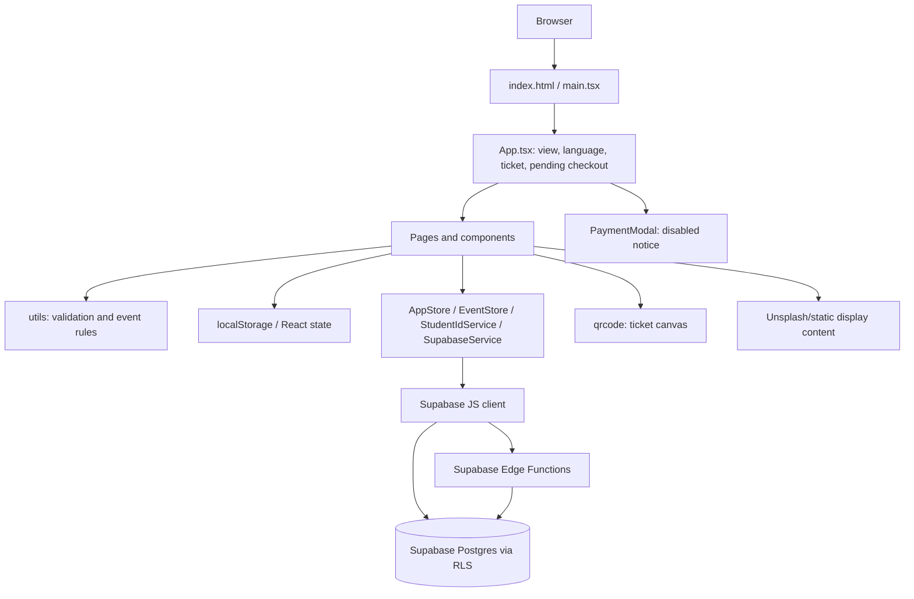

# Frontend architecture

## Framework and entry

Vite serves a React 19 TypeScript single-page application. `index.html` mounts `src/main.tsx`, which mounts `App` and imports `index.css`. Styling uses Tailwind CSS and custom classes. The app does not import a routing library; `App.tsx` holds the active view as React state. On refresh it returns to the default home view, and pages do not have stable URL routes.

## Views and navigation

`App.tsx` conditionally renders these view IDs:

| View ID | Main component |
|---|---|
| `home` | `HomePage` |
| `register` | `RegistrationPage` |
| `find-ticket` | `TicketLookupModal` |
| `ticket` | `TicketView` when an in-memory active ticket exists |
| `donate` | `DonationPage` |
| `notices` | `NoticeBoardPage` |
| `gallery` | `GalleryPage` |
| `about` | `AboutContactPage` |
| `scanner` | `ScannerPortal` |
| `admin` | `AdminDashboard` |

`Header`/`Footer` trigger navigation callbacks. Main state includes language, fee settings, selected ticket, and pending registration/payment values.

## Component groups

- Public content: `HomePage`, `Header`, `Footer`, `NoticeBoardPage`, `GalleryPage`, `AboutContactPage`.
- Registration and ticket: `RegistrationPage`, `PaymentModal`, `TicketLookupModal`, `TicketView`.
- Operations: `ScannerPortal`, `GateScannerModule`, `FoodScannerModule`, `DressScannerModule`, `StaffFinanceModule`.
- Admin: `AdminDashboard` and six `src/components/admin/*Tab.tsx` components.

## State and validation

UI state is primarily React hooks. Domain persistence is split:

- `AppStore` uses `localStorage` as the registration/donation/settings cache and starts asynchronous Supabase writes.
- `EventStore` stores event/budget/expense data in localStorage and local module cache, while it starts best-effort writes to Supabase.
- `StudentIdService` reads browser-local student-ID records and attempts remote writes without awaiting/reporting errors.
- Admin and staff sessions use Supabase Auth; the browser client is configured with `persistSession: false`.

`rules.ts` validates registration fields and fees; `eventRules.ts` handles scanner/role/finance rules; `fileValidation.ts` validates image file MIME, size (5 MB), and dimensions, then reads it as a base64 data URL. Contact form performs client-side name/phone/message validation.

## Frontend-to-backend calls

- `SupabaseService` uses `@supabase/supabase-js` with a browser publishable/anon key for table access, Auth, and Function invocation.
- Ticket lookup calls `secure-ticket-lookup` through `supabase.functions.invoke`.
- Audit recording calls `admin-audit`.
- There is no invocation of `verify-payment`.
- No client code uploads objects to Supabase Storage. Registration and receipt images become data URLs instead.
- Event/financial writes are often fire-and-forget; local UI reports success even when a remote write may fail.

## Registration/payment flow (observed)

1. `RegistrationPage` builds form data and checks client rules. Current-student ID verification is localStorage-based.
2. `App.handleInitiatePayment` stores pending form/fee state and attempts a local student-ID reservation.
3. `PaymentModal` shows a “payment unavailable” message and a close action. No registration save, PayStation initiation, callback, or successful-ticket transition follows.
4. Closing releases the local reservation.

Thus the registration UI does not currently communicate the submitted form to a payment API or persist it through `AppStore.addRegistration`.

## Scanner and ticket behavior

`TicketView` generates a QR canvas using the `qrcode` package and encodes a JSON object with registration ID, name, category, batch and QR token. Scanner modules expose camera/video and manual text input; there is no QR-decoding library or observed camera decode path. Scanner lookup and operational state use local app data, creating cross-device/staleness risk. The ticket email resend modal is simulated, not a send operation.

## Diagram

## Source references

- Navigation/state: `src/App.tsx:24-95,102-211`
- Form validation and handoff: `src/components/RegistrationPage.tsx:145-238`
- Disabled checkout: `src/components/PaymentModal.tsx:47-54`
- Client persistence: `src/services/store.ts:101-146`
- Client Supabase configuration: `src/services/supabase.ts:18-40`
- QR/email UI: `src/components/TicketView.tsx:27-62,272-330`

