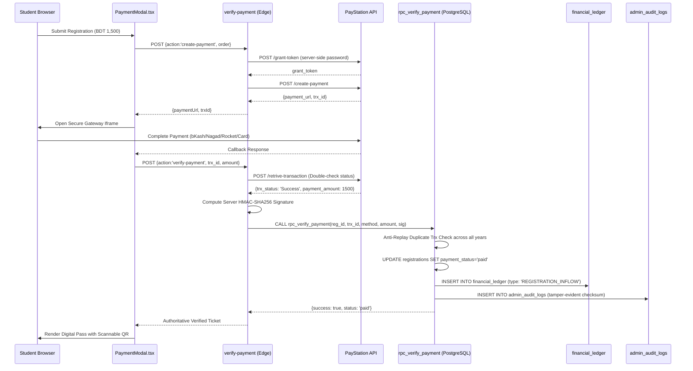

# PAYMENT INTEGRITY & FINANCIAL VERIFICATION REPORT
## Police Lines School & College, Faridpur — Reunion Platform
**Payment Gateway:** PayStation (Bangladesh)  
**Edge Verification Endpoint:** `supabase/functions/verify-payment`  
**Database Procedure:** `public.rpc_verify_payment`  
**Ledger Table:** `public.financial_ledger`  

---

## 1. END-TO-END PAYMENT LIFECYCLE VERIFICATION

---

## 2. FINANCIAL INTEGRITY SAFEGUARDS

1. **Zero Client Trust:**
   - Payment status is NEVER accepted directly from the client.
   - The browser cannot mark a registration as `paid`.
   - The `verify-payment` Edge Function queries PayStation's `/retrive-transaction` API server-to-server.
2. **Double-Spend & Anti-Replay Protection:**
   - `rpc_verify_payment` executes an anti-replay query checking both `registrations_2027` and `registrations_2026` for duplicate `transaction_id`.
   - Attempting to reuse an existing transaction reference results in an immediate `DUPLICATE_TRANSACTION` abort.
3. **Atomic Ledger Insertion:**
   - Every verified registration creates exactly one double-entry inflow in `financial_ledger` with `transaction_type = 'REGISTRATION_INFLOW'`.
   - Migration `20270104000000_fix_financial_ledger_constraint.sql` ensures PostgreSQL check constraints permit this value without transaction aborts.
4. **Server Cryptographic Signing:**
   - Every verified ticket receives an authoritative `SIG_HMAC256_<HASH>` stamp generated with `PAYMENT_SIGNING_SECRET`.
   - Scanners and ticket lookups verify this signature before issuing admittance.
