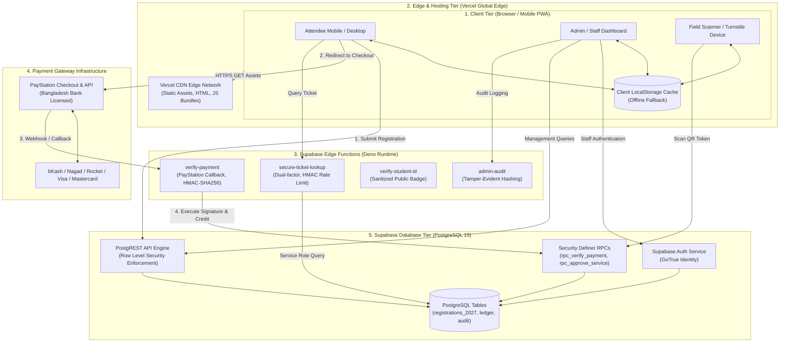
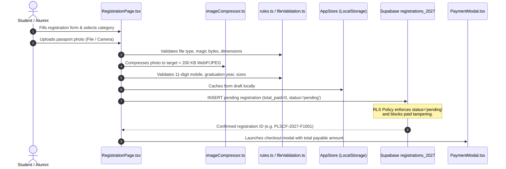
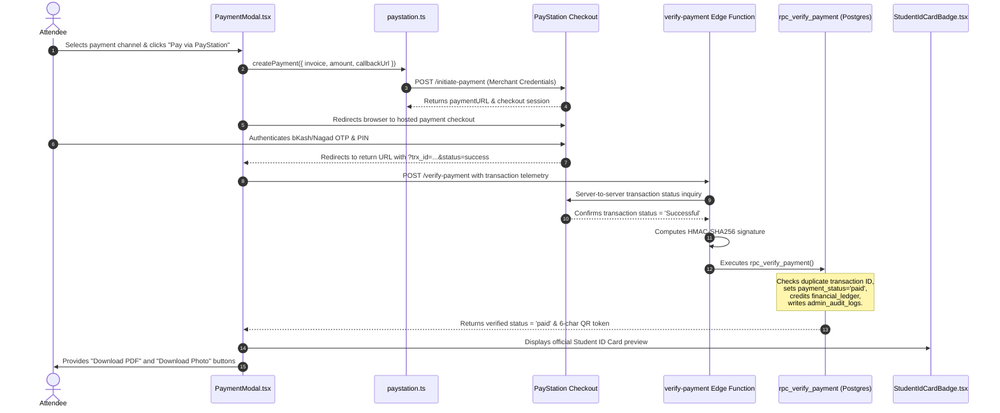
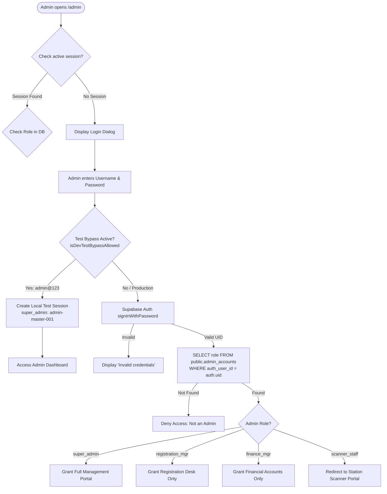
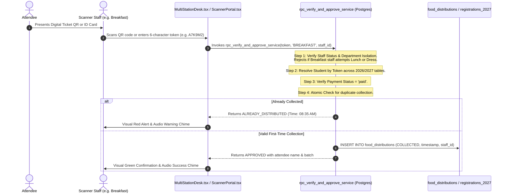
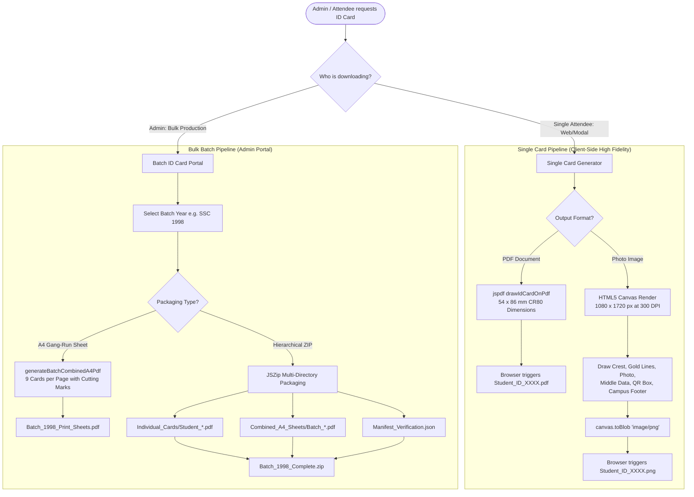
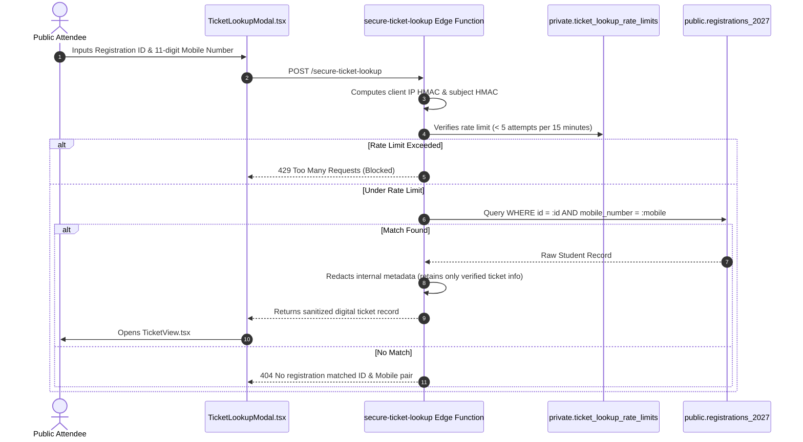

# WEBSITE DATA FLOW & SYSTEM INTERACTION DIAGRAMS

**System:** Police Lines School & College, Faridpur — Grand Reunion 2026 / 2027  
**Audit Document:** Data Movement & Interaction Flows  
**Auditor:** Senior Software Architect & Full-Stack Engineer  

---

## 1. Complete Website Architecture Diagram

The website operates as a high-performance Single Page Application (SPA) built with React 19 and Vite, deployed on Vercel CDN, backed by Supabase Cloud BaaS (PostgreSQL, PostgREST, Edge Functions) and PayStation Payment Gateway.

---

## 2. User Registration & Enrollment Flow

---

## 3. Payment Processing & Gateways Flow

---

## 4. Admin Authentication & Role Verification Flow

---

## 5. Event Day Department Verification & Service Approval Flow

---

## 6. Student ID Card Generation & Bulk Download Flow

---

## 7. Ticket Lookup & Identity Minimization Flow

