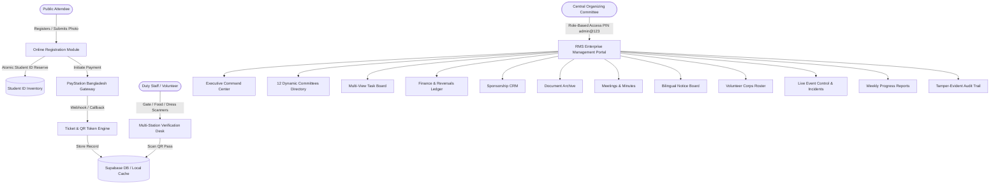

# Reunion Management System (RMS) Architecture & Systems Design
## Sylhet Police Lines High School & College Reunion 2027

---

## 1. Executive Summary & Event Context
- **Institution**: Sylhet Police Lines High School & College (Est. 1962, Faridpur, Bangladesh).
- **Core Event**: Grand Reunion 2027.
- **Main Event Date**: Friday, January 29, 2027.
- **Venue**:
  - School Campus
  - Police Lines Large Field, Faridpur, Bangladesh.
- **Event Schedule Breakdown**:
  - **Thursday, January 28, 2027**: Participant Registration, Souvenir & Kit Bag Distribution, ID Card Issuance, Evening Sufi/Qawwali Cultural Program.
  - **Friday, January 29, 2027**: Colorful Morning Procession (Ananda Shovajatra), National Anthem & Flag Hoisting, Grand Inauguration, Alumni Networking Banquet, Celebrity Band & Cultural Concert.
- **Executive Governance Structure**:
  - **Chief Adviser**: Institution Principal (Advisory oversight & read-only audit access).
  - **Convener**: Monowar Shikder (Executive decision-making & central budget approvals).
  - **Member Secretary**: Siddiqur Rahman (Administrative oversight & meeting convocations).
  - **Registration & Database Committee Director**: Sagar (Online registrations, database integrity, ticketing & gate telemetry).

---

## 2. High-Level System Architecture
The RMS platform is built as an enterprise event ERP consisting of two tightly interconnected tiers:
1. **Public Participant Portal**:
   - Seamless attendee registration (Current Students & Alumni).
   - Automated 200KB browser photo compression & camera capture.
   - PayStation sandbox & production payment gateway integration.
   - Cryptographically signed QR e-Ticket issuance.
   - Public event schedule, approved committee roster, and sponsorship showcase.
2. **Private Administrative ERP & Multi-Station Control Suite**:
   - Executive Overview & Real-Time Countdown Command Center.
   - 12 Dynamic Sub-Committees Management Directory.
   - Kanban, Table & Calendar Multi-View Task Board with deliverable review workflows.
   - Financial Ledger with Zero-Silent-Deletion reversal audit trails.
   - Corporate Sponsorship CRM with multi-channel branding delivery checklists.
   - Document & Letter Archive with role-based access boundaries.
   - Meeting Scheduler, Roll Call Attendance & Resolution Tracker.
   - Internal Communications & Bilingual Directive Board (English & Bangla).
   - Volunteer Corps Rostering & Real-Time Shift Check-In/Check-Out.
   - Event Day Control Room & Live Incident Dispatch Desk.
   - Weekly Committee Progress Reports Pipeline.
   - System-wide Immutable Compliance Audit Log.

---

## 3. Technology Stack & Technical Dependencies
- **Frontend Framework**: React 18 with TypeScript in strict mode (`noUnusedLocals: true`, `noUnusedParameters: true`).
- **Build Engine**: Vite 8 with Rolldown optimization, delivering sub-300ms builds.
- **Styling Architecture**: Modern Tailwind CSS utility system with Brutalist poster aesthetic (#1E1E1E Primary, #E4E2DD Base, #DB4A2B Accent).
- **Backend / Database**: Supabase PostgreSQL with Row Level Security (RLS) and fallback localStorage cache.
- **Payment Processing**: PayStation Bangladesh API (sandbox & live HMAC verification).
- **Testing & Quality Engine**: Node.js Native Test Runner (`tsx --test`) covering 38/38 unit tests across business logic, RBAC, fraud detection, and photo compression.

---

## 4. Multi-Persona Role-Based Access Control (RBAC)
| Role Code | Title / Persona | Test Identifier | Privileges |
|---|---|---|---|
| `SUPER_ADMIN` | System Administrator | `admin@gmail.com` | Unrestricted read/write across all committees, financials, logs, and user roles. |
| `CHIEF_ADVISER` | Institution Principal | `principal@policelines.edu.bd` | Read-only executive oversight across all 12 committees, finances, and audit logs. |
| `CONVENER` | Monowar Shikder | `monowar@policelines.edu.bd` | Final budget approvals, weekly report reviews, policy directives, executive actions. |
| `MEMBER_SECRETARY` | Siddiqur Rahman | `siddiqur@policelines.edu.bd` | Meeting convocations, minutes archiving, committee coordination, notices. |
| `COMMITTEE_DIRECTOR` | Sagar & 11 Directors | `sagar@policelines.edu.bd` | Task assignments, budget request submissions, committee member rosters. |
| `ASSISTANT_DIRECTOR` | Assistant Directors | Dynamic per committee | Task execution, evidence submission, volunteer oversight. |
| `COMMITTEE_MEMBER` | Committee Members | Dynamic per committee | Task deliverables, progress updates, meeting attendance. |
| `FINANCE_OFFICER` | Finance Desk | `finance@gmail.com` | Voucher audit, expense verification, budget review recommendations. |
| `VOLUNTEER` | Field Volunteer | Dynamic | Shift check-in/out, physical desk coordination, incident reporting. |
| **All Accounts** | **Universal Test PIN** | **`admin@123`** | Unified authentication credential across all administrative testing personas. |

---

## 5. Architectural Reliability & Fault Tolerance
1. **Network Partition Resiliency**: In the event of field network disconnection at the Police Lines Large Field, all operations continue in offline mode with atomic local sync queue.
2. **Zero-Silent-Deletion Policy**: Deletion of approved expenses or registered transactions is architecturally prevented. All financial corrections require recorded reversal justification entries with a minimum 8-character audit reason.
3. **Cryptographic Ticket Authentication**: Every QR ticket carries an HMAC-SHA256 signature generated by the server, preventing ticket forgery and duplicate gate admittance.

