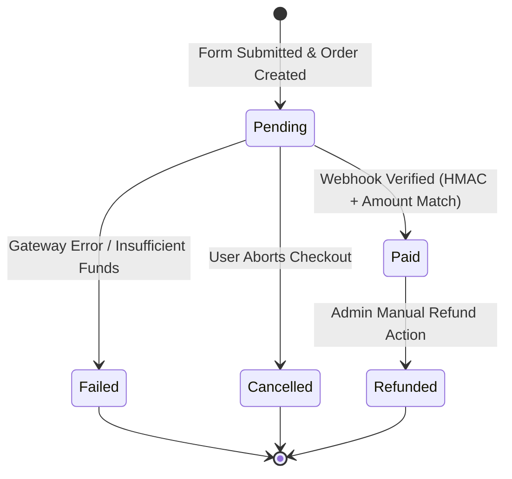

# System & Business Rules Document (Rules.md)
## Police Lines School & College Faridpur — Reunion 2026 Platform
### Design Standard: Raw Form (Light Sky Edition) | Stack: Next.js 15 + Supabase

---

## 1. Attendee Registration Rules

### 1.1. Identification & Contact Validation
- **BR-REG-01 (Full Name)**: Attendee must supply their official name in English (2 to 80 characters, alphabetical and standard punctuation). Full name in Bangla (`full_name_bn`) is strongly encouraged for souvenir badge generation.
- **BR-REG-02 (Mobile Number)**:
  - Must conform strictly to the Bangladeshi cellular standard: `^(?:\+?88)?01[3-9]\d{8}$`.
  - Before persistence, the mobile number must be normalized into standard 11-digit local format: `01XXXXXXXXX`.
  - A mobile number can only be linked to **one paid registration** per reunion year unless registered under an authorized multi-ticket corporate or family sponsor bundle.
- **BR-REG-03 (Email Address)**:
  - Optional field. If provided, must pass RFC 5322 validation.
  - If omitted, ticket delivery defaults exclusively to SMS and on-screen download.

### 1.2. Category & Eligibility Matrix
- **BR-REG-04 (Alumni Eligibility)**:
  - Applicable to former students who passed SSC/HSC from 1962 to 2025.
  - Must select an official Passing Year and Batch Name.
  - Base Fee: ৳1,500 BDT.
- **BR-REG-05 (Current Student Eligibility)**:
  - Applicable only to currently enrolled students (Class 6 to Class 12).
  - Must provide a valid Student ID number and current Class/Section/Roll.
  - Each Student ID can only be registered **once**. The system executes an atomic server check against the `current_student_ids` verification table.
  - Subsidized Fee: ৳500 BDT.
- **BR-REG-06 (Teacher & Dignitary Eligibility)**:
  - Applicable to current/retired faculty members, governing body members, and state guests.
  - Base Fee: ৳0 BDT (Complimentary).
  - Requires pre-authorization or approval verification token.
- **BR-REG-07 (Guests & Accompanying Persons)**:
  - Alumni may register spouse and children.
  - Surcharge: ৳1,000 BDT per adult guest; ৳500 BDT per child (above 5 years). Children under 5 are free (no food coupon or souvenir bag).

### 1.3. Merchandise & T-Shirt Sizing
- **BR-REG-08 (Merchandise Sizing)**:
  - Every paid attendee (except infants) is entitled to one official Reunion 2026 Polo T-Shirt.
  - Allowed sizes: `S` (36"), `M` (38"), `L` (40"), `XL` (42"), `XXL` (44"), `XXXL` (46"), and `Oversize 50` (50").
  - Once payment is confirmed, the T-shirt size is permanently locked in the database and can only be altered by Super Admin override before bulk manufacturing cutoff.

### 1.4. Photograph Upload Specifications
- **BR-REG-09 (Photo Constraints)**:
  - Maximum upload size: 2.0 MB.
  - Supported formats: `image/jpeg`, `image/png`, `image/webp`.
  - Minimum resolution: 300 × 300 pixels (aspect ratio 1:1 preferred).
  - Upload is directly streamed to Supabase Storage bucket `student-photos` using a unique non-guessable hash: `photos/{year}/{uuid}.webp`.
  - Base64 data URLs must **never** be written to database columns.

---

## 2. Payment & Financial Verification Rules

### 2.1. Transaction State Machine
- **BR-PAY-01 (Order State Transitions)**:
  - An order initiates in state `pending`.
  - Transitions to `paid` ONLY upon cryptographically verified callback or webhook from the payment gateway.
  - Transitions to `failed` or `cancelled` upon explicit gateway failure or customer abandonment.
  - Transitions to `refunded` only through an authorized Super Admin server action.

### 2.2. Payment Gateway Verification Rules
- **BR-PAY-02 (Server-Authoritative Amounts)**:
  - Total payable fee is calculated strictly server-side based on Category, Guest Count, and Donation. The client submission fee is ignored.
- **BR-PAY-03 (Signature Verification)**:
  - All webhook callbacks from PayStation / Merchant Gateway must carry an HMAC-SHA256 signature calculated over `merchant_id + transaction_id + amount + currency`.
  - If the computed signature does not match the header signature, the request is rejected with HTTP 403 and logged as a potential fraud attempt.
- **BR-PAY-04 (Idempotent Webhook Processing)**:
  - Each `transaction_id` is unique. If a webhook with an already processed `transaction_id` is received, the server responds with HTTP 200 OK immediately without duplicating ticket issuance or ledger entries.
- **BR-PAY-05 (Automatic Digital Ticket Generation)**:
  - Immediately upon transition to `paid`, the system:
    1. Generates an unguessable 64-character alphanumeric `qr_token`.
    2. Computes a tamper-evident server verification signature: `HMAC_SHA256(registration_id + qr_token + total_paid, SERVER_SECRET)`.
    3. Writes an inflow credit entry to the `financial_ledger`.
    4. Triggers an asynchronous email dispatch with the ticket PDF attachment.

---

## 3. On-Site Operations & Scanner Rules

### 3.1. Gate Check-In Rules
- **BR-OPS-01 (Single Entry Gate Pass)**:
  - An attendee's QR code entitles them to admission at the physical venue.
  - Upon first scan, the record is marked `is_checked_in = TRUE` with timestamp, `gate_id`, and `staff_id`.
  - If scanned subsequently, the scanner terminal displays a prominent **RED ALERT** showing: `"ALREADY CHECKED IN at [Timestamp] via [Gate ID] by [Staff Name]"`.
  - Scanner terminal plays an audible confirmation sound: high chime for success, buzzer for duplicate or invalid.

### 3.2. Meal & Food Distribution Rules
- **BR-OPS-02 (Meal Entitlements)**:
  - Each registered ticket includes entitlements for three distinct meals:
    1. `Breakfast` (সকালের নাস্তা)
    2. `Lunch` (দুপুরের খাবার)
    3. `Dinner` (রাতের গালা ডিনার)
- **BR-OPS-03 (Breakfast Time Window Cutoff)**:
  - **Strict Policy**: Breakfast distribution is prohibited after **13:00 (1:00 PM) Dhaka Time (UTC+6)** on event day.
  - The database RLS policy enforces: `CURRENT_TIME AT TIME ZONE 'Asia/Dhaka' <= TIME '13:00:00'`. Scans attempted after this cutoff return an error: `"Breakfast service concluded at 13:00"`.
- **BR-OPS-04 (Single-Meal Enforcement)**:
  - A unique database index on `(registration_id, meal_type)` prevents multiple servings of the same meal.
  - In case of accidental scan or technical error, only a staff member with `super_admin` role can execute a `VOID_MEAL` correction with mandatory reason text.

### 3.3. Dress & Merchandise Distribution Rules
- **BR-OPS-05 (Merchandise Dispensation)**:
  - Dress counter volunteers scan the attendee QR code.
  - The terminal immediately displays the attendee's name, registered photo, and exact T-shirt size.
  - Upon clicking `"Confirm Handover"`, an immutable entry is logged to `dress_distributions`. Subsequent scans for `T_SHIRT` are rejected as already fulfilled.

---

## 4. Financial Ledger & Staff Petty Cash Rules

### 4.1. Central Budget & Fund Allocation
- **BR-FIN-01 (Budget Allocation)**:
  - Super Admin establishes the central budget cap for the reunion year.
  - Sub-allocations are distributed to authorized department heads (Catering, Stage, Souvenir, Security).
  - The sum of staff allocations cannot exceed the approved central budget.

### 4.2. Expense Logging & Proof of Expenditure
- **BR-FIN-02 (Mandatory Receipt Upload)**:
  - Any expense line item exceeding **৳500 BDT** requires a legible receipt photo or cash memo uploaded to `payment-receipts`.
  - Date of expense cannot be in the future: `expense_date <= CURRENT_DATE`.
- **BR-FIN-03 (Two-Tier Approval)**:
  - Submitted expenses remain in `pending` status.
  - Only authorized Finance Admins or Super Admins can transition an expense to `approved` or `rejected`.
- **BR-FIN-04 (Remaining Balance Formula)**:
  $$\text{Remaining Balance} = \text{Allocated Amount} - \sum(\text{Approved Expenses}) - \sum(\text{Returned Cash})$$

---

## 5. Security, Audit & Compliance Rules

### 5.1. Admin Access & Profile Linking
- **BR-SEC-01 (Single Super Admin Slot)**:
  - For operational integrity, the primary system owner maintains the root slot.
  - Every administrative action is linked directly to a verified `auth.users` UUID.
- **BR-SEC-02 (Audit Trail Immutability)**:
  - Every update or delete on registrations, financial allocations, or manual ticket overrides triggers an automatic write to `admin_audit_logs`.
  - Each audit record includes client IP, user agent, actor ID, action name, payload diff, and an HMAC-SHA256 checksum calculated server-side.
  - `admin_audit_logs` has **NO UPDATE** and **NO DELETE** database permissions granted to any role, including service accounts.

### 5.2. Public API Rate Limiting
- **BR-SEC-03 (Ticket Lookup Throttling)**:
  - IP Address limit: Max 20 requests per 60-second window.
  - Target Subject (Mobile / Reg ID) limit: Max 5 lookups per 60-second window.
  - Exceeding the threshold returns HTTP 429 Too Many Requests with `Retry-After: 60`.

### 5.3. Development & Testing Credentials Standard
- **BR-SEC-04 (Testing Credentials)**:
  - For development, rapid verification, and evaluation testing across both the Admin Dashboard and Operational Scanner:
    - **Email / Username**: `admin@gmail.com`
    - **Password / Access PIN**: `admin@123`
  - These credentials grant Super Admin permissions across all operational modules (Gate Entry, Breakfast/Lunch/Dinner Food Scanning, Dress Distribution, and Finance Ledger).

