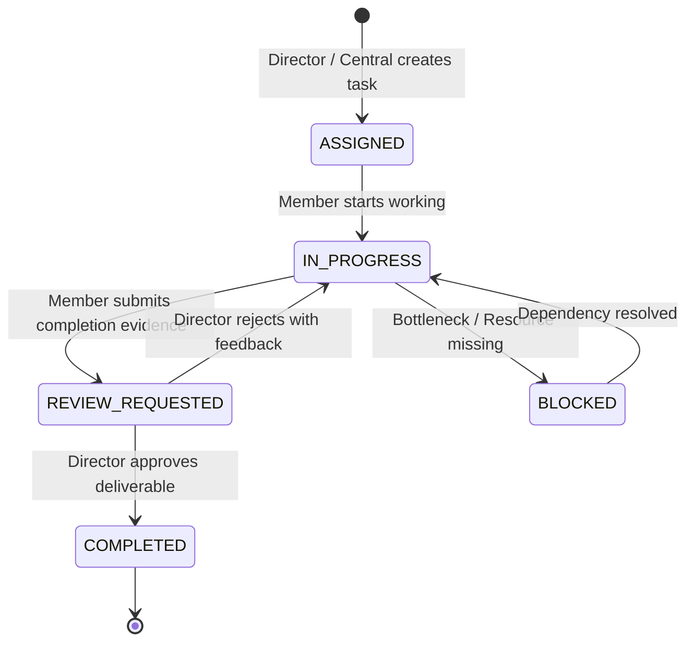

# Task Management Guide & Deliverable Review System
## Sylhet Police Lines High School & College Reunion 2027

---

## 1. Task Lifecycle State Machine
Every operational action item follows a rigorous verification state machine governed by `rmsRules.ts`:

### Transition Authority Rules
- **Member Self-Completion Protection**: Standard committee members cannot mark tasks directly as `COMPLETED`. They must provide deliverable proof (text or file link) and request review.
- **Director Verification Authority**: Only the Committee Director, Convener, Member Secretary, or Super Admin can mark a task `COMPLETED` after inspecting the submitted evidence.
- **Rejection with Mandatory Feedback**: If deliverables fail standards, the Director transitions the task back to `IN_PROGRESS` and records corrective instructions.

---

## 2. Multi-View Task Dashboard
The Task Management module (`RmsTaskBoardModule`) offers three synchronized perspectives:

1. **Kanban Board View**:
   - Visual columns for `ASSIGNED`, `IN_PROGRESS`, `REVIEW_REQUESTED`, `COMPLETED`, and `BLOCKED`.
   - Priority badges (`CRITICAL`, `HIGH`, `MEDIUM`, `LOW`).
   - One-click transition buttons conforming to user role permissions.
2. **Table View**:
   - Searchable by task title, description, or assignee name.
   - Filterable by Committee, Priority, and Status.
   - Displays deadline countdowns and reviewer badges.
3. **Calendar View**:
   - Displays tasks plotted along their start dates and hard completion deadlines leading up to January 28-29, 2027.

---

## 3. Operational Step-by-Step Guide

### 3.1 Creating a New Task
1. Navigate to **Task Management** in the RMS portal.
2. Click **Create New Task**.
3. Select the Committee, enter Task Title, Description, Priority, Start Date, and Deadline.
4. Assign to a specific committee member or leave open for director allocation.
5. Click **Create Task**.

### 3.2 Submitting Deliverable Evidence (For Members)
1. In the task card, click **Submit Completion Evidence**.
2. Detail the completed milestone (e.g. "Vendor contract signed and uploaded to documents repository").
3. Click **Request Director Review**. Task moves to `REVIEW_REQUESTED`.

### 3.3 Reviewing Deliverables (For Directors & Convener)
1. Locate tasks marked `REVIEW_REQUESTED`.
2. Inspect the submitted evidence summary and attachments.
3. Choose **Approve & Mark Completed** or **Reject Deliverable** (stating corrective notes).
4. All actions are stamped into the task history log.

