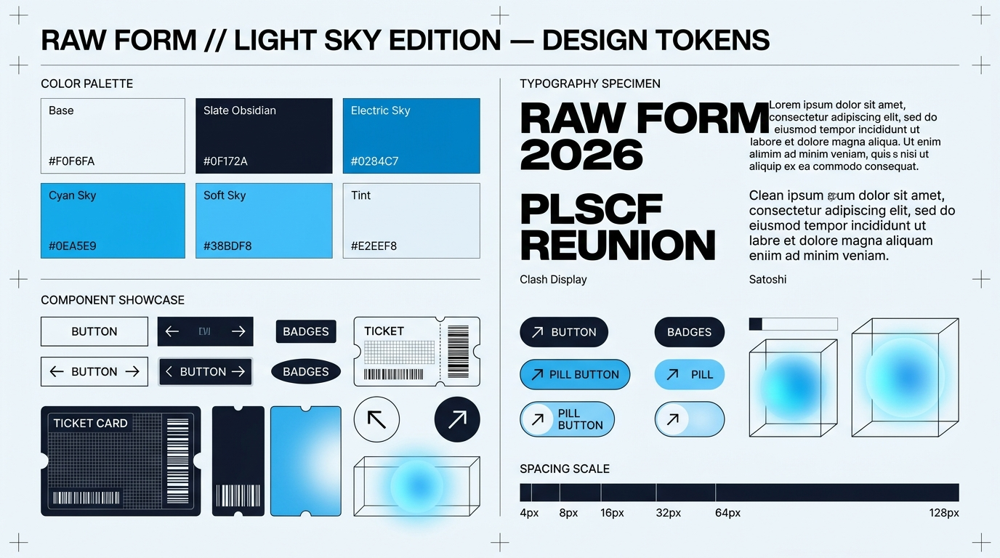

# UI Component & Screen Specifications (UI.md)
## Design System: Raw Form — Light Sky Brutalist Edition
### Framework: Next.js 15 (App Router) + Tailwind CSS v4 + Lucide Icons

---

## 1. Design System Overview & Tokens Board

**Raw Form (Light Sky Edition)** couples the bold geometric weight of Swiss Brutalism with a crisp, airy palette. It eliminates decorative soft containers in favor of razor-sharp type breaks, 0px border-radii, atmospheric multiply blobs, and kinetic hover animations.



---

## 2. Global Styles & Tailwind Configuration

### 2.1. `src/styles/globals.css`
```css
@import "tailwindcss";

@layer base {
  :root {
    --bg-base: #F0F6FA;
    --bg-surface: #E2EEF8;
    --bg-dark: #0F172A;
    --text-primary: #0F172A;
    --text-secondary: #475569;
    --accent-sky: #0284C7;
    --accent-cyan: #0EA5E9;
    --accent-glow: #38BDF8;
  }

  body {
    background-color: var(--bg-base);
    color: var(--text-primary);
    font-family: 'Satoshi', sans-serif;
    overflow-x: hidden;
    selection-background-color: #0284C7;
    selection-color: #FFFFFF;
  }

  /* Custom Light Sky Brutalist Scrollbar */
  ::-webkit-scrollbar {
    width: 8px;
  }
  ::-webkit-scrollbar-track {
    background: #F0F6FA;
  }
  ::-webkit-scrollbar-thumb {
    background: #0284C7;
  }
  ::-webkit-scrollbar-thumb:hover {
    background: #0369A1;
  }

  ::selection {
    background-color: #0284C7;
    color: #FFFFFF;
  }
}

/* Global Slide-Up Entrance */
.animate-brutalist-enter {
  animation: brutalistSlideUp 0.8s cubic-bezier(0.16, 1, 0.3, 1) forwards;
}

@keyframes brutalistSlideUp {
  0% {
    opacity: 0;
    transform: translateY(32px);
  }
  100% {
    opacity: 1;
    transform: translateY(0);
  }
}
```

---

## 3. Atomic Brutalist Component Library

### 3.1. Interactive CTA Button (`BrutalistButton.tsx`)
A high-contrast button featuring a directional white slide-in hover effect and text color transition to `#0284C7`.

```tsx
'use client';

import React from 'react';
import Link from 'next/link';

interface BrutalistButtonProps {
  label: string;
  href?: string;
  onClick?: () => void;
  type?: 'button' | 'submit';
  variant?: 'primary' | 'secondary';
  disabled?: boolean;
}

export const BrutalistButton: React.FC<BrutalistButtonProps> = ({
  label,
  href,
  onClick,
  type = 'button',
  variant = 'primary',
  disabled = false,
}) => {
  const content = (
    <span className="relative group overflow-hidden inline-flex items-center justify-center px-8 py-4 bg-[#0F172A] text-[#F0F6FA] font-satoshi font-bold text-sm uppercase tracking-[0.15em] transition-colors duration-300 disabled:opacity-50">
      <span className="relative z-10 transition-colors duration-300 group-hover:text-[#0284C7]">
        {label}
      </span>
      <div className="absolute inset-0 bg-white transform -translate-x-full transition-transform duration-300 ease-out group-hover:translate-x-0" />
    </span>
  );

  if (href) {
    return <Link href={href}>{content}</Link>;
  }

  return (
    <button type={type} onClick={onClick} disabled={disabled}>
      {content}
    </button>
  );
};
```

---

### 3.2. Animated Gradient Blob (`AnimatedGradientBlob.tsx`)
Soft organic shapes that drift subtly behind typography to produce atmospheric depth.

```tsx
import React from 'react';

interface AnimatedGradientBlobProps {
  color?: string;
  size?: string;
  top?: string;
  left?: string;
  duration?: string;
}

export const AnimatedGradientBlob: React.FC<AnimatedGradientBlobProps> = ({
  color = '#0EA5E9',
  size = '60vw',
  top = '10%',
  left = '20%',
  duration = '14s',
}) => {
  return (
    <div
      className="absolute pointer-events-none rounded-full filter blur-[140px] mix-blend-multiply animate-pulse"
      style={{
        width: size,
        height: size,
        backgroundColor: color,
        top,
        left,
        opacity: 0.65,
        animationDuration: duration,
      }}
    />
  );
};
```

---

### 3.3. Full-Width Category Divider (`CategoryDivider.tsx`)
Commanding full-width typographic section breaks with faint radial gradients.

```tsx
import React from 'react';

interface CategoryDividerProps {
  title: string;
  align?: 'left' | 'right';
}

export const CategoryDivider: React.FC<CategoryDividerProps> = ({
  title,
  align = 'left',
}) => {
  return (
    <section className="relative w-full py-32 overflow-hidden border-y border-[#0F172A]/10 bg-radial-gradient">
      <div className="absolute inset-0 bg-[radial-gradient(circle_at_center,_var(--tw-gradient-stops))] from-[#38BDF8]/20 via-transparent to-transparent pointer-events-none" />
      <div className="max-w-[1600px] mx-auto px-6">
        <h2
          className={`font-clash font-bold text-[12vw] uppercase tracking-[-0.05em] leading-[0.8] text-[#0F172A]/90 select-none ${
            align === 'right' ? 'text-right' : 'text-left'
          }`}
        >
          {title}
        </h2>
      </div>
    </section>
  );
};
```

---

### 3.4. Borderless 3/4 Card Grid (`ProductGrid.tsx`)
Editorial presentation for ticket tiers, merchandise, and event passes.

```tsx
import React from 'react';
import Image from 'next/image';
import { ArrowUpRight } from 'lucide-react';

interface GridItem {
  id: string;
  title: string;
  subtitle: string;
  price: string;
  imageUrl: string;
  tag: string;
}

export const BorderlessGrid: React.FC<{ items: GridItem[] }> = ({ items }) => {
  return (
    <div className="grid grid-cols-1 md:grid-cols-2 lg:grid-cols-3 gap-x-4 gap-y-16 max-w-[1600px] mx-auto px-6 py-16">
      {items.map((item) => (
        <div key={item.id} className="group cursor-pointer">
          <div className="relative aspect-[3/4] overflow-hidden bg-[#E2EEF8]">
            <Image
              src={item.imageUrl}
              alt={item.title}
              fill
              className="object-cover transition-transform duration-700 ease-[cubic-bezier(0.16,1,0.3,1)] group-hover:scale-105"
            />
            <div className="absolute top-4 left-4 bg-[#0F172A] text-[#F0F6FA] px-3 py-1 text-xs font-satoshi font-bold tracking-[0.15em] uppercase">
              {item.tag}
            </div>
          </div>
          <div className="pt-4 flex justify-between items-baseline border-b border-[#0F172A]/15 pb-2">
            <div>
              <h3 className="font-satoshi font-bold text-sm tracking-[0.15em] uppercase text-[#0F172A] transition-colors duration-300 group-hover:text-[#0284C7]">
                {item.title}
              </h3>
              <p className="font-satoshi text-xs text-[#475569]">{item.subtitle}</p>
            </div>
            <span className="font-satoshi font-bold text-base text-[#0F172A]">
              {item.price}
            </span>
          </div>
        </div>
      ))}
    </div>
  );
};
```

---

## 4. Key Application Screen Specifications

### 4.1. Public Landing Page (`/`)
- **Hero Section**:
  - Full viewport height (`100vh`).
  - Animated ambient blobs (`#0EA5E9` and `#38BDF8`) floating softly.
  - Headline: `'PLSCF REUNION'` at `18vw` uppercase, line-height `0.75`.
  - Indented line: `'2026'` indented `15vw`.
  - Subtext: *"Celebrating 64 Years of Academic Excellence, Comradeship, and Heritage at Police Lines School & College, Faridpur."* (Max-width 420px).
  - CTA Cluster: Primary Brutalist Button (`"REGISTER NOW"`) + Secondary `#0284C7` Text Link (`"VIEW TICKET PASS →"`).
- **Campaign Block**:
  - Background: Soft Sky Tint `#E2EEF8`.
  - Left 8 cols: `'SIXTY-FOUR YEARS OF BROTHERHOOD'` in *Clash Display* at `6vw`.
  - Right 4 cols: Vertical stack featuring thin dividers, event schedule summary, and circular arrow-up-right links.

---

### 4.2. Multi-Step Registration Screen (`/register`)
- **Step 1: Category Selection**: High-contrast tiles for Alumni, Current Student, and Teacher/VIP.
- **Step 2: Attendee Credentials**: English and Bangla name inputs, validated 11-digit Bangladeshi mobile, batch passing year picker (1962–2025).
- **Step 3: Merchandise & Portrait**:
  - Size selector with visual badge pills (`S` through `Oversize 50`).
  - Direct photo cropper with circular face mask preview and immediate Supabase Storage upload.
- **Step 4: Invoice Summary & PayStation Checkout**:
  - Breakdown table with Base Fee, Guest Surcharges, and Optional Donation.
  - Direct redirect button executing `/api/checkout/initiate`.

---

### 4.3. Digital Ticket Pass Screen (`/ticket/[id]`)
- **Editorial Boarding-Pass Layout**:
  - Top: School Seal & "POLICE LINES SCHOOL & COLLEGE FARIDPUR — OFFICIAL REUNION PASS".
  - Left Column: High-density QR code encoding `qr_token` with anti-tamper watermark.
  - Center Column: Attendee Photo (1:1), Full Name (English & Bangla), Category, Batch Name, and Registered T-Shirt Size.
  - Right Column: Assigned Entry Gate (e.g. `GATE-01 NORTH`), Verification Status (`PAID & VERIFIED`), and issued timestamp.
  - Actions: Clean print button (triggering `@media print` CSS layout) and "Save Pass as PDF" button.

---

### 4.4. On-Site Operations Scanner Screen (`/scanner/*`)
- **Fullscreen Viewport**: Optimized for handheld smartphones with continuous auto-focus camera stream.
- **Header**: Active Module Badge (`GATE 01`, `BREAKFAST COUNTER`, or `DRESS DESK`) + Realtime Connection Indicator (Green dot = Synced).
- **Instant Result Overlay**:
  - **Success (Green #059669)**: Attendee portrait photo, Name, Batch, and Entitlement status + Audio success ping.
  - **Duplicate Alert (Rose #E11D48)**: Warning message detailing prior check-in timestamp and staff ID + Error buzzer.
  - **Offline Alert (Amber #D97706)**: Notification indicating item queued in IndexedDB for automatic background flush.

---

## 5. Responsive Design & Accessibility Matrix

| Viewport | Container Max Width | Horizontal Padding | Column Count | Typographic Adjustments |
|---|---|---|---|---|
| **Mobile (< 640px)** | `100%` | `16px` | 1 Column | Hero: `14vw`, Indent: `8vw`, Nav: `mix-blend-difference` |
| **Tablet (640–1024px)** | `768px` | `24px` | 2 Columns | Hero: `16vw`, Indent: `12vw`, Buttons: Standard |
| **Desktop (> 1024px)** | `1600px` | `32px` | 3 / 12 Columns | Hero: `18vw`, Indent: `15vw`, Full interactive hover states |

### Accessibility (a11y) Standards
- **Color Contrast**: Contrast ratio between deep slate `#0F172A` and light sky `#F0F6FA` exceeds `14:1`, surpassing WCAG 2.1 AAA requirements.
- **Reduced Motion**: Full support for `prefers-reduced-motion: reduce`, disabling ambient blob translations and instant-sliding button fills.
- **Screen Readers**: Explicit `aria-live="polite"` regions for scanner feedback and dynamic ticket status updates.

