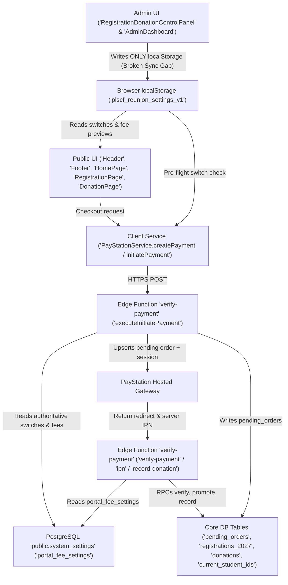

# 01 — System Overview: Registration & Donation Governance Control

**Audit Classification:** Verified implementation (source code, Edge Functions, SQL migrations, and live PostgreSQL schema inspected read-only)  
**Target System:** Police Lines School & College Reunion (`PLSCF-2027`, 65 Years Celebration) — Super Admin Governance & Public/Admin Registration + Donation Architecture  
**Critical Architectural Finding:** The system currently operates in a **split-brain configuration** between the frontend governance UI (`localStorage`) and backend/payment enforcement (`public.system_settings.portal_fee_settings`).

---

## 1. Executive Summary

The Registration & Donation Governance Control system regulates **who can register**, **which registration categories are open**, **what fees and gateway charges apply**, **whether online donations are accepted**, and **what advisory notices are displayed** across the reunion web application.

However, deep full-stack tracing proves that governance spans **two disconnected persistence stores**:

1. **Frontend Client Store (`localStorage`):**
   - Managed by `RegistrationDonationControlPanel` (`src/components/admin/RegistrationDonationControlPanel.tsx`) and the duplicate legacy form in `AdminDashboard` (`src/components/AdminDashboard.tsx:930-956, 3389-3744`), backed by `AppStore.saveFeeSettings()` / `AppStore.getFeeSettings()` (`src/services/store.ts:725-760`).
   - Controls all public React navigation, closed banners, category cards, donation UI visibility, and client-side fee previews.
   - **Never persists to Supabase.** Changes made by a Super Admin only update that admin's own browser `localStorage` and emit a local DOM `CustomEvent('plscf_fee_settings_updated')` inside the same browser tab.

2. **Server Authoritative Store (`public.system_settings` row `key = 'portal_fee_settings'`):**
   - Read by the `verify-payment` Supabase Edge Function (`supabase/functions/verify-payment/index.ts`, `initiationHandler.ts`, `feeValidation.ts`) and PostgreSQL RPC `public.rpc_compute_expected_order_amount`.
   - Enforces `paymentEnabled`, `registrationOpen`, `alumniRegistrationOpen`, `currentStudentRegistrationOpen`, `donationOpen`, fees, donation bounds, and the flat `1.8%` gateway charge (`0.018`) during checkout initiation and payment finalization.
   - Has **no write integration** anywhere in the frontend (`src/`). Only SQL migrations and database admins write to `portal_fee_settings`.

In contrast, the companion **International Payment CMS** (`InternationalPaymentService` in `src/services/internationalPaymentService.ts` + `InternationalPaymentManagementTab.tsx`) **does** synchronize cleanly to `public.system_settings` (`key = 'international_payment_info'`), proving the pattern exists in the codebase but was never wired up for `portal_fee_settings`.

---

## 2. High-Level Four-Tier Architecture

---

## 3. Core Subsystems Analyzed

### A. Global Online Registration (`registrationOpen`) — Verified Implementation

- **Definition & Semantics:** Master ON/OFF switch for online registration (`FeeSettings.registrationOpen`, evaluated via `isGlobalRegistrationOpen()` in `src/utils/rules.ts:460-463`).
- **When `Global Registration = ON`:**
  - `Header` (`src/components/Header.tsx:72-74`) and `Footer` (`src/components/Footer.tsx:113-124`) show the **Register** link.
  - `HomePage` shows the **Hero CTA** (`src/components/HomePage.tsx:285`), secondary **Feature CTA** (`L587`), and **Registration Fee & Status Cards** (`L984-1065`) filtered by category switches.
  - `RegistrationPage` allows form rendering (subject to category switches) and checkout initiation.
  - Backend `executeInitiatePayment` (`supabase/functions/verify-payment/initiationHandler.ts:126-130`) passes the global check (`rawSettings.registrationOpen === true`).
- **When `Global Registration = OFF`:**
  - `isGlobalRegistrationOpen()` returns `false`, forcing `isAlumniRegistrationOpen()`, `isCurrentStudentRegistrationOpen()`, and `isCategoryRegistrationOpen()` to return `false` regardless of their individual stored booleans (`src/utils/rules.ts:469-494`).
  - Navigation links in `Header` and `Footer` and Home CTAs disappear; `HomePage` (`L984-995`) and `RegistrationPage` (`L811-820`) render the global closed lock banner using `closedMessageEn` / `closedMessageBn`; `RegistrationPage` (`L634-641, L2116`) blocks submission and removes the submit button; `PayStationService.createPayment` (`src/services/paystation.ts:265-270`) and `savePendingRegistration` (`L730-732`) throw errors.
  - Backend `executeInitiatePayment` (`initiationHandler.ts:126-130`) returns HTTP `403 REGISTRATION_CLOSED` if `rawSettings.registrationOpen !== true`.
- **Effect on Existing / Pending / Manual Records:**
  - **Already registered & paid users:** Completely unaffected (`TicketLookupModal`, `TicketView`, `verify-student-id`, gate/food/dress scanners, and `AdminDashboard` read/manage `registrations_2027` normally).
  - **Pending online applications (`pending_orders`):** If a user already obtained a PayStation `paymentUrl` and pays before checkout expiry, `verify-payment`, `ipn`, and `rpc_promote_pending_order_to_registration` **do NOT re-check `registrationOpen`**, allowing in-flight paid transactions to complete (`supabase/functions/verify-payment/index.ts:406-572`, `supabase/migrations/20270312000000_p0_3_post_18dde48_remediation.sql:480-810`).
  - **Venue / Manual Desk Registrations:** Intentionally **unaffected** (`ManualRegistrationTab.tsx` and `rpc_create_manual_registration` ignore `registrationOpen` so office staff can record offline registrations when online portals close).

### B. Alumni Registration Control (`alumniRegistrationOpen`) — Verified Implementation

- **Switch Dependency:** `isAlumniRegistrationOpen()` (`src/utils/rules.ts:469-472`) evaluates `isGlobalRegistrationOpen(settings) && settings?.alumniRegistrationOpen !== false`.
- **Eligibility & Validation Rules:**
  - Passing year dropdown/options cover alumni batches (`RegistrationPage.tsx:882`: UI text `1962 to 2025`; `rules.ts:194-199` only checks non-empty `passingYear`, no server-side year-range enforcement).
  - Required fields (`validateRegistrationData`, `src/utils/rules.ts:113-233`): `fullName` (>=2 chars), `photoUrl` (mandatory upload <=200 KB to `student-photos`), valid 11-digit Bangladeshi `mobileNumber`, `bloodGroup`, `passingYear`, `tShirtSize`, `termsAccepted`. `email` and `address` (optional/collected in form; `address`, `batchName`, `tShirtSize`, `photoUrl` strictly required by backend `registrationPayload.ts` & `rpc_promote_pending_order_to_registration`).
  - **Accompanying Parent Rule (`RegistrationPage.tsx:347-355`):** Eligible if `gender === 'female'` (note: UI allows optional accompanying guardian for female alumni too; backend does not enforce gender-parent restriction).
- **Fees:**
  - Client `INITIAL_FEE_SETTINGS` & live `portal_fee_settings`: `formerStudentFee = 1500` BDT.
  - **Confirmed Parent Fee Mismatch:** `src/utils/rules.ts:315` hardcodes `parentFee = hasParent ? 1500 : 0`, whereas `public.system_settings.portal_fee_settings` stores `"parentFee": 500`, creating a `1,000` BDT conflict that causes backend `FEE_DECOMPOSITION_MISMATCH` (`400`) when an online registrant selects `hasParent = true`.
  - Uniform gateway charge: `1.8%` (`0.018`) computed on `subtotal` (`registrationFee + parentFee + donationAmount`).
- **Database Records Affected:** `pending_orders` (during checkout) → promoted on payment verification to `registrations_2027`, `payment_transactions`, `financial_ledger`, and `admin_audit_logs`.

### C. Current Student Registration Control (`currentStudentRegistrationOpen`) — Verified Implementation

- **Switch Dependency:** `isCurrentStudentRegistrationOpen()` (`src/utils/rules.ts:478-481`) evaluates `isGlobalRegistrationOpen(settings) && settings?.currentStudentRegistrationOpen !== false`.
- **Student Verification & Eligibility:**
  - Mandatory `studentId` verified against `public.current_student_ids` via `rpc_verify_student_id` (`supabase/migrations/20270311000000_p0_3_pii_fee_validation_hardening.sql:106-156`) before checkout; reserves ID for 15 minutes via `rpc_reserve_student_id` (released via `rpc_release_student_id_reservation`).
  - **Known Reservation Bug:** `rpc_reserve_student_id` checks `verification_status = 'USED'` but misses `'ALREADY_USED'` (`20270310` L306).
  - **Parent Eligibility:** `gender === 'female'` OR `isStudentBelowClass6(effectiveCurrentClass)` (`src/utils/rules.ts:41-66, 353-355`).
- **Fees:** `currentStudentFee = 500` BDT (both client default and live `portal_fee_settings`), plus `parentFee` (`1500` client bug vs `500` server) + optional `donationAmount` + `1.8%` gateway charge.
- **Database Records Affected:** `current_student_ids` (verified/reserved → marked `USED` on `rpc_verify_payment` / `rpc_promote_pending_order_to_registration`), `pending_orders`, `registrations_2027`, `payment_transactions`, `financial_ledger`, `admin_audit_logs`. (Note: manual approval via `rpc_approve_manual_registration` fails silently to mark `current_student_ids` as `USED` due to non-existent column names in `20270309` L607–612).

### D. Donation Portal & Contribution Control (`donationOpen`) — Verified Implementation

- **Independence from Global Registration:** `isDonationOpen()` (`src/utils/rules.ts:500-503`) evaluates `settings.donationOpen !== false` **without** consulting `registrationOpen`. Backend `executeInitiatePayment` (`initiationHandler.ts:148-155`) likewise checks `rawSettings.donationOpen !== true` (`403 DONATION_CLOSED`) completely independently of `registrationOpen`.
- **UI Visibility & Buttons Controlled:**
  - `Header` (`src/components/Header.tsx:75-77`) and `Footer` (`src/components/Footer.tsx:135-146`) Donate link.
  - `HomePage` (`src/components/HomePage.tsx:296`) Hero Donate button.
  - `FinancialTransparencyDashboard` (`src/components/financials/FinancialTransparencyDashboard.tsx:271`) "Contribute / Donate" CTA.
  - `DonationPage` (`src/components/DonationPage.tsx:272-275, 594-606, 824-855`) renders paused notice and disables domestic submit button.
- **Gaps Verified in Donation Flow:**
  1. **Integrated Registration Donation:** `RegistrationPage.tsx:2031-2078` still renders and accepts an optional `donationAmount` even when `donationOpen === false`!
  2. **International Payment CTA:** `DonationPage.tsx:565-590` gates the "International Payment" button only on `intlPaymentInfo.isEnabled`, **not** `isDonationOpen(feeSettings)` (when `DonationPage` is accessed directly or via URL).
  3. **PayStation Return Finalization (`record-donation`):** `verify-payment/index.ts:298-359` validates `PAYSTATION_ALLOW_PAYMENT_FINALIZATION` and `minDonation` (`100`) / `maxDonation` (`50000`) / `maxTotalPayable` (`100000`), **but does NOT check `donationOpen === true` or `paymentEnabled === true`**.
  4. **IPN Donation Promotion Gap:** `rpc_promote_pending_order_to_registration` (`20270312` L623-636) only marks `pending_orders.status = 'paid'` for `order_type = 'donation'` and returns `DONATION_CONFIRMED` — **it does NOT insert into `public.donations` or `public.financial_ledger`** (relying on client return redirect calling `SupabaseService.saveDonation()` → `verify-payment` `action: 'record-donation'` → `rpc_record_donation`).
- **Effect on History & In-Flight Transactions:**
  - Disabling `donationOpen` does **not** alter `public.donations`, `public.donations_2027`, `Donations Hall of Fame`, `FinancialTransparencyDashboard`, or `rpc_get_financial_transparency_summary()`.
  - Already-initiated PayStation donations returning via redirect still call `action: 'record-donation'`, which is **not** blocked by `donationOpen = false`.

---

## 4. Verification Classification Summary

| Domain | Classification | Primary Evidence |
|---|---|---|
| Four governance switches & UI logic | **Verified implementation** | `src/utils/rules.ts`, `RegistrationDonationControlPanel.tsx`, `HomePage.tsx`, `Header.tsx`, `Footer.tsx`, `RegistrationPage.tsx`, `DonationPage.tsx` |
| Backend Edge enforcement (`paymentEnabled`, open flags, fees) | **Verified implementation** | `supabase/functions/verify-payment/initiationHandler.ts`, `feeValidation.ts`, `index.ts` |
| Live PostgreSQL schema, grants, RLS, triggers, live rows | **Verified implementation** | Read-only live introspection of `hnthoszbkhvygoowtvau` (`39` tables, `98` RLS policies, `62` RPCs, `13` triggers) |
| Frontend→Supabase sync for `portal_fee_settings` | **Missing implementation** | `AppStore.saveFeeSettings()` writes `localStorage` only; `AdminDashboard.tsx` & `RegistrationDonationControlPanel.tsx` never call Supabase for `portal_fee_settings` |
| Deadline (`endDate`) & late fee (`lateFeeEnabled`/`lateFeeAmount`) enforcement | **Missing / Unused UI fields** | Declared in `FeeSettings` and edited in `AdminDashboard.tsx`, zero runtime enforcement in frontend, Edge Functions, or SQL |
| `paymentEnabled` Super Admin UI toggle | **Missing implementation** | Enforced in `paystation.ts:247` & `initiationHandler.ts:95`, omitted from `FeeSettings` type & Admin UI |
