# 03 — Complete Control Relationship & Dependency Map

**Audit Classification:** Verified implementation (traced directly across `src/utils/rules.ts`, `RegistrationDonationControlPanel.tsx`, `AdminDashboard.tsx`, `RegistrationPage.tsx`, `DonationPage.tsx`, `PayStationService`, and `supabase/functions/verify-payment/initiationHandler.ts`).

---

## 1. Control Dependency Matrix

| Control A (Parent / Peer) | Control B (Child / Target) | Relationship Type | Effective Rule | Enforcement Layer(s) | Effect if A Disabled (`false`) | Effect if B Disabled (`false`) | Can A & B Conflict / Override? |
|---|---|---|---|---|---|---|---|
| **Global Registration (`registrationOpen`)** | **Alumni Registration (`alumniRegistrationOpen`)** | **Mandatory Parent → Child** | `global && (alumni !== false)` | Frontend (`rules.ts:469-472`) + Edge `initiationHandler.ts:126-137` | **Hard Override:** Forces Alumni **OFF** everywhere even if `alumniRegistrationOpen === true` | Alumni **OFF**; Current Students still unaffected if `global && current` | **Parent overrides child** in effective state (`L470`); UI Panel keeps independent stored boolean intact in state |
| **Global Registration (`registrationOpen`)** | **Current Student Registration (`currentStudentRegistrationOpen`)** | **Mandatory Parent → Child** | `global && (current !== false)` | Frontend (`rules.ts:478-481`) + Edge `initiationHandler.ts:126-147` | **Hard Override:** Forces Current Student **OFF** everywhere even if `currentStudentRegistrationOpen === true` | Current Student **OFF**; Alumni unaffected if `global && alumni` | **Parent overrides child** in effective state (`L479`); UI Panel shows child locked overlay (`L367-370, 444-447`) |
| **Global Registration (`registrationOpen`)** | **Alumni + Current both OFF** | **Inverse Collapse / Dual-Child Lock** | `global && (alumni || current)` needed for any category | `HomePage.tsx:996-1007`, `RegistrationPage.tsx:821-831` | Shows global closed banner | Even with `global === true`, form submission is blocked and closed banner shows (`Registration for All Categories is Currently Paused`) | **Operational conflict:** Nav `Register` link stays visible (`Header.tsx:72`, `HomePage.tsx:285`), leading users to a page with both categories disabled |
| **Global Registration (`registrationOpen`)** | **Donation Portal (`donationOpen`)** | **Strictly Independent** | Evaluated separately (`L460`, `L500`) | Frontend (`rules.ts:496-503`) + Edge `initiationHandler.ts:125-155` | Zero effect on Donation Portal | Zero effect on Registration (standalone `DonationPage`) | **No conflict on standalone `DonationPage`**. **GAP on `RegistrationPage`:** optional `donationInput` (`L2031-2078`) ignores `donationOpen === false` |
| **Donation Portal (`donationOpen`)** | **PayStation Donation Checkout** | **Operational Prerequisite** | Checkout initiation requires `donationOpen` AND `paymentEnabled`; finalization requires `PAYSTATION_ALLOW_PAYMENT_FINALIZATION` | Client `paystation.ts:247, 258` + Edge `initiationHandler.ts:95, 149` + `index.ts:299` | Blocks donation checkout initiation (`403 DONATION_CLOSED`); **does NOT block** post-payment `record-donation` return callback (`index.ts:298-359`) | Gateway Disabled blocks both registration & donation (`403 PAYMENT_DISABLED`) | **Asymmetry:** Disabling `donationOpen` mid-payment still lets paid redirects invoke `record-donation` |
| **Donation Portal (`donationOpen`)** | **International Payment Page (`international_payment_info.isEnabled`)** | **Decoupled / Incomplete Gate** | Separate `system_settings` key | `DonationPage.tsx:565`, `InternationalPaymentPage.tsx` | **No effect:** `InternationalPaymentPage` remains reachable by URL even if `donationOpen === false`! `DonationPage` hides neither based on `donationOpen` | Hides the "International Payment" button on `DonationPage`, domestic form still governed by `donationOpen` | Direct URL `?page=international-payment` bypasses `donationOpen = false` |
| **Global & Category Registration Switches** | **Manual Venue Desk (`ManualRegistrationTab` / `ManualApprovalTab`)** | **Intentional Isolation (Bypass)** | Manual desk operates independently of online switches | `ManualRegistrationTab.tsx` (no `isGlobalRegistrationOpen` check) + `rpc_create_manual_registration` (no check) | **None:** Venue admins can register attendees & collect Cash/bKash/Bank manually when online is closed | **None** | **Warning:** Manual desk approvals sync to `registrations_2027` but omit online `registrationOpen` checks intentionally |
| **Super Admin Auth (`auth.uid()` / `current_admin_role`)** | **Governance Persistence (`AppStore.saveFeeSettings` vs `portal_fee_settings`)** | **DISCONNECTED (Broken Dependency)** | Client reads/writes `localStorage`; Edge reads `portal_fee_settings` | Frontend UI vs `initiationHandler.ts` + SQL RLS `system_settings_admin_write` | RLS blocks non-`super_admin` SQL writes if implemented; currently **no frontend code writes to `system_settings.portal_fee_settings`** | N/A | **CRITICAL CONFLICT:** Toggling in `RegistrationDonationControlPanel` updates admin browser UI ONLY; live server state in DB overrides actual checkout! |
| **`RegistrationDonationControlPanel` state** | **Legacy `AdminDashboard` Fee Form (`handleSaveFeeSettings`)** | **Peer Competition / Stale Cache Conflict** | Both write `localStorage['plscf_reunion_settings_v1']` | `AdminDashboard.tsx:424-565, 930-956` vs `RegistrationDonationControlPanel.tsx:70-127` | Saving ControlPanel updates `registrationOpenInput` (`L3397`) but **not** other legacy inputs (`endDate`, `hideDonationAmounts`, etc.) | Legacy `handleSaveFeeSettings` spreads stale `...feeSettings` React state (`L935`), though reads `...currentLatest` first (`L934`), **and does not write `EventStore.recordAuditHistory`** | **Dual-form hazard** on the same `feeSettings` tab (`L3389-3744`) |
| **Master Online Payment Gate (`paymentEnabled`)** | **All PayStation Checkouts (Registration + Donation)** | **Master Payment Gate** | `portal_fee_settings.paymentEnabled === true` required on server | `paystation.ts:247` + `initiationHandler.ts:95` | Blocks ALL new PayStation checkouts (`403 PAYMENT_DISABLED`) even if `registrationOpen` & `donationOpen` are `true` | N/A | **UI Gap:** No Super Admin toggle exists in React UI to flip `paymentEnabled` |
| **`Current Student Registration` (`current`)** | **Student ID Verification & Reservation (`current_student_ids`)** | **Mandatory Sub-workflow** | `rpc_verify_student_id` → `rpc_reserve_student_id` (15m) → `USED` on promote | `RegistrationPage.tsx`, `studentIdStore.ts`, `initiationHandler.ts`, `rpc_promote_pending_order_to_registration` | Entire student ID verification UI unreachable when `currentStudentRegistrationOpen = false` or `global = false` | Individual inactive/used student ID blocks only that student | **Bug:** `rpc_reserve_student_id` misses `'ALREADY_USED'` check; `rpc_approve_manual_registration` fails silently to update `current_student_ids` |
| **Donation Toggle (`donationOpen`)** | **Financial Transparency Dashboard & Historical Records** | **Read-Only Independence** | Transparency data always queryable | `rpc_get_financial_transparency_summary()`, `FinancialTransparencyDashboard.tsx:271` | Hides `"Contribute / Donate"` CTA button (`L271`) ONLY | N/A | Zero impact on historical `donations` rows or totals |

---

## 2. Effective State Truth Table (Online Checkout & Public Portal)

*(Assuming `localStorage` and DB `portal_fee_settings` were kept in sync; currently server state controls checkout while client `localStorage` controls UI)*

| `paymentEnabled` (DB) | `registrationOpen` | `alumniRegistrationOpen` | `currentStudentRegistrationOpen` | `donationOpen` | Nav `Register` | Alumni Checkout | Current Student Checkout | Nav `Donate` & Standalone Donation | Optional Donation Inside Reg Form (UI Bug) |
|---|---|---|---|---|---|---|---|---|---|
| `false` | `true` | `true` | `true` | `true` | Shown | **Blocked (`403 PAYMENT_DISABLED`)** | **Blocked (`403 PAYMENT_DISABLED`)** | Form shown; Checkout **Blocked (`403 PAYMENT_DISABLED`)** | Blocked at checkout (`403`) |
| `true` | `false` | `true` | `true` | `true` | **Hidden** | **Blocked (UI + `403`)** | **Blocked (UI + `403`)** | **Open & Operational** | Unreachable |
| `true` | `false` | `false` | `false` | `false` | **Hidden** | **Blocked (UI + `403`)** | **Blocked (UI + `403`)** | **Blocked (UI + `403`)** | Unreachable |
| `true` | `true` | `true` | `false` | `true` | Shown | **Open & Operational** | **Blocked (UI + `403`)** | **Open & Operational** | Allowed in UI |
| `true` | `true` | `false` | `true` | `false` | Shown | **Blocked (UI + `403`)** | **Open & Operational** | **Hidden / Blocked on `DonationPage`** | **UI BUG:** Still visible in `RegistrationPage:2032`! Server validates against `minDonation`/`maxTotalPayable` in `feeValidation.ts` (does not check `donationOpen` for `orderType='registration'`) |
| `true` | `true` | `false` | `false` | `true` | **Shown (UI Gap)** | **Blocked (UI + `403`)** | **Blocked (UI + `403`)** | **Open & Operational** | Form submit hidden (`L2116`) |

---

## 3. Complete Dependency Graph (Mermaid)

```mermaid
flowchart TB
  subgraph ServerSecret["Edge Environment Secrets"]
    ALLOW_FIN["PAYSTATION_ALLOW_PAYMENT_FINALIZATION"]
    ORIGINS["APP_ALLOWED_ORIGINS"]
  end

  subgraph DBSettings["PostgreSQL system_settings"]
    PAY_EN["portal_fee_settings.paymentEnabled"]
    DB_GLOBAL["portal_fee_settings.registrationOpen"]
    DB_ALUMNI["portal_fee_settings.alumniRegistrationOpen"]
    DB_CURR["portal_fee_settings.currentStudentRegistrationOpen"]
    DB_DON["portal_fee_settings.donationOpen"]
    DB_FEES["portal_fee_settings fees + limits + 1.8pct rate"]
    DB_INTL["international_payment_info.isEnabled"]
  end

  subgraph LocalSettings["Browser localStorage (DISCONNECTED FROM DB!)"]
    LS_GLOBAL["FeeSettings.registrationOpen"]
    LS_ALUMNI["FeeSettings.alumniRegistrationOpen"]
    LS_CURR["FeeSettings.currentStudentRegistrationOpen"]
    LS_DON["FeeSettings.donationOpen"]
    LS_FEES["formerStudentFee / currentStudentFee"]
    LS_MSG["closedMessage / donationClosedMessage"]
    LS_DEAD["endDate / startDate / lateFee (UNUSED)"]
  end

  LS_GLOBAL -->|"Master override"| LS_ALUMNI
  LS_GLOBAL -->|"Master override"| LS_CURR
  LS_GLOBAL -->|"Shows/hides nav & form"| UI_REG["Public Registration UI"]
  LS_ALUMNI -->|"Enables Alumni card/tab"| UI_REG
  LS_CURR -->|"Enables Current Student card/tab + ID check"| UI_REG
  LS_DON -.->|"Does NOT gate RegPage optional donation"| UI_REG
  LS_DON -->|"Independent gate"| UI_DON["Public Donation UI"]
  DB_INTL -->|"Shows International CTA on DonationPage"| UI_DON

  DB_GLOBAL -->|"Master override (HTTP 403)"| EDGE_INIT["Edge Function: create-payment"]
  DB_ALUMNI -->|"HTTP 403 if false"| EDGE_INIT
  DB_CURR -->|"HTTP 403 if false"| EDGE_INIT
  DB_DON -->|"HTTP 403 if not true"| EDGE_INIT
  PAY_EN -->|"Master payment gate (HTTP 403)"| EDGE_INIT
  ALLOW_FIN -->|"Gates verify-payment / ipn / record-donation"| EDGE_VER["Edge Function: verify / ipn / record-donation"]
  ORIGINS -->|"Server callback URL allowlist"| EDGE_INIT

  DB_FEES -->|"Authoritative calculation"| FEE_VAL["feeValidation.ts & rpc_compute_expected_order_amount"]
  LS_FEES -.->|"MISMATCH HAZARD (parentFee 1500 vs 500)"| UI_REG
  FEE_VAL --> EDGE_INIT
  FEE_VAL --> EDGE_VER
```

