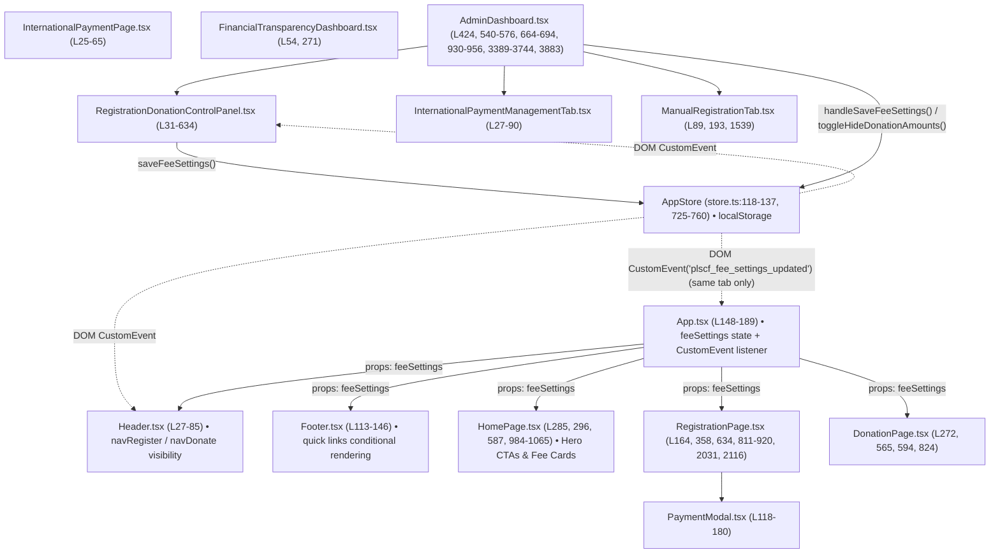

# 05 — Frontend Architecture

**Audit Classification:** Verified implementation (every component path, hook, handler, and line number inspected directly in `src/`).

---

## 1. Component Hierarchy & Governance Prop/Event Flow

---

## 2. Primary Admin Governance Dashboard & Subcomponents

### 2.1 `AdminDashboard.tsx` (`src/components/AdminDashboard.tsx`)

- **Tab Routing & Type Definition (`AdminTab`, `L324-355`):**
  - Renders `RegistrationDonationControlPanel` when `activeTab === 'feeSettings' || activeTab === 'registrationControl'` (`L3389`).
  - **Sidebar Navigation Entry:** Only `feeSettings` (`"Registration, Donation & Settings"`, badge `"Controls"`, `L1656-1663`) appears in the sidebar; `registrationControl` is reachable via URL deep-link `?tab=registrationControl` or `sessionStorage['plscf_admin_active_tab']`.
  - **Ghost Tabs Declared Without Renderers:** `'securityAudit'` (`L339`) and `'registrations'` (`L341`) are defined in `AdminTab` and included in `PORTAL_ROLE_CONFIGS.super_admin.allowedTabs`, yet have **no matching JSX tab view** inside `AdminDashboard`.
- **State Initialization (`L424-565`):**
  - `feeSettings` initialized from `AppStore.getFeeSettings()` (`L424-426`).
  - Individual legacy form input states initialized from `feeSettings`: `formerFeeInput` (`L540`), `currentFeeInput` (`L541`), `registrationOpenInput` (`L542`), `closedMessageEnInput` (`L544`), `closedMessageBnInput` (`L548`), `eventTargetDateInput` (`L552`), `simulateEventCompletedInput` (`L555`), `homePageSectionsInput` (`L558`), `endDateInput` (`L560`), `hideDonationAmountsInput` (`L561-562`).
- **Dual Forms Inside Same Tab (`L3389-3744`):**
  - Top card (`L3392-3399`): `<RegistrationDonationControlPanel />` with `onSettingsChanged` callback (`L3395-3398`) updating `setFeeSettings(updated)` and `setRegistrationOpenInput(updated.registrationOpen)` — **not** `closedMessageEnInput` or `closedMessageBnInput`.
  - Middle card (`L3402-3405`): `<MealTimeScannerControlPanel />`.
  - Bottom card (`L3407-3744`): Legacy `<form onSubmit={handleSaveFeeSettings}>` containing duplicate Global Open/Closed toggle (`L3445-3465`), English/Bengali closed notices (`L3493-3513`), `formerStudentFee` (`L3522`), `currentStudentFee` (`L3535`), Event Date & Deadline (`L3563-3588`), Post-Event Simulation (`L3609-3619`), and Homepage Section Order/Visibility (`L3623-3680`).
- **State Sync & Save Bugs in `AdminDashboard`:**
  1. `AdminDashboard` does **not** subscribe to `window.addEventListener('plscf_fee_settings_updated', ...)`.
  2. `syncLocalState()` (`L664-694`) forgets to reset `hideDonationAmountsInput`, so running `refreshAll()` leaves `hideDonationAmountsInput` potentially stale before the next `handleSaveFeeSettings()` call (`L950`).
  3. `handleSaveFeeSettings()` (`L930-956`) merges `{ ...currentLatest, ...feeSettings, ...inputs }` — meaning stale `feeSettings` fields in memory could override recently saved `currentLatest` fields other than the explicitly listed keys (`L938-950`), and **omits** calling `EventStore.recordAuditHistory()`.
  4. `handleToggleHideDonationAmounts()` (`L568-576`) exists separately in the `donations` tab (`L3883-3906`) for `isSuperAdminAccount` only.

### 2.2 `RegistrationDonationControlPanel.tsx` (`src/components/admin/RegistrationDonationControlPanel.tsx`)

- **Props (`L25-29`):** `language?: Language`, `adminName?: string`, `onSettingsChanged?: (updated: FeeSettings) => void`.
- **State Hooks (`L36-67`):** `settings`, `globalOpen`, `alumniOpen`, `currentOpen`, `donationOpen`, `closedNoticeEn`, `closedNoticeBn`, `donationNoticeEn`, `donationNoticeBn`, `isSaving`, `successNotice`.
- **Cross-Component Sync (`L70-83`):** Subscribes to `window` `'plscf_fee_settings_updated'` event to stay synchronized when the legacy form in `AdminDashboard` saves `registrationOpen`.
- **Submit Pipeline (`handleSave`, `L85-127`):**
  1. Prevents default submit; sets `isSaving = true`.
  2. Constructs `updated: FeeSettings` spreading existing `...settings` and overwriting the 4 toggles (`L91-94`) + 4 closed messages (`L95-98`).
  3. Calls `AppStore.saveFeeSettings(updated)` (`L101` → `localStorage` write + `CustomEvent` dispatch).
  4. Updates local state (`L102`) and notifies parent (`onSettingsChanged?.(updated)`, `L103`).
  5. Records local/best-effort audit history via `EventStore.recordAuditHistory` (`L107-121`) with `adminId: 'SUPER_ADMIN_MASTER'`, `entityType: 'REGISTRATION'`, `entityId: 'REGISTRATION_DONATION_GOVERNANCE'`, `action: 'UPDATE_SETTINGS'`.
  6. Displays `successNotice` (`L125-126`) for `3500ms`.
- **UI Sections:**
  - Header & Live Policy Badge (`L139-195`): Displays 5 possible live states (`Global Reg Closed`, `All Categories Active`, `Alumni Only`, `Current Students Only`, `Both Categories Closed`).
  - Section 1 (`L210+`): Master Global Registration Toggle.
  - Section 2 (`L367+` area): Category-specific Alumni & Current Student Toggles (with visual lock overlay when `globalOpen === false`).
  - Section 3: Independent Donation Portal Toggle.
  - Section 4 (`L540-601`): Bilingual Registration Closed Notice (`BN`/`EN`) & Donation Closed Notice (`BN`/`EN`).
  - Footer Submit (`L603-630`): Claim text `"All changes take immediate effect site-wide and persist to database"` (**MISLEADING UI COPY** — changes do NOT persist to Supabase database!).

### 2.3 `InternationalPaymentManagementTab.tsx` (`src/components/admin/InternationalPaymentManagementTab.tsx`)

- **Contrast with `RegistrationDonationControlPanel`:** Fetches on mount via `InternationalPaymentService.fetchFromSupabase()` (`L40-61`) and saves via `InternationalPaymentService.saveToSupabase(form, adminName)` (`L70-90`) which genuinely persists to Supabase `public.system_settings` (`key = 'international_payment_info'`), updates `localStorage`, and notifies subscribers.

---

## 3. Public Frontend Enforcement Inventory (Exact Files & Line Numbers)

| Component / File | Lines | Control(s) Checked | Runtime Behavior |
|---|---|---|---|
| `src/App.tsx` | `L148-157, 188` | All (`feeSettings` state) | Initializes from `AppStore.getFeeSettings()`, refreshes on `'plscf_fee_settings_updated'` event & view navigation (`L188`). Passes `feeSettings` down as props |
| `src/components/Header.tsx` | `L35-53, 70-82` | `isGlobalRegistrationOpen`, `isDonationOpen` | Conditionally adds `'register'` and `'donate'` items to desktop & mobile nav menus. Listens for `'plscf_fee_settings_updated'` (`L45-53`) |
| `src/components/Footer.tsx` | `L113-146` | `isGlobalRegistrationOpen`, `isDonationOpen` | Conditionally renders Quick Links for Register (`L113`) and Donate (`L135`) using passed `feeSettings` prop |
| `src/components/HomePage.tsx` | `L285, 296, 587` | `isGlobalRegistrationOpen`, `isDonationOpen` | Hero Register CTA (`L285`), Hero Donate CTA (`L296`), mid-page Feature CTA (`L587`) |
| `src/components/HomePage.tsx` | `L984-1065+` | `isGlobalRegistrationOpen`, `isAlumniRegistrationOpen`, `isCurrentStudentRegistrationOpen` | Renders global closed card (`L984-995`), all-categories paused card (`L996-1007`), or individual Alumni (`L1015`) / Current Student (`L1065`) registration fee cards |
| `src/components/RegistrationPage.tsx` | `L164-169` | `isAlumniRegistrationOpen`, `isCurrentStudentRegistrationOpen` | Auto-switches initial `category` selection if default category is closed and the other category is open |
| `src/components/RegistrationPage.tsx` | `L358-360` | `calculateTotalFee`, `calculateGatewayCharge` | Computes fees using `feeSettings.formerStudentFee` / `currentStudentFee`, **hardcoded `parentFee: 1500` (`rules.ts:315`)**, `donationInput`, and `1.8%` charge |
| `src/components/RegistrationPage.tsx` | `L634-649` | `isGlobalRegistrationOpen`, `isCategoryRegistrationOpen` | Blocks `handleSubmit` if global or selected category closed, displaying `getRegistrationClosedMessage` |
| `src/components/RegistrationPage.tsx` | `L811-925` | `isGlobalRegistrationOpen`, `alumni`, `current` | Shows lock banners (`L811-831`) and disables Alumni (`L842-884`) or Current Student (`L887-925`) category selector buttons |
| `src/components/RegistrationPage.tsx` | `L2031-2078` | Optional Donation inside Registration | **BUG:** Unconditional! Does **not** check `isDonationOpen(feeSettings)` before rendering optional donation presets/input |
| `src/components/RegistrationPage.tsx` | `L2116` | `isGlobalRegistrationOpen && isCategoryRegistrationOpen` | Hides final Submit button if closed |
| `src/components/DonationPage.tsx` | `L272-275` | `isDonationOpen` | Blocks `handleInitiateDonation` if false (`setErrorMessage(getDonationClosedMessage(...))`) |
| `src/components/DonationPage.tsx` | `L565-590` | `intlPaymentInfo.isEnabled` | Shows **International Payment** button at top of form (**does not check `isDonationOpen`**) |
| `src/components/DonationPage.tsx` | `L594-606, 824-855` | `isDonationOpen` | Displays amber pause banner (`L594-606`) and replaces PayStation submit button with disabled locked button (`L824-833`) |
| `src/components/InternationalPaymentPage.tsx` | `L25-65` | `InternationalPaymentService` | Fetches `international_payment_info` from Supabase on mount; **not gated by `donationOpen`** |
| `src/components/financials/FinancialTransparencyDashboard.tsx` | `L54, 271` | `isDonationOpen` | Conditionally renders `"Contribute / Donate"` CTA button (`L271`) |
| `src/components/admin/manual/ManualRegistrationTab.tsx` | `L89, 193, 357, 1539` | `AppStore.getFeeSettings()` | Intentionally ignores online open/closed toggles. Reads `feeSettings` via `useMemo(..., [])` once on mount (**never syncs on updates**) and displays hardcoded `+৳1,500` Parent fee label (`L1539, L1556`) |
| `src/components/PaymentModal.tsx` | `L129-145` | `AppStore.getFeeSettings()` | On gateway return, backs out `1.018` gateway factor (`L136`) and uses `(registrationData.parentFee ?? 500)` (`L134`) + `effectiveBaseFee` from `feeSettings` to recover net `donationAmount` |

---

## 4. End-to-End Trace: Clicking Save in Super Admin Panel

1. Super Admin toggles **Current Student Registration = OFF** inside `RegistrationDonationControlPanel.tsx` and clicks **Save Governance Controls** (`L614`).
2. `handleSave()` (`L85-127`) builds `updated: FeeSettings` (`currentStudentRegistrationOpen: false`).
3. `AppStore.saveFeeSettings(updated)` (`src/services/store.ts:748-760`) writes JSON to `localStorage.setItem('plscf_reunion_settings_v1', ...)` and dispatches `window.dispatchEvent(new CustomEvent('plscf_fee_settings_updated', { detail: normalized }))`.
4. Within the **same browser tab**, `App.tsx`, `Header.tsx`, and `RegistrationDonationControlPanel.tsx` receive the `CustomEvent` and update state immediately. `AdminDashboard.tsx` receives `onSettingsChanged` (`L3395`) and updates `feeSettings` + `registrationOpenInput`.
5. **STOP POINT (Split-Brain Gap):** Nothing posts `updated` to Supabase `public.system_settings`.
6. Consequence: All other visitors' browsers continue reading `INITIAL_FEE_SETTINGS` (or their stale local cache), and `verify-payment` Edge Function continues validating against `public.system_settings.portal_fee_settings` (`currentStudentRegistrationOpen: true`) in PostgreSQL!
