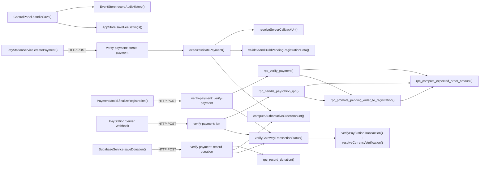

# 06 — Backend & Service Architecture

**Audit Classification:** Verified implementation (traced directly across `src/services/*.ts`, `supabase/functions/*`, and `supabase/migrations/*.sql`).  
**Security Note:** Zero secret values, tokens, passwords, or keys are exposed; only server environment variable identifiers are documented.

---

## 1. Frontend Service Layer Inventory (`src/services/`)

### 1.1 `AppStore` (`src/services/store.ts`)
- `INITIAL_FEE_SETTINGS` (`L118-137`): Default client `FeeSettings` (`formerStudentFee: 1500`, `currentStudentFee: 500`, `registrationOpen: true`, `alumniRegistrationOpen: true`, `currentStudentRegistrationOpen: true`, `donationOpen: true`, `startDate: '2026-01-01'`, `endDate: '2027-01-20'`, `lateFeeEnabled: false`, `lateFeeAmount: 300`, default EN/BN closed messages, `eventTargetDate: '2027-01-29T09:00:00'`, `simulateEventCompleted: false`, `hideDonationAmounts: false`, `homePageSections`). **Notice:** `paymentEnabled` and `parentFee` are absent from `INITIAL_FEE_SETTINGS` and `FeeSettings` (`src/types/index.ts:236-255`).
- `getFeeSettings()` (`L725-735`): Reads `localStorage['plscf_reunion_settings_v1']` (via `getStored`), defaulting `registrationOpen`, `alumniRegistrationOpen`, `currentStudentRegistrationOpen`, `donationOpen` to booleans, and reconciling `homePageSections`. **Never reads Supabase `system_settings`.**
- `saveFeeSettings(settings)` (`L748-760`): Normalizes booleans and writes to `localStorage['plscf_reunion_settings_v1']`, then emits `window.dispatchEvent(new CustomEvent('plscf_fee_settings_updated', { detail: normalized }))`. **Never writes to Supabase `system_settings`.**
- `getActiveEventYear()` (`L737-746`): Parses `eventTargetDate` year or defaults to `2027`.

### 1.2 `PayStationService` (`src/services/paystation.ts`)
- `createPayment(order, _grantToken)` (`L235-315+`):
  - Reads `AppStore.getFeeSettings()`. Checks `(settings as any)?.paymentEnabled === false` (`L247`), `isDonationOpen(settings)` (`L258`), `isGlobalRegistrationOpen(settings)` (`L265`), `isAlumniRegistrationOpen(settings)` (`L273`), and `isCurrentStudentRegistrationOpen(settings)` (`L279`).
  - Calls `supabase.functions.invoke('verify-payment', { body: { action: 'create-payment', order } })` (`L292-294`).
  - Note: Client fallback code lines explicitly comment (`L473-474, L1148`) that post-P0-3 browser `anon` RPC calls (`rpc_promote_pending_order_to_registration`, `rpc_handle_paystation_ipn`, `rpc_reconcile_pending_orders`) are blocked by PostgreSQL `REVOKE` (`42501`).
- `savePendingRegistration(formData, fees, invoiceNumber, existingRegId)` (`L725-775+`): Client-side draft construction gated by `isGlobalRegistrationOpen` and `isCategoryRegistrationOpen`.
- `completeRegistrationAfterPayment(formData, payment)` (`L875+`): Recovers `baseFee` (`currentStudentFee` vs `formerStudentFee`), `parentFee` (`formData.parentFee ?? pendingSession?.fees?.parentFee ?? 500`), uploads photos to `student-photos` bucket (`StudentPhotoStorageService.uploadStudentPhoto`) if base64, and completes verification via Edge Function `verify-payment`.
- `completeDonationAfterPayment(data, payment)` (`L1080-1120+`): Rejects if `!isDonationOpen(settings)` (`L1089-1091`), generates `DON-${year}-...` and 6-char `token`, then calls `SupabaseService.saveDonation()`.

### 1.3 `SupabaseService` (`src/services/supabase.ts`)
- `saveDonation(donation, year)` (`L1062-1146`):
  - **Primary (`L1074-1108`):** Invokes Edge Function `verify-payment` with `action: 'record-donation'`.
  - **Authenticated Admin Fallback (`L1110-1142`):** Only runs if `supabase.auth.getSession()` has an authenticated user — calls `supabase.rpc('rpc_record_donation', ...)` (**Note:** `20270310` revoked `rpc_record_donation` from `authenticated` too and granted it to `service_role` only, so this fallback also fails unless called with `service_role`, leaving Edge Function `verify-payment` as the sole working path!). Never writes anonymously (`L1113-1118`).
- `loginAdmin(...)` (`L1945-1989`): Authenticates via Supabase Auth, verifies portal role via RPC (`rpc_authenticate_portal_role`), caches session in `localStorage['plscf_test_admin_session']`, and **always calls `this.recordAuditLog(...)` (`L1971`)**, signing out (`await supabase.auth.signOut()`, `L1981`) if audit fails!
- `recordAuditLog(...)` (`L2153+`): Invokes Edge Function `admin-audit`. Because `admin-audit/index.ts:77` strictly rejects any `admin.role !== 'super_admin'`, logging in through non-super-admin admin portals (`admin`, `finance_manager`, `registration_officer`, etc.) triggers audit `403` and forced sign-out (`L1981`)!
- `verifyRegistrationQr(...)` / `secureTicketLookup(...)` (`L1274`, `L1497`, `L1686`): Delegates public lookups to Edge Functions `secure-ticket-lookup` and `verify-student-id`.

### 1.4 `InternationalPaymentService` (`src/services/internationalPaymentService.ts`)
- Stores key `'international_payment_info'` in `public.system_settings` and caches to `localStorage['plscf_international_payment_info_v1']`.
- `fetchFromSupabase()` reads `system_settings`; `saveToSupabase(form, adminName)` performs PostgREST `upsert` (requiring Super Admin RLS) and broadcasts via internal listener set + `EVENT_INTERNATIONAL_PAYMENT_UPDATED`.

### 1.5 `StudentIdService` (`src/services/studentIdStore.ts`) & `ManualRegistrationService` (`src/services/manualRegistrationService.ts`)
- `StudentIdService`: Calls `rpc_verify_student_id` (`L654`) and `rpc_reserve_student_id` (`L734`) for public `anon` verification/15-min reservation (direct table `SELECT` on `current_student_ids` is revoked from `anon`, `L549`). Admin CRUD in `StudentIdManagementTab` uses `authenticated` RLS.
- `ManualRegistrationService.createManualRegistration` (`L277-345+`): Validates mobile/method/duplicates locally and calls `supabase.rpc('rpc_create_manual_registration', ...)`. Intentionally **does not check** `registrationOpen` switches.

---

## 2. Supabase Edge Functions (`supabase/functions/`)

### 2.1 `verify-payment` (`supabase/functions/verify-payment/index.ts`)
- **Required Env Vars:** `PAYSTATION_MERCHANT_ID`, `PAYSTATION_PASSWORD`, `PAYMENT_SIGNING_SECRET`, `SUPABASE_URL`, `SUPABASE_SERVICE_ROLE_KEY`, `PAYSTATION_ENV` (`sandbox` default vs `production`), `PAYSTATION_ALLOW_PAYMENT_FINALIZATION` (`'true'` required), `PAYSTATION_ALLOW_ORDER_BOUND_CURRENCY_ATTESTATION`, `APP_ALLOWED_ORIGINS`.
- **CORS (`L81-93`):** Strict allowlist parsed via `parseAllowlistedOrigins` (`callbackUrl.ts:21-45`); never emits wildcard `*`.

| Action | Trigger | Security & Governance Checks | External Calls | Database Operations & RPCs |
|---|---|---|---|---|
| `create-payment` / `initiate-payment` (`L246-292`, `initiationHandler.ts:75-351`) | Client `PayStationService.createPayment` | 1. Reads `system_settings.portal_fee_settings` (`L256`) 2. Requires `paymentEnabled === true` (`403 PAYMENT_DISABLED`) 3. Runs `computeAuthoritativeOrderAmount` (`feeValidation.ts`) 4. Registration requires `registrationOpen === true`, `alumni !== false`, `current !== false` 5. Donation requires `donationOpen === true` 6. Validates callback origin (`callbackUrl.ts`) & complete payload (`registrationPayload.ts`) | `POST /v2/create-payment` on PayStation | `SELECT system_settings`; `UPSERT pending_orders` (before calling PayStation!) |
| `record-donation` (`L298-359`) | Client return from PayStation via `SupabaseService.saveDonation` | 1. Requires `PAYSTATION_ALLOW_PAYMENT_FINALIZATION === 'true'` (`403`) 2. Calls `verifyGatewayTransactionStatus` (server-to-server v2/v1 PayStation check + BDT currency check) 3. Evaluates `computeAuthoritativeOrderAmount` (`100 <= amount <= 50000`) **GAP:** Does NOT re-check `paymentEnabled` or `donationOpen`! | `verifyPayStationTransaction` (`statusClient.ts`) | `SELECT pending_orders` (`loadPendingOrderBinding`), `SELECT system_settings`, `RPC rpc_record_donation` (`service_role`) |
| `ipn` (`L406-478`) | Direct PayStation webhook POST | 1. Checks `PAYSTATION_ALLOW_PAYMENT_FINALIZATION === 'true'` (acknowledges `200 finalization_disabled` if false) 2. Rejects non-BDT currency 3. Verifies gateway status server-to-server (`verifyGatewayTransactionStatus`) 4. Verifies `abs(trx_amount - gwCheck.amount) <= 0.01` | `verifyPayStationTransaction` (`statusClient.ts`) | `SELECT pending_orders`, `RPC rpc_handle_paystation_ipn` (`service_role`) |
| `verify-payment` (`L481-571`) | Client return redirect (`PaymentModal`) | 1. Checks `PAYSTATION_ALLOW_PAYMENT_FINALIZATION === 'true'` (`403`) 2. Requires `trx_id` & (`registration_id` or `invoice_number`) 3. Server-to-server gateway verification (`verifyGatewayTransactionStatus`) 4. Generates HMAC-SHA256 `serverSignature` using `PAYMENT_SIGNING_SECRET` | `verifyPayStationTransaction` (`statusClient.ts`) | `SELECT pending_orders`, `RPC rpc_verify_payment` (`service_role`) |
| `transaction-status-v1` (`L364`) & `v2` (`L385`) | Diagnostics / direct query | Credential check | PayStation v1/v2 status API | None |

### 2.2 `admin-audit` (`supabase/functions/admin-audit/index.ts`)
- Requires Bearer JWT (`L43-47`), `AUDIT_SIGNING_SECRET` (>=32 chars, `L51-55`), and strictly `admin_accounts.role === 'super_admin'` (`L77-79`). Signs payload with HMAC-SHA256 and inserts into `public.admin_audit_logs` via `service_role`.

### 2.3 `secure-ticket-lookup` (`supabase/functions/secure-ticket-lookup/index.ts`)
- Enforces `APP_ALLOWED_ORIGINS` (`L49-55`), 4KB max body (`L71`), regex format checks on `registrationId` & `mobileNumber` (`L83-85`), `RATE_LIMIT_HMAC_SECRET` + `consume_ticket_lookup_rate_limit` (`service_role`), and queries `registrations_2027` (`L80`) via `service_role`.

### 2.4 `verify-student-id` (`supabase/functions/verify-student-id/index.ts`)
- Enforces `APP_ALLOWED_ORIGINS` (`L64-70`), parses QR URLs/tokens, queries public student verification non-PII status via `service_role` (never leaks `photoUrl` or PII).

---

## 3. PostgreSQL Authoritative RPC Functions (Governance, Payment, Manual, Ledger)

| RPC Function | Grants (Live DB) | Accessed Tables | Functions Called | Failure / Bug Notes |
|---|---|---|---|---|
| `rpc_compute_expected_order_amount` | `service_role` ONLY (`20270315` L220) | `system_settings` | `rpc_normalize_payment_method` (logic inline in `20270315`) | Reads `portal_fee_settings` fees/limits/rates; ignores `registrationOpen`/`donationOpen`/`paymentEnabled` |
| `rpc_verify_payment` | `service_role` ONLY (`20270315` L625) | `registrations_2027`, `pending_orders`, `payment_transactions`, `current_student_ids`, `admin_audit_logs` | `rpc_normalize_payment_method`, `rpc_promote_pending_order_to_registration`, `rpc_compute_expected_order_amount` | `20270315` removed direct `financial_ledger` insert when updating an existing `registrations_2027` row (relies on `rpc_promote_pending_order_to_registration` for new pending orders) |
| `rpc_promote_pending_order_to_registration` | `service_role` ONLY (`20270312` L819) | `pending_orders`, `registrations_2027`, `financial_ledger`, `current_student_ids` | `rpc_compute_expected_order_amount` | **3 gaps:** (1) For `order_type='donation'`, marks `pending_orders` paid without inserting `donations`/`financial_ledger`; (2) does not call `rpc_normalize_payment_method`; (3) skips `payment_transactions` & `admin_audit_logs` |
| `rpc_handle_paystation_ipn` | `service_role` ONLY (`20270311` L1336) | `registrations_2027`, `pending_orders` | `rpc_promote_pending_order_to_registration`, `rpc_compute_expected_order_amount` | Removed `ipn_logs` write; fallback update on `registrations_2027` skips `current_student_ids` & `financial_ledger` |
| `rpc_record_donation` | `service_role` ONLY (`20270310` L1130) | `donations`, `donations_2027` | Trigger `sync_donations_2027_to_canonical` | Does not check `minDonation`/`maxDonation`/`donationOpen` in SQL; does not insert `financial_ledger` |
| `rpc_reconcile_pending_orders` | `service_role` ONLY (`20270310` L1124) | `pending_orders` | None | **Orphaned:** Never scheduled (`pg_cron`) and never invoked by Edge or frontend |
| `rpc_verify_student_id` | `anon, authenticated, service_role` | `current_student_ids` | None | Checks `'USED'`, `'ALREADY_USED'`, and `reserved_until > NOW()` cleanly |
| `rpc_reserve_student_id` | `anon, authenticated, service_role` | `current_student_ids` | None | **Bug:** Only checks `verification_status = 'USED'`, missing `'ALREADY_USED'` |
| `rpc_create_manual_registration` | `anon, authenticated, service_role` | `manual_registrations`, `registrations_2027` (dup check), `manual_registration_audit_logs` | None | Zero `auth.uid()` check despite `anon` grant; bypasses online `registrationOpen` |
| `rpc_approve_manual_registration` | `anon, authenticated, service_role` (**2 overloads live!**) | `manual_registrations`, `registrations_2027`, `financial_transactions`, `manual_registration_audit_logs`, `current_student_ids` | None | Writes `financial_transactions` (not `financial_ledger`); **silently fails** `current_student_ids` update due to wrong column names (`20270309` L607-612) |
| `rpc_approve_manual_financial` / `rpc_reject_manual_registration` / `rpc_reject_manual_financial` / `rpc_staff_update_manual_registration` | `anon, authenticated, service_role` | `manual_registrations`, `registrations_2027`, `financial_transactions`, `manual_registration_audit_logs` | None | All trust caller parameters without `auth.uid()` verification |
| `rpc_delete_registration` | `anon, authenticated, service_role` | `registrations_2027`, (`registrations_2026`), `current_student_ids`, `admin_audit_history` | None | **Critical Exposure:** Executable by `anon`; leaves `used_registration_id` dirty |
| `rpc_admin_get_registrations` / `get_paid_registrations` | `anon, authenticated, service_role` | `registrations_2027` | None | **Critical Exposure:** Full PII bypass of RLS callable by `anon` |
| `rpc_get_financial_transparency_summary` | `anon, authenticated, service_role` | `registrations_2027`, `donations`, `expenses`, `staff_expenses` | None | Public financial aggregation |

---

## 4. Function-to-Function Call Graph (Mermaid)

