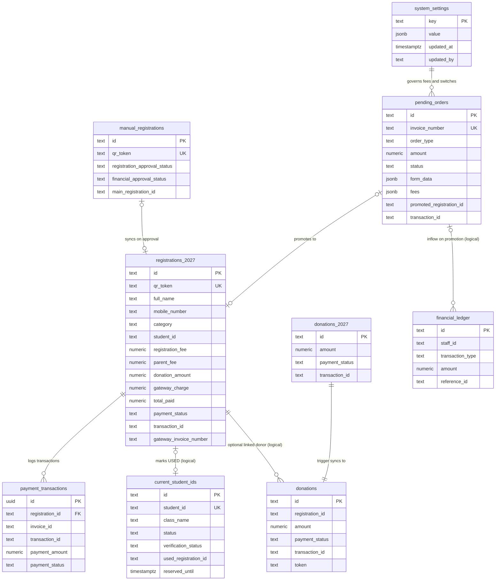

# 07 — Database Schema & Relationships

**Audit Classification:** Verified implementation (read directly from live PostgreSQL catalog on `hnthoszbkhvygoowtvau` and cross-checked with `supabase/migrations/`).  
**Scope Snapshot (Verified Live Counts at Audit Time):**
- Public schema objects: **`39` tables**, **`98` RLS policies**, **`62` RPC functions**, **`13` triggers**, **`0` custom PostgreSQL enums** (constraints use `CHECK` clauses).
- Live row counts: `registrations_2027` = **`5`**, `pending_orders` = **`33`**, `donations` = **`3`**, `payment_transactions` = **`79`**, `current_student_ids` = **`17`**.

---

## 1. Core Table Specifications

### 1.1 `public.system_settings` (`5` columns)
| Field | Details |
|---|---|
| **Purpose** | Stores authoritative JSONB portal settings (`portal_fee_settings`, `international_payment_info`). |
| **Primary Key** | `key` (`text`) |
| **Important Columns** | `key (text NN)`, `value (jsonb NN)`, `description (text)`, `updated_at (timestamptz NN default now())`, `updated_by (text NN default 'SYSTEM')` |
| **Foreign Keys** | None |
| **Read Operations** | `verify-payment` Edge Function (`portal_fee_settings`), `rpc_compute_expected_order_amount`, `InternationalPaymentService` (`international_payment_info`), anon `SELECT` via `system_settings_public_read_safe`. |
| **Write Operations** | `InternationalPaymentService.saveToSupabase()` (`international_payment_info`), SQL migrations (`portal_fee_settings`). **Frontend `AppStore.saveFeeSettings()` NEVER writes here.** |
| **RLS Policies** | `system_settings_public_read_safe` (`public SELECT` on `key IN ('portal_fee_settings', 'international_payment_info')`), `system_settings_admin_write` (`authenticated ALL` where `current_admin_role() = 'super_admin'`), `system_settings_service_write` (`service_role ALL`). |

**Verified Live `portal_fee_settings` Value (`updated_by: "P0-3-FOLLOWUP-MIGRATION"`):**
`parentFee: 500`, `formerStudentFee: 1500`, `currentStudentFee: 500`, `minDonation: 100`, `maxDonation: 50000`, `maxTotalPayable: 100000`, `maxGatewayCharge: 75`, `gatewayChargePercent: 1.8`, `paymentEnabled: true`, `registrationOpen: true`, `alumniRegistrationOpen: true`, `currentStudentRegistrationOpen: true`, `donationOpen: true`, `gatewayChargeRates` (`0.018` for `amex`, `card`, `upay`, `visa`, `bkash`, `nagad`, `other`, `rocket`, `mastercard`, `paystation`, `sslcommerz`, `cybersource`).

---

### 1.2 `public.registrations_2027` (`73` columns)
| Field | Details |
|---|---|
| **Purpose** | Consolidated single-source-of-truth table for online & approved manual reunion registrations. |
| **Primary Key** | `id` (`text`) |
| **Unique Constraints / Indexes** | `registrations_2027_qr_token_key` (`UNIQUE (qr_token)`), `uq_registrations_2027_qr_token` (`UNIQUE (qr_token)` — duplicate index!), `uq_reg_2027_trx_id_nonempty` (`UNIQUE upper(trim(transaction_id)) WHERE nonempty`), `uq_reg_2027_current_student_paid` (partial unique `student_id` for paid current students), `uq_reg_2027_former_student_paid` (partial unique name+batch+normalized mobile for paid former students). |
| **Check Constraints** | `category IN ('former','current')`, `t_shirt_size IN ('XS','S','M','L','XL','XXL','XXXL','Oversize 50')`, `payment_status IN ('paid','pending','failed','refunded','paid_duplicate','rejected')`, `payment_method` allows 16 normalized values (`bkash`..`other`), `registration_fee >= 0`, `donation_amount >= 0`, `total_paid >= 0`. |
| **Key Columns** | Identity: `id`, `full_name`, `full_name_bn`, `photo_url`, `photo_storage_path`, `mobile_number`, `email`, `address`, `gender`, `blood_group`, `qr_token`. Academic: `category`, `student_id`, `passing_year`, `last_class_attended`, `current_class`, `batch_name`, `group_or_section`, `roll_number`. Parent: `has_parent`, `parent_name`, `parent_age`, `parent_phone`, `parent_relation`, `parent_fee`, `parent_photo_url`, `parent_photo_storage_path`. Payment/Approval: `registration_fee`, `donation_amount`, `gateway_charge`, `total_paid`, `payment_status`, `transaction_id`, `payment_method`, `gateway_invoice_number`, `gateway_provider`, `gateway_response`, `server_verification_signature`, `verification_timestamp`, `verified_by`, `is_manual_registration`, `registration_type`, `registration_approval_status`, `financial_approval_status`. Event ops: `is_tshirt_collected`, `is_checked_in`, `gate_status`, `event_id`, `year`. |
| **Foreign Keys** | Referenced by `payment_transactions.registration_id` (`ON DELETE SET NULL`). Logical (unconstrained FK) links to `current_student_ids.used_registration_id`, `dress_distributions.registration_id`, `food_distributions.registration_id`, `gate_events.registration_id`, `donations.registration_id`. |
| **Read Operations** | `AdminDashboard`, Scanners, `secure-ticket-lookup`, `verify-student-id`, `rpc_lookup_ticket`, `rpc_verify_student_qr`, `rpc_get_financial_transparency_summary`, `rpc_admin_get_registrations`. |
| **Write Operations** | `rpc_promote_pending_order_to_registration`, `rpc_verify_payment`, `rpc_handle_paystation_ipn`, `rpc_approve_manual_registration`, `rpc_approve_manual_financial`, `rpc_delete_registration`, staff service RPCs (`gate`/`food`/`tshirt`), `trg_sync_dress_distribution_to_registration`. |
| **RLS Policies** | `registrations_2027_service_all` (`service_role ALL`), `registrations_2027_admin_staff_read` (`authenticated SELECT` if `current_admin_role() IS NOT NULL OR current_event_staff_role() IS NOT NULL`), `registrations_2027_admin_write` (`authenticated ALL` for `super_admin, admin, registration_officer`), `registration_staff_update_flags_2027` (`authenticated UPDATE` for gate/food/dress staff). `anon` table privileges revoked. |

---

### 1.3 `public.pending_orders` (`19` columns)
| Field | Details |
|---|---|
| **Purpose** | Pre-payment staging record persisted by `verify-payment` (`executeInitiatePayment`) before redirecting to PayStation. |
| **Primary Key / Unique** | `id (text)` PK; `invoice_number (text)` UNIQUE. |
| **Check Constraints** | `order_type IN ('registration','donation')`, `status IN ('pending','paid','expired','failed','cancelled')`. |
| **Important Columns** | `id`, `invoice_number`, `order_type`, `amount`, `currency`, `status`, `customer_name`, `customer_phone`, `customer_email`, `form_data (jsonb)`, `fees (jsonb)`, `gateway_provider`, `gateway_payment_url`, `promoted_registration_id`, `transaction_id`, `reconciled_at`, `expires_at (default now() + 2 hours)`. |
| **Read / Write** | Written exclusively by `verify-payment` (`service_role` upsert), promoted/updated by `rpc_promote_pending_order_to_registration` & `rpc_reconcile_pending_orders`. Read by authenticated admins via `pending_orders_admin_read`. |
| **RLS Policies** | `pending_orders_service_all` (`service_role ALL`), `pending_orders_admin_read` (`authenticated SELECT` where `current_admin_role() IS NOT NULL`). |

---

### 1.4 `public.donations` (`22` columns) & `public.donations_2027`
| Field | Details |
|---|---|
| **Purpose** | Canonical patronage / welfare donation records (`donations`), synchronized from legacy mirror `donations_2027`. |
| **Primary Key / Unique** | `id (text)` PK; `uq_donations_trx_id_nonempty` (`UNIQUE upper(trim(transaction_id)) WHERE nonempty`). |
| **Check Constraints** | `amount > 0`, `payment_status IN ('paid','pending','failed','refunded')`. |
| **Important Columns** | `id`, `registration_id`, `donor_name`, `donor_name_bn`, `mobile_number`, `email`, `batch_name`, `passing_year`, `amount`, `purpose`, `payment_method`, `transaction_id`, `gateway_invoice_number`, `payment_status`, `donation_date`, `is_anonymous`, `date`, `year`, `token`, `qr_token`, `gateway_provider`. |
| **Triggers** | `donations_2027` has `trg_sync_donations_2027_to_canonical` (`AFTER INSERT OR UPDATE` → `sync_donations_2027_to_canonical()` replicating into `public.donations`). Note `donations_2027` `anon INSERT` policy `donations_insert_2027` still appears in policy catalog (`audit_db_summary.txt:256`) though `anon` grants are revoked in migrations. |
| **Read / Write** | Written via `rpc_record_donation` (`service_role`), triggered from `donations_2027`. Read by `AdminDashboard`, `rpc_lookup_donation`, `rpc_get_financial_transparency_summary`. |
| **RLS Policies** | `donations`: `Admin manage donations` (`super_admin`), `donations_admin_all` (`current_admin_role() IS NOT NULL`), `Service role manage donations` / `donations_service_all` (`service_role`). |

---

### 1.5 `public.current_student_ids` (`11` columns)
| Field | Details |
|---|---|
| **Purpose** | Official whitelist of eligible Current Student IDs with checkout reservation locking. |
| **Primary Key / Unique** | `id (text)` PK; `student_id (text)` UNIQUE. |
| **Check Constraints** | `status IN ('ACTIVE','INACTIVE')`, `verification_status IN ('AVAILABLE','RESERVED','USED','ALREADY_USED')`. |
| **Important Columns** | `id`, `student_id`, `student_name`, `class_name`, `academic_year`, `status`, `verification_status`, `used_registration_id`, `reserved_until`, `created_at`, `updated_at`. |
| **Read / Write** | Public non-PII verification/reservation via `rpc_verify_student_id`, `rpc_reserve_student_id`, `rpc_release_student_id_reservation`. Marked `'USED'` by `rpc_verify_payment` / `rpc_promote_pending_order_to_registration`. Admin CRUD via `StudentIdManagementTab`. |
| **RLS Policies** | `Service role full access on current_student_ids`, `Authenticated admins full access on current_student_ids` (`super_admin`), `current_student_ids_admin_read` (`super_admin, admin, registration_officer`). |

---

### 1.6 `public.manual_registrations` & `public.manual_registration_audit_logs`
| Field | Details |
|---|---|
| **Purpose** | Isolated staging table for offline/venue desk registrations prior to Super Admin dual approval (`registration_approval_status` + `financial_approval_status`). *Note: `manual_registrations_2027` does not exist.* |
| **Primary Key / Indexes** | `id (text)` PK, `qr_token` UNIQUE (`idx_manual_reg_*` indexes in `20270309`). |
| **Read / Write** | `ManualRegistrationService` / `ManualRegistrationTab` / `ManualApprovalTab` via `rpc_create_manual_registration`, `rpc_staff_update_manual_registration`, `rpc_approve_manual_registration`, `rpc_reject_manual_registration`, `rpc_approve_manual_financial`, `rpc_reject_manual_financial`. |
| **RLS Policies** | **CRITICAL GAP:** `manual_registrations_select_all` and `manual_registrations_write_all` have `qual=true / with_check=true` (`20270309`), and `manual_registration_audit_logs` retains `anon` grants + `USING (true)`. |

---

### 1.7 `public.payment_transactions`, `public.ipn_logs`, & `public.financial_ledger`
- **`payment_transactions` (`14` cols):** UUID PK, FK `registration_id -> registrations_2027(id) ON DELETE SET NULL`, `uq_payment_trx_id_nonempty`. Written by `rpc_verify_payment` (NOT by `rpc_promote_pending_order_to_registration`!). RLS `pay_trx_admin_all` (`super_admin`/`SUPER_ADMIN`).
- **`ipn_logs` (`12` cols):** UUID PK, RLS `ipn_logs_admin_read` (`super_admin`/`SUPER_ADMIN`). **Currently orphaned from writes:** `20270310`/`20270311` `rpc_handle_paystation_ipn` no longer inserts into `ipn_logs`.
- **`financial_ledger` (`11` cols):** Immutable append-only ledger (`trg_enforce_ledger_immutability` BEFORE UPDATE/DELETE raises `IMMUTABLE_FINANCIAL_LEDGER`). Stores `gross_amount`, `gateway_fee`, `net_amount`. Written by `rpc_promote_pending_order_to_registration` (`REGISTRATION_INFLOW`), staff finance flows, etc.

---

### 1.8 Admin, Staff & Audit Tables
- **`admin_accounts` (`18` cols):** `auth_user_id` FK → `auth.users(id) ON DELETE CASCADE`, unique `username`, partial unique index `uq_single_super_admin_account`, trigger `trg_protect_immutable_super_admin`.
- **`staff_accounts` (`21` cols):** `auth_user_id` FK → `auth.users(id) ON DELETE CASCADE`, `assigned_manager_id` FK → `admin_accounts(id) ON DELETE SET NULL`, trigger `trg_protect_immutable_super_admin_staff`.
- **`admin_audit_logs` (`12` cols) & `admin_audit_history` (`16` cols):** Store security & action audit logs (`admin-audit` Edge Function writes `admin_audit_logs`; `EventStore` writes `admin_audit_history`; `rpc_fetch_unified_audit_trail` merges both + `financial_audit_logs`). **CRITICAL GAP:** Wide-open `anon` RLS policies added by `20270131` remain active in live DB!
- **Legacy Table Status Note:** Live DB catalog confirms `registrations_2026` and `donations_2026` still exist as tables with `rls_enabled=true` (even though `20270106` intended consolidation into `registrations_2027`). All active online flows target `registrations_2027` and `donations`.

---

## 2. Complete Trigger Inventory (`13` Live Triggers Across `5` Tables)

| Table | Trigger Name | Timing / Event | Function | Purpose |
|---|---|---|---|---|
| `admin_accounts` | `trg_protect_immutable_super_admin` | `BEFORE INSERT/UPDATE/DELETE` | `fn_protect_immutable_super_admin()` | Prevents 2nd super admin, deletion, or protected identity mutation |
| `staff_accounts` | `trg_protect_immutable_super_admin_staff` | `BEFORE INSERT/UPDATE/DELETE` | `fn_protect_immutable_super_admin_staff()` | Protects immutable super admin staff mapping |
| `donations_2027` | `trg_sync_donations_2027_to_canonical` | `AFTER INSERT/UPDATE` | `sync_donations_2027_to_canonical()` | Mirrors legacy `donations_2027` rows into `public.donations` |
| `dress_distributions` | `trg_dress_sync_registration` | `AFTER INSERT/UPDATE/DELETE` | `trg_sync_dress_distribution_to_registration()` | Syncs T-shirt distribution status back to `registrations_2027.is_tshirt_collected` |
| `financial_ledger` | `trg_enforce_ledger_immutability` | `BEFORE UPDATE/DELETE` | `trg_prevent_ledger_mutation()` | Enforces append-only financial ledger immutability |

---

## 3. Database Entity-Relationship Diagram (Mermaid)

