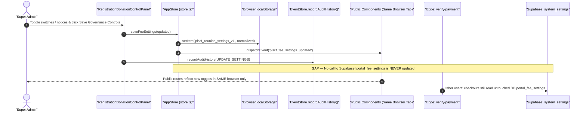
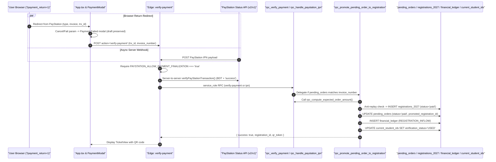
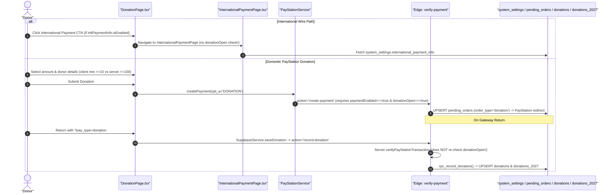
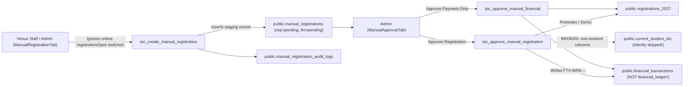
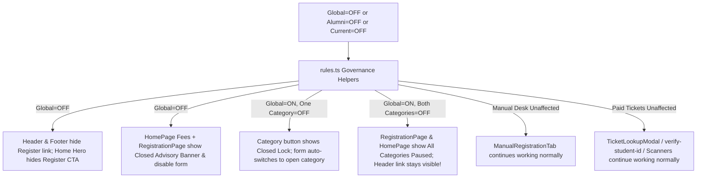
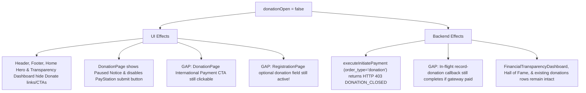

# 09 — End-to-End System Data Flow Diagrams

**Audit Classification:** Verified implementation (every step matches observed code paths across `src/`, `supabase/functions/`, and `supabase/migrations/`).

---

## Flow 1: Super Admin Governance Toggle & UI Update (Current Split-Brain Behavior)



---

## Flow 2: Public Visitor Registration Flow (Alumni & Current Student)

```mermaid
sequenceDiagram
  autonumber
  actor User as "Visitor (Alumni or Current Student)"
  participant RegUI as "RegistrationPage.tsx"
  participant Rules as "rules.ts (validate + fees)"
  participant SID as "StudentIdService / RPC"
  participant Pay as "PayStationService.createPayment"
  participant Edge as "Edge: verify-payment (create-payment)"
  participant DB as "Supabase (system_settings, pending_orders)"
  participant GW as "PayStation Hosted Gateway"

  User->>RegUI: Select category ('former' or 'current')
  alt category == 'current'
    User->>RegUI: Enter Student ID & click Verify
    RegUI->>SID: rpc_verify_student_id(studentId)
    SID-->>RegUI: Returns AVAILABLE + className (evaluates below Class 6 rule)
    RegUI->>SID: rpc_reserve_student_id(studentId, 15m)
  end
  RegUI->>Rules: calculateTotalFee() + calculateGatewayCharge(0.018)
  Note over RegUI,Rules: BUG — rules.ts uses parentFee=1500 if hasParent=true
  User->>RegUI: Submit form (photo uploaded to student-photos bucket)
  RegUI->>Pay: createPayment(order)
  Pay->>Edge: POST action='create-payment'
  Edge->>DB: SELECT value FROM system_settings WHERE key='portal_fee_settings'
  Edge->>Edge: Check paymentEnabled===true, registrationOpen===true, category open
  Edge->>Edge: computeAuthoritativeOrderAmount() checks DB parentFee=500
  alt Client vs DB Fee Mismatch or Switch Closed
    Edge-->>Pay: HTTP 400 FEE_DECOMPOSITION_MISMATCH or HTTP 403 REGISTRATION_CLOSED
    Pay-->>RegUI: Show error; draft preserved in localStorage
  else Valid & Open
    Edge->>DB: service_role UPSERT pending_orders (expires_at = +2h)
    Edge->>GW: POST /v2/create-payment (with server-allowlisted callbackUrl)
    GW-->>Edge: Returns payment_url
    Edge-->>Pay: { success: true, paymentUrl }
    Pay-->>User: Redirect browser to PayStation checkout
  end
```

---

## Flow 3: Payment Return & IPN Promotion Lifecycle



---

## Flow 4: Public Donation & International Payment Flow



---

## Flow 5: Manual Venue Registration & Dual-Stage Approval Lifecycle



---

## Flow 6: Registration Closure State Propagation Across Views



---

## Flow 7: Donation Closure & Ongoing Transaction Handling


