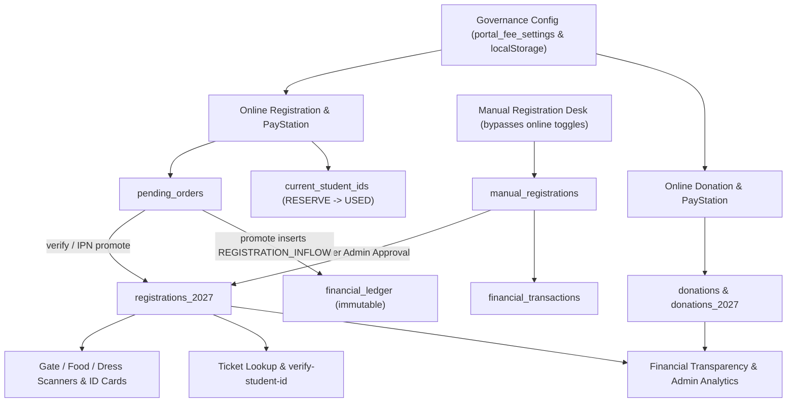

# 10 — Cross-Module Dependencies

**Audit Classification:** Verified implementation (traced directly via imports, RPC usage, and table dependencies across `src/`, `supabase/functions/`, and `supabase/migrations/`).

---

## 1. Cross-Module Coupling Matrix

| Dependent Module | Primary File / RPC | Coupling Mechanism | Governance Impact When Controls Change |
|---|---|---|---|
| **Navigation & Public Landing (`Header`, `Footer`, `HomePage`)** | `Header.tsx:72-77`, `Footer.tsx:113-146`, `HomePage.tsx:285, 296, 587, 984-1065` | Reads `FeeSettings` via props + `plscf_fee_settings_updated` DOM event | Immediately hides/shows Register & Donate links, Hero CTAs, and category cards per `localStorage` |
| **Ticket Lookup & Digital Card (`TicketLookupModal`, `TicketView`, `secure-ticket-lookup`)** | `TicketLookupModal.tsx:263`, `TicketView.tsx:155`, `secure-ticket-lookup/index.ts` | Reads `registrations_2027`; checks `isGlobalRegistrationOpen(AppStore.getFeeSettings())` **only** to show/hide optional "Register Another" CTA | Existing ticket lookup, QR rendering, and verification work regardless of whether `registrationOpen` is ON or OFF |
| **Student ID Management & Verification** | `StudentIdManagementTab.tsx`, `studentIdStore.ts:654, 734`, `verify-student-id/index.ts` | Manages `current_student_ids`; public checkout calls `rpc_verify_student_id` & `rpc_reserve_student_id`; `rpc_verify_payment`/`rpc_promote_pending_order_to_registration` mark `'USED'` | Disabling `currentStudentRegistrationOpen` or `registrationOpen` stops public ID reservations; existing `'USED'` IDs stay intact |
| **Manual Venue Registration & Approval Desk** | `ManualRegistrationTab.tsx:89, 193, 1539`, `ManualApprovalTab.tsx`, `manualRegistrationService.ts` | Stages in `manual_registrations`, syncs on approval to `registrations_2027` + `financial_transactions` via `rpc_approve_manual_registration` | **Intentionally decoupled** from `registrationOpen`/`alumniRegistrationOpen`/`currentStudentRegistrationOpen`. Uses snapshot `useMemo` of `AppStore.getFeeSettings()` on mount + hardcoded `+৳1,500` Parent fee UI label |
| **Financial Transparency & Treasury Dashboard** | `FinancialTransparencyDashboard.tsx:54, 271`, `rpc_get_financial_transparency_summary` (`20270305`) | Aggregates paid `registrations_2027`, `donations`, `expenses`, `staff_expenses`; button at `L271` checks `isDonationOpen(feeSettings)` | Toggling `donationOpen = false` hides the "Contribute / Donate" button (`L271`); historical financial totals remain queryable |
| **International Payment Module** | `InternationalPaymentPage.tsx`, `InternationalPaymentManagementTab.tsx`, `InternationalPaymentService` | Stored separately in `system_settings.key = 'international_payment_info'` | **Decoupled from `donationOpen`:** Direct URL access and CTA (`DonationPage.tsx:565`) remain controlled only by `intlPaymentInfo.isEnabled` |
| **Gate / Food / Dress Scanners & Event Ops** | `GateScannerModule`, `FoodScannerModule`, `DressScannerModule`, `MultiStationDesk`, `StaffFinanceModule`, `ScannerPortal` | Query `registrations_2027` & `manual_registrations` (via `rpc_verify_student_qr`, `rpc_confirm_*`) and update attendance/distribution flags | Unaffected by `GOV-01..04`; depends strictly on `registrations_2027.payment_status = 'paid'` & `registration_approval_status` populated during payment promotion or manual approval |
| **ID Card Generation & Batch Print** | `IdCardManagementPortal`, `idCardStore.ts:423, 535, 585` | Generates `/verify-student-id?id=...&token=...` QR passes from paid `registrations_2027` | Reads approved/paid registrations; unaffected by closing registration switches |
| **Double-Entry Financial Ledger & Payouts** | `financial_ledger`, `StaffFinanceModule.tsx`, `BudgetManagementTab.tsx` | `rpc_promote_pending_order_to_registration` writes `REGISTRATION_INFLOW` with `gross_amount`, `gateway_fee`, `net_amount`; manual approvals write `financial_transactions` | Direct `rpc_verify_payment` (`20270315`) & `rpc_record_donation` do **not** insert into `financial_ledger` (only `rpc_promote_pending_order_to_registration` does!) |
| **Audit Trail & Security Portal** | `AuditHistoryTab.tsx`, `UserAccessManagementTab.tsx`, `admin-audit/index.ts`, `rpc_fetch_unified_audit_trail` | `RegistrationDonationControlPanel` calls `EventStore.recordAuditHistory()`; `AdminDashboard.handleSaveFeeSettings` omits auditing; `loginAdmin` invokes `admin-audit` | Non-`super_admin` portal logins trigger HTTP `403` inside `admin-audit` (`L77`) and get signed out (`supabase.ts:1981`) |

---

## 2. Dependency Flow Across Core & Downstream Modules

